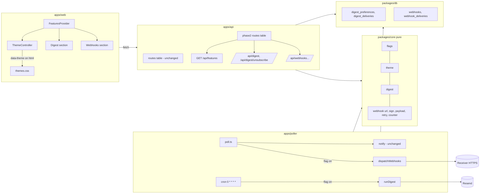

# Design Document

## Overview

This design covers AeroBrief Phase 2, round 1: dark mode, a high-contrast AAA theme, a daily digest email and signed outbound webhooks (with a test-event button). All work happens on the branch `phase-2`. Every feature sits behind its own flag, off by default. With all flags off, `phase-2` behaves as `main` (Requirement 3).

Design decisions at a glance:

| Decision | Choice | Why |
| --- | --- | --- |
| Flag source | Worker variables `FEATURE_*`, read by a new `parseFlags` function and served by `GET /api/features` | A flag flips without redeploying the Frontend (Req 1, 2). |
| Route isolation | Phase 2 routes live in a separate table, `routes` is untouched | `routes.test.ts` passes unchanged (Req 2.4). |
| Theme application | Script sets `data-theme` on `html`; no CSS `prefers-color-scheme` rule; light has no attribute | Flags-off DOM and CSS behavior equal `main` (Req 8.5). |
| Theme tokens | New files that mirror `palette.ts`; pairs derived from `palettePairs` | Existing token files stay byte-identical (Req 3.3, 9.9). |
| Digest schedule | One hourly cron `0 * * * *`; the handler returns at once when the flag is off | One trigger serves every Digest_Hour (Req 11.1). |
| Digest at-most-once | Insert-claim row per user and date, plus a Resend idempotency key | No double send, even on overlapping runs (Req 11.5, 11.6). |
| Webhook secrets | `HMAC(WEBHOOK_MASTER_SECRET, webhookId)`, never stored | No secret in the database to leak (Req 13.10). |
| Webhook URL storage | Plain text, masked in all output and logs | The sender needs the URL. Encryption is deferred (Appendix B). |
| SSRF defense | Pure validator in `packages/core`, re-run before each send, `redirect: "manual"`, body ignored | Req 14. |
| Dependencies | None added. Web Crypto only | Req 3.8. |

Research notes that shaped the design:

- Slack incoming webhooks render the top-level `text` field and ignore unknown JSON fields. The requirement keeps the extra fields beside `text`, and a manual check confirms this against a real Slack URL ([Slack incoming webhooks](https://api.slack.com/messaging/webhooks), [formatting reference](https://api.slack.com/reference/surfaces/formatting#escaping)). Slack asks senders to escape `&`, `<` and `>`.
- Cloudflare Workers `fetch` with `redirect: "manual"` returns the 3xx response instead of following it, and `AbortSignal.timeout` aborts a slow request ([Workers Fetch API](https://developers.cloudflare.com/workers/runtime-apis/fetch/)).
- Workers cannot inspect the DNS answer for a hostname, so a hostname that resolves to a private address cannot be detected by the sender. Cloudflare's network does not route Worker requests to RFC 1918 ranges. This residual risk is stated in Error Handling.
- Cron triggers accept standard 5-field expressions and deliver `controller.cron` and `controller.scheduledTime` to `scheduled()` ([Cron Triggers](https://developers.cloudflare.com/workers/configuration/cron-triggers/)). The existing `index.ts` already switches on `controller.cron`.
- Resend accepts an `Idempotency-Key` header ([Resend idempotency](https://resend.com/docs/dashboard/emails/idempotency-keys)).
- `crypto.subtle.verify` with HMAC compares in constant time, so the verify function needs no hand-written comparison.

Content was rephrased from the cited sources for compliance with licensing restrictions.

## Architecture



Layering follows `structure.md`. `packages/core` holds every pure rule and imports only from itself. Side effects stay in `apps/poller` (fetching, sending), `packages/db` (Drizzle) and `apps/api` (serving).

### Flags and `/api/features`

- `packages/core/src/flags.ts` exports `parseFlags(raw: Record<string, string | undefined>): { flags: Flags; warnings: string[] }`. It takes a plain record, reads no environment itself and is separate from `parseEnv` (Req 1.4). Each flag is parsed independently by a Zod schema: the strings `true` and `false` map to booleans, and an absent or any other value maps to `false`. A warning names the flag and never the value (Req 1.3).
- `apps/api/src/features.ts` and `apps/poller/src/features.ts` call `parseFlags(env)` once per request or per scheduled run and log the warnings.
- `apps/api/src/routes-phase2.ts` holds the Phase 2 route table. `router.ts` first matches `routes`. When nothing matches, it tries the Phase 2 table. A Phase 2 handler is only reachable when its flag is on. When its flag is off, the table entry returns the same `404` body and headers as the router's unknown-route response, so a disabled route is indistinguishable from an unknown one (Req 1.5, 1.6, 2.2). The `router.ts` change is a fall-through only. `router.test.ts` and `routes.test.ts` run unchanged and Phase 2 adds new test files.
- `GET /api/features` answers `200` with `{ darkMode, highContrast, digests, webhooks }` while at least one flag is on, and `404` while all are off. It reads no cookie, makes no database query and sends `Cache-Control: no-store` (Req 2.1 to 2.3).
- `apps/web/src/features/FeaturesProvider.tsx` wraps `<App />` in `main.tsx`. It renders its children at once with all flags off, requests `/api/features` once with a 3-second `AbortController` timeout, validates the body with a Zod schema and then updates the context. Any failure keeps all flags off (Req 2.5, 2.6). `useFeatures()` returns all-off when no provider exists, so every existing component test renders as before (Req 2.7). No flag is read from the URL, local storage or a build variable (Req 2.8).
- A brief flash of the light look can occur on first paint when a User stored a dark choice, because the flags arrive after the first render. This is accepted. A pre-paint script would need the flags, and Req 2.8 forbids caching them in local storage.

### Rollback and merge procedure

Merge order: dark mode, high contrast, webhooks, digest.

- Dark mode first: it builds the theme resolution function, the token pipeline and the settings section that high contrast reuses. High contrast second, because it extends those pieces and cannot be tested without them.
- Webhooks before digest: webhooks carry the larger security surface (SSRF, signing, secrets), so they get the longest soak time on `main` before the freeze. The digest is smaller and its only production-visible change is one more cron trigger.
- Migration numbers follow merge order: `0004_webhooks` then `0005_digest`.

Per-feature merge procedure, run by the project owner (Req 6):

1. Run the MVP_Test_Suite with all flags off. All tests pass with no test file edited.
2. Run the feature's tests with its flag on.
3. Check that the feature's commits touch no other feature's code, except the shared flag and test helpers.
4. Merge into `main` with the flag off. A Migration stays unapplied to the Production_DB until the owner approves (Req 4.9).
5. Turn the flag on in production only after the owner's approval.

Rollback, in order of preference: set the flag to `false` (no deploy of the Frontend needed); then `git revert` the feature's commits; if `phase-2` as a whole fails, delete the branch. The tag `mvp-contest-2026` never moves. After December 4, 2026, 2:00 PM PT, `main` takes no merge until judging has finished.

The task plan includes a task, marked "needs user approval", that adds `if: github.ref == 'refs/heads/main'` to `.github/workflows/deploy-workers.yml` (Req 6.8). The plan includes no push, tag move or deploy.

## Components and Interfaces

### Theme design

Four Theme_Variants exist: `light` (the MVP look, AA), `dark` (AA), `hc-light` (AAA) and `hc-dark` (AAA).

**Resolution.** `packages/core/src/theme.ts` exports:

```ts
type ThemeVariant = "light" | "dark" | "hc-light" | "hc-dark";
interface ThemeInput {
  darkFlag: boolean;
  contrastFlag: boolean;
  storedTheme: string | null;     // raw local storage value
  storedContrast: string | null;  // raw local storage value
  systemDark: boolean;            // prefers-color-scheme: dark
}
function resolveTheme(input: ThemeInput): ThemeVariant;
```

Rules: when `darkFlag` is off, the mode is `light` and `storedTheme` is ignored. When it is on, `storedTheme` of `light` or `dark` wins; any other value (including `null`) counts as `system`, which follows `systemDark`. When `contrastFlag` is off, contrast is `standard`. When it is on, only the exact value `high` selects high contrast; any other value counts as `standard`. The result is `hc-<mode>` for high contrast and `<mode>` otherwise. The function never throws and always returns one variant.

**Application.** `apps/web/src/theme/ThemeController.tsx` is rendered only when `darkMode` or `highContrast` is on. It reads local storage, calls `resolveTheme`, and sets `document.documentElement.dataset.theme` to `dark`, `hc-light` or `hc-dark`. For `light` it removes the attribute, so the MVP CSS applies untouched. It subscribes to `matchMedia("(prefers-color-scheme: dark)")` changes through JavaScript, so no CSS media query exists (Req 8.4, 8.5). While both flags are off it renders nothing, reads nothing and writes nothing (Req 8.6).

**Tokens.** New files, with `tokens.css` and `palette.ts` untouched:

- `apps/web/src/styles/themes.ts` exports `darkPalette`, `hcLightPalette` and `hcDarkPalette`, each typed `Record<PaletteToken, string>`, so a missing token is a compile error. It also exports `themePalettes: Record<ThemeVariant, Record<PaletteToken, string>>` where `light` is the existing `palette`.
- `apps/web/src/styles/themes.css` holds `html[data-theme="dark"] { ... }`, `html[data-theme="hc-light"] { ... }` and `html[data-theme="hc-dark"] { ... }` blocks that redefine every `--color-*` custom property, plus `color-scheme: dark` for the dark variants so native controls follow. Because every selector needs the attribute, the file has no effect in Flags_Off_Mode. `main.tsx` imports it after `tokens.css`.
- `apps/web/src/styles/themes.pairs.ts` exports `MIN_RATIO_AAA = { normal: 7, large: 4.5, ui: 4.5 }` and `themePairs(variant)`. It maps every entry of `palettePairs` to the variant's resolved colors, keeping `fg`, `bg` and `size`. High-contrast variants add focus pairs: `color-focus` against every token that appears as `bg` in `palettePairs`.
- The `hc-*` blocks also set a 3px focus outline (`outline: 3px solid var(--color-focus)`) and thicker borders where the MVP uses 1px borders. These are CSS only, with no DOM change.

**Contrast tests.** A new `themes-contrast.test.ts` iterates `themePairs(variant)` for each variant. `dark` uses `MIN_RATIO` (AA: 4.5, 3, 3); `hc-light` and `hc-dark` use `MIN_RATIO_AAA`. A new `themes-sync.test.ts` mirrors `palette-sync.test.ts`: each token in `themes.ts` appears in the matching `themes.css` block with the same hex. The existing `contrast.test.ts` and `palette-sync.test.ts` stay unchanged and keep checking the light look. A failing pair is fixed by changing the token, never by lowering the threshold (design.md steering, hard rule 2).

**Axe coverage.** The existing axe tests run unchanged. New tests under `apps/web/test/a11y/themes/` render the Status, Airport, Watchlist, Sign-in and unsubscribe pages inside a test `FeaturesProvider`, set `data-theme` to `dark`, `hc-light` and `hc-dark`, and run axe with zero tolerated violations (Req 8.13, 9.11). jsdom has no layout, so axe cannot compute rendered contrast there; contrast is guaranteed by the token tests above, and axe covers structure, names and roles. The task that writes these tests first confirms how the existing `axe.ts` helper treats the `color-contrast` rule.

**Design steering rules.** Hard rule 1 (no DOM change to the airport table, banners, nav bar or `aria-live` region): the theme work changes CSS and one attribute on `html` only. Hard rule 2 (AA pairs): enforced by the token tests above. Hard rule 3 (no new dependencies, no icon packages): none added. The "one primary Button per view" principle holds: the Display settings section has no Button, and the digest section adds "Save digest settings" as the one primary Button on the Watchlist page, and "Send test event", "Re-enable" and "Delete" are secondary Buttons.

**Control location.** A new `DisplaySettings` component renders a `section` titled "Display settings" in `App.tsx` between the page content and the `Footer`, so it appears on every page (Req 9.12) and sits outside the nav bar and footer (Req 8.1). It contains a `fieldset` with `legend` "Theme" and three native radios (System, Light, Dark) when `darkMode` is on, and a native checkbox "High contrast" when `highContrast` is on. It renders nothing when both flags are off. The `App.tsx` edit is one conditional element. The placement is approved (decision 3): a section on every page, not a separate page and not in the nav bar.

**Risk.** If `app.css` or `primitives.css` use hard-coded colors instead of tokens, the dark variants would look wrong. The first theme task audits both files and routes any literal color through an existing or new token without changing the light value.

### Digest design

**Cron.** `wrangler.jsonc` of the poller gains `"0 * * * *", // digest` and `index.ts` gains `export const DIGEST_CRON = "0 * * * *"` with a new `case`. The case calls `runDigest(env, now)`, which parses flags first and returns at once when `digests` is off, before any database, Resend or outbound call (Req 1.5). The existing cron cases and `dispatcher.test.ts` stay unchanged and a new test covers the new case. Adding a cron trigger changes the deployed Worker on the next production deploy even with the flag off (Appendix A, `dispatcher.test.ts` row). The merge task for the digest is therefore marked "needs user approval".

**Preferences.** `GET /api/digest` returns `{ enabled, hour }`, defaulting to `{ enabled: false, hour: 7 }` for a User without a row. The default hour 7 is only a UI preselection; it is not stored. `PUT /api/digest` validates `digestPreferenceSchema` (`enabled: boolean`, `hour: int 0..23`) and upserts the row with `updated_at = now()`. An invalid body returns `400` and writes nothing.

**Due-time selection.** `packages/core/src/digest/due.ts` exports a pure function:

```ts
interface DigestPrefRow { userId: string; enabled: boolean; hour: number; updatedAt: Date }
interface DueDigest { userId: string; digestDate: string; scheduledAt: Date }
function selectDueDigests(args: {
  now: Date;
  prefs: readonly DigestPrefRow[];
  claimedKeys: ReadonlySet<string>;      // `${userId}|${digestDate}`
  watchlistCounts: ReadonlyMap<string, number>;
}): DueDigest[];
```

For each preference with `enabled` true, the function looks at offsets k = 0, 1, 2, 3 hours back from `now` truncated to the hour. If the hour of `now - k` equals the preference hour, then `scheduledAt` is that instant and `digestDate` is the UTC date of `scheduledAt`. This makes a catch-up run after midnight use the earlier date, for a User whose hour is 23 and whose run was missed. The User is dropped when `updatedAt > scheduledAt`, when the Watchlist count is 0, or when `claimedKeys` holds the key. A preference has one hour, so at most one offset can match, and each User appears at most once. Offsets are 0 to 3, so the catch-up window is exactly 3 hours (Req 11.2 to 11.4, 11.14).

**Claim and send.** `apps/poller/src/digest.ts` loads enabled preferences, watchlist counts and claimed keys for the candidate dates, calls `selectDueDigests`, and for each due User:

1. Insert into `digest_deliveries (user_id, digest_date, status = 'claimed')` with `ON CONFLICT DO NOTHING RETURNING`. No returned row means another run owns it, so skip (Req 11.5).
2. Build the content and send through Resend with `Idempotency-Key: digest/<userId>/<digestDate>` (Req 11.6).
3. Retry up to 2 more times after a rejection or a 10-second timeout, waiting 1 second then 3 seconds.
4. Update the row to `handed_off` or `failed` with the attempt count and completion time.

A crash between steps 1 and 4 leaves a `claimed` row, and the User receives no second digest that date. The design chooses at-most-once over at-least-once (Req 11.11). Errors for one User are logged without the email address and the loop continues (Req 11.13). Safe_Send_Mode filters recipients through `filterAllowlisted` (Property 5) before step 2 and records `not_allowlisted` as the reason on a skipped row.

**Content.** `packages/core/src/digest/content.ts` exports `selectDigestContent` (events in the last 24 hours whose airport the User watches, plus `NATIONWIDE_EVENT` events, sorted by time) and `composeDigest` (subject, text, HTML). The subject is `AeroBrief daily digest: <N> disruption(s)` or `AeroBrief daily digest: no disruptions`, cut to at most 100 characters. The body has:

- a heading line with the Digest_Date;
- a stale notice when the latest Snapshot is missing or older than 10 minutes, giving its capture time and saying the data may be out of date (Req 11.9);
- the line "No disruptions at your airports in the last 24 hours" when there is nothing to list, followed in every case by the current status of each watched airport in plain language (Req 11.8);
- for each Event: airport name, Event type in words, the Explanation unaltered, and the time in UTC to the minute;
- a link to the Watchlist page and the unsubscribe link.

HTML output escapes all interpolated text. No raw FAA code appears (Req 11.12).

**Unsubscribe.** `packages/core/src/digest/unsubscribe.ts` exports `signDigestUnsubscribe(userId, secret)` and `verifyDigestUnsubscribe(userId, sig, secrets)`. The signed text is `digest.` + `userId`, HMAC-SHA256, base64url. The existing `signUnsubscribe` and `verifyUnsubscribe` stay unchanged. The API verifies against the secrets returned by the existing `acceptedUnsubscribeSecrets` (current, plus previous while unexpired). The link is `${FRONTEND_URL}/digest/unsubscribe?u=<userId>&s=<sig>`. A web page at that path posts to `POST /api/digest/unsubscribe`, which sets `enabled = false` (idempotent) and returns `200`, or returns `403` for a bad signature and changes nothing. The digest carries no `List-Unsubscribe` header (Req 12.9). The page renders only while `digests` is on.

### Webhook design

**Endpoints** (all behind `webhooks`; all require a session):

| Route | Purpose |
| --- | --- |
| `GET /api/webhooks` | List: `id`, `host`, `createdAt`, `state`, `lastOutcome`, `lastOutcomeAt`, `disabledAt`. |
| `POST /api/webhooks` | Validate URL, insert, return the list item plus `secret` once. |
| `DELETE /api/webhooks/:id` | Delete the webhook; its deliveries cascade. |
| `POST /api/webhooks/:id/reenable` | Set `active`, reset the counter, clear the reason. Idempotent. |
| `POST /api/webhooks/:id/test` | Send one test event. Rate-limited. |

Every route uses the session and request checks that the watchlist routes use. A missing or short `WEBHOOK_MASTER_SECRET` makes all five answer `503` with the variable name only (Req 13.12).

**Derived secret.** `deriveWebhookSecret(master, webhookId)` computes `HMAC-SHA256(key = utf8(master), message = utf8("aerobrief.webhook.v1." + webhookId))`, 32 bytes, and returns `whsec_` + base64url (43 characters). The domain prefix keeps this output separate from any other HMAC use of the same key. The signing key is the full string including `whsec_`, as UTF-8 bytes. Nothing is stored. Rotating `WEBHOOK_MASTER_SECRET` changes every derived secret, so every receiver fails verification until its User re-copies the new secret. Users can only re-copy by deleting and re-creating the webhook, since the API never shows a secret twice. For that reason `WEBHOOK_MASTER_SECRET` is not added to the rotation script now, and the rotation is listed in Appendix B as deferred. The operations note in `docs/` says so in plain words.

**URL validation.** `packages/core/src/webhooks/url.ts` exports `validateWebhookUrl(input: string): { ok: true; url: string; host: string } | { ok: false; reason: UrlRejectReason }`. Steps, in order:

1. Reject strings over 2048 characters (`too_long`).
2. Parse with `new URL`; on a throw return `unparseable`.
3. Reject when `protocol` is not `https:` (`scheme`), when `username` or `password` is non-empty (`credentials`), when `port` is non-empty (`port`; the URL parser drops the default 443, so any remaining port is a non-default one), and when `hash` is non-empty (`fragment`).
4. Take `hostname` (already lowercased and punycoded). Reject when it ends with `.` (`trailing_dot`), starts with `[` (`ipv6`), has an all-digit or `0x`-prefixed last label (`ip_literal`; this catches every IPv4 notation the parser did not already normalize to dotted decimal, and dotted decimal itself), equals `localhost` or ends with `.localhost` (`localhost`), has one label (`single_label`), or ends with `.local`, `.internal`, `.lan`, `.home.arpa`, `.test`, `.invalid` or `.example` (`reserved_suffix`).
5. Return `url.href` as the normalized value and `hostname` as the host.

Revalidating a returned `href` yields the same `href`, because the parser's output is a fixed point (Property 12). The API calls the validator on creation. The sender calls it again before every attempt (Req 14.5). `maskWebhookUrl(url)` returns only the host and never a path, query or userinfo.

**Signing.** `packages/core/src/webhooks/sign.ts` exports `signWebhook(secret, timestamp, body)` returning `v1=` + lowercase hex of `HMAC-SHA256(secret, `${timestamp}.${body}`)`, and `verifyWebhook({ secret, timestamp, body, signatureHeader, nowSeconds })`. Verify returns `true` only when the header is `v1=` plus 64 hex characters, `|nowSeconds - timestamp| <= 300`, and `crypto.subtle.verify("HMAC", ...)` succeeds on the decoded bytes. Request headers: `Content-Type: application/json`, `X-AeroBrief-Delivery` (the Delivery_ID), `X-AeroBrief-Timestamp` (Unix seconds) and `X-AeroBrief-Signature`. Each attempt takes a fresh timestamp and signature and keeps the Delivery_ID (Req 15.3, 15.4).

Receiver guidance, written to `docs/webhooks.md`: compute the HMAC over `<timestamp>.<raw body>` with the full `whsec_...` string as the key, compare in constant time, reject timestamps more than 300 seconds from your clock, and store seen Delivery_IDs for at least 10 minutes to drop replays inside the window. Include a TypeScript example using Web Crypto.

**Payload.** `packages/core/src/schemas/webhook-payload.ts` defines `webhookPayloadSchema` as a discriminated union on `type`. Event payloads: `id` (UUID), `type` (`ground_stop.started`, `ground_stop.ended`, `nationwide.event`), `createdAt` (ISO 8601 UTC), `data` (`eventKey`, `airportId` or null, `airportName` or null, `eventTime`, `explanation`) and `text`. The test payload has `type: "TEST"`, `data: { test: true, note }` and `text`. Types are inferred from the schema. Limits: `airportName` at most 80 characters, `explanation` at most 400 characters, `eventKey` at most 100.

`buildWebhookPayload` first removes control characters from all strings. The `text` is one line: for example `Ground stop started at Newark Liberty (EWR): <explanation> (14:32 UTC)`, or `Nationwide ground stop: <explanation> (14:32 UTC)`. The explanation inside `text` is cut to 200 characters with an ellipsis before escaping; `data.explanation` stays unaltered up to its schema limit. Then `&`, `<` and `>` become `&amp;`, `&lt;` and `&gt;` in `text` only. Worst-case size: `text` is at most (200 + 80) × 5 + 100 = 1500 characters, `data` at most about 1200 after JSON quoting, so the body stays under 4096 bytes (Req 15.1, 17.8). Control-character removal keeps JSON escapes at most 2 bytes per character. The schema check runs before every send, and a payload that fails the schema is recorded as `failed` with error kind `invalid_payload` and is not sent.

**Sender.** An I/O function `sendWebhookOnce({ fetch, url, secret, deliveryId, body, now })` does: validate URL, sign, `fetch(url, { method: "POST", redirect: "manual", signal: AbortSignal.timeout(5000), headers, body })`, then `response.body?.cancel()` without reading it, and returns `{ status }` or `{ errorKind }` with `errorKind` one of `timeout`, `network`, `blocked_url`, `invalid_payload`. It never returns the response body, the URL or the secret, and its log lines carry only the Delivery_ID, the webhook id and the host (Req 14.6 to 14.9, 16.8). Both the Notifier and the API test endpoint use it. It lives in the internal workspace package `packages/webhook-sender` (decision 1, see Resolved Decisions). The package has no external dependency, takes `fetch` as an injected argument and imports only from `@aerobrief/core`. `apps/api` and `apps/poller` import it; `apps/web` must not.

**Retry policy.** `packages/core/src/webhooks/retry.ts` exports `classifyAttempt(result)` returning `delivered` (2xx), `retryable` (network error, timeout, 408, 429, 5xx) or `permanent` (everything else, including 3xx and `blocked_url`), and `nextStep(attemptsMade, classification)` returning `{ done: true, outcome }` or `{ done: false, waitMs }` with `waitMs` 2000 after attempt 1 and 8000 after attempt 2. After attempt 3 the result is final. The Notifier loop calls these and sleeps with a timer.

**Failure counter.** `packages/core/src/webhooks/counter.ts` exports `applyOutcome(state, event)` over `{ failures: number; disabled: boolean }` with events `delivered`, `failed`, `skipped` and `reenabled`. `failed` adds 1 and sets `disabled` when the count reaches 5; `delivered` resets to 0; `skipped` changes nothing; `reenabled` sets `{ failures: 0, disabled: false }`. A `disabled` webhook stays disabled on later events other than `reenabled`. The database applies the same rule in one `UPDATE` statement per outcome (`SET consecutive_failures = CASE ... END, state = CASE ... END`) so concurrent deliveries cannot lose an increment. An integration test compares the SQL result to `applyOutcome` over random sequences. No email is sent when a webhook disables itself (Req 16.17); the Watchlist page shows the state and a "Re-enable" Button.

**Delivery flow.** `dispatchWebhooks(env, events, now)` in `apps/poller/src/webhooks.ts` runs after `notify()` returns, only when `webhooks` is on and the latest Snapshot is fresh (Req 16.13). It selects the same recipients as alert emails for each event, loads their `active` webhooks, applies Safe_Send_Mode, and for each pair claims a row in `webhook_deliveries` with `ON CONFLICT DO NOTHING RETURNING` on `(webhook_id, event_key, event_type)`. Claimed deliveries run through a pool of 20 concurrent deliveries, each following the retry policy. The whole function is wrapped so that any throw is caught and logged, leaving alert emails untouched (Req 16.14). A single delivery takes at most about 25 seconds (3 attempts of 5 seconds, plus 2 and 8 seconds of waiting), well inside a cron invocation. With at most 3 webhooks per User, the first attempts start within 120 seconds unless more than about 80 deliveries queue behind slow receivers; the Notifier logs the first-attempt delay so this can be checked.

**Test event.** The API handler for `POST /api/webhooks/:id/test`:

1. Look up the webhook by `id` and session user; no match returns `404`.
2. Claim the rate limit atomically: `UPDATE webhooks SET last_test_at = $now WHERE id = $id AND user_id = $user AND (last_test_at IS NULL OR last_test_at <= $now - interval '60 seconds') RETURNING id`. No returned row means the limit applies, so the handler reads `last_test_at` and returns `429` with `retryAfterSeconds` from `retryAfterSeconds(lastTestAt, now)`. The pure `testEventAllowed(lastTestAt, now)` mirrors the SQL condition.
3. Apply Safe_Send_Mode: a host not on the Allowlist returns the outcome `failed` with `errorKind: "not_allowlisted"` without a request.
4. Build the `TEST` payload and call `sendWebhookOnce` once, with no retry.
5. Return `{ outcome: "delivered" | "failed", status?, errorKind? }`. Store `last_test_outcome` and nothing else.

The test event writes no `webhook_deliveries` row and never touches `consecutive_failures`, so it cannot disable a webhook (Req 18.7). It also skips the stale-data gate, because a test checks the endpoint, not the FAA data. A disabled webhook accepts a test event so the User can check the endpoint before re-enabling (Req 18.8). The decision for no retry: the User is waiting for an answer, and a failure should show at once. The rate limit is claimed before the send, so a slow or failing endpoint cannot be hit more than once a minute.

### Safe_Send_Mode

`packages/core/src/safe-send.ts` exports `isSafeSendMode(raw)` (absent or `true` means on; only the exact string `false` turns it off) and `filterAllowlisted(items, allowlist, keyOf)`. Allowlists come from Worker variables `SAFE_SEND_ALLOWLIST_EMAILS` and `SAFE_SEND_ALLOWLIST_HOSTS` (comma-separated; absent or empty means empty). Safe_Send_Mode applies only while `digests` or `webhooks` is on and only to the digest and webhook paths. Alert emails never pass through it (Req 5.8). The address `delivered@resend.dev` is always allowed for email. The test-event path uses the host filter.

### Frontend components

- `FeaturesProvider`, `useFeatures` in `apps/web/src/features/`.
- `ThemeController`, `DisplaySettings` in `apps/web/src/theme/` (the settings component renders in `components/` per `structure.md`; the controller holds only effects).
- `DigestSettings` and `WebhookSettings` components on the Watchlist page, rendered only when their flag is on. Each calls the API through `apps/web/src/api/digest.ts` and `apps/web/src/api/webhooks.ts`, holds no business logic and shows each state (loading, empty, error, success) as visible text. Save and test results go to an `aria-live` region that is new and separate from the existing live regions, without moving focus.
- `DigestUnsubscribePage` at `/digest/unsubscribe`, rendered only when `digests` is on.
- The new secret is shown once in a read-only `input` with the text "This secret cannot be shown again" and a copy Button.

## Data Models

Two additive migrations. No MVP table changes (Req 4.3, 4.4). No column name contains `password`, `passwd` or `pass` (Req 3.9).

### `0004_webhooks` (merges before the digest)

```sql
CREATE TABLE webhooks (
  id                   uuid PRIMARY KEY DEFAULT gen_random_uuid(),
  user_id              uuid NOT NULL REFERENCES users(id) ON DELETE CASCADE,
  url                  text NOT NULL CHECK (length(url) <= 2048),
  host                 text NOT NULL,
  state                text NOT NULL DEFAULT 'active' CHECK (state IN ('active','disabled')),
  consecutive_failures smallint NOT NULL DEFAULT 0 CHECK (consecutive_failures >= 0),
  disabled_reason      text,
  disabled_at          timestamptz,
  last_outcome         text CHECK (last_outcome IN ('delivered','failed','skipped')),
  last_outcome_at      timestamptz,
  last_test_at         timestamptz,
  last_test_outcome    text CHECK (last_test_outcome IN ('delivered','failed')),
  created_at           timestamptz NOT NULL DEFAULT now()
);
CREATE INDEX webhooks_user_idx ON webhooks (user_id);

CREATE TABLE webhook_deliveries (
  id            uuid PRIMARY KEY,           -- the Delivery_ID
  webhook_id    uuid NOT NULL REFERENCES webhooks(id) ON DELETE CASCADE,
  event_key     text NOT NULL,
  event_type    text NOT NULL,
  outcome       text NOT NULL DEFAULT 'pending' CHECK (outcome IN ('pending','delivered','failed','skipped')),
  attempts      smallint NOT NULL DEFAULT 0,
  last_status   integer,
  last_error_kind text,
  created_at    timestamptz NOT NULL DEFAULT now(),
  completed_at  timestamptz,
  UNIQUE (webhook_id, event_key, event_type)
);
```

Cap of 3: a `BEFORE INSERT` trigger on `webhooks` takes `SELECT 1 FROM users WHERE id = NEW.user_id FOR UPDATE` and then counts that User's rows, raising an error with a fixed message at 3. This follows the approach of the existing `0001_enforce_subscription_cap` migration, which the task confirms and mirrors. The lock serializes concurrent inserts for one User (Req 13.2). The API maps the error to a validation error. `webhooks.url` is plain text by decision; the API never selects it for output and the logger never receives it.

Rows older than 24 hours in `webhook_deliveries` are not cleaned up in this round; they hold no URL or secret and are removed with the webhook or the account. This is a default listed under Remaining Defaults.

### `0005_digest`

```sql
CREATE TABLE digest_preferences (
  user_id    uuid PRIMARY KEY REFERENCES users(id) ON DELETE CASCADE,
  enabled    boolean NOT NULL DEFAULT false,
  hour       smallint NOT NULL CHECK (hour BETWEEN 0 AND 23),
  updated_at timestamptz NOT NULL DEFAULT now()
);

CREATE TABLE digest_deliveries (
  user_id      uuid NOT NULL REFERENCES users(id) ON DELETE CASCADE,
  digest_date  date NOT NULL,
  status       text NOT NULL DEFAULT 'claimed' CHECK (status IN ('claimed','handed_off','failed','skipped')),
  attempts     smallint NOT NULL DEFAULT 0,
  skip_reason  text,
  claimed_at   timestamptz NOT NULL DEFAULT now(),
  completed_at timestamptz,
  PRIMARY KEY (user_id, digest_date)
);
```

Both `user_id` foreign keys cascade, so account deletion removes preferences, deliveries, webhooks and their deliveries in the same statement that deletes the user (Req 10.6, 13.9). The existing `account-deletion` integration test is left unchanged and a new test covers the new tables.

### Down migrations and grants

- `packages/db/migrations/down/0004_webhooks.down.sql` drops the trigger, the trigger function, then `webhook_deliveries`, then `webhooks`. `0005_digest.down.sql` drops `digest_deliveries` then `digest_preferences`. The Drizzle migrator reads only `migrations/meta/_journal.json`, so the `down/` folder never runs by accident.
- A round-trip integration test applies the migration and its down file on a copy of the Phase2_Branch_DB and compares a schema snapshot from `information_schema` and `pg_catalog` before and after (Req 4.7).
- `packages/db/migrations/grants/0004_webhooks.grants.sql` and `0005_digest.grants.sql` hold `GRANT SELECT, INSERT, UPDATE, DELETE ON <tables> TO :runtime_role;` with the role name as a psql variable, because the MVP leaves grants to a manual step. The tasks document the manual step.
- `packages/db/src/phase2-target.ts` exports `assertPhase2Target(databaseUrl, expectedHost)`, a pure check that compares the URL host (with `-pooler` removed) to the configured Phase2_Branch_DB host and refuses when `expectedHost` is unset, when the hosts differ, or when the host equals the Production_DB host. The migration script `scripts/migrate-phase2.ts` calls it before any statement and prints which target it refused, without the password (Req 4.5, 4.6). The script reads the URL from the environment; this design never reads `.env`.

### Local storage keys

`aerobrief.theme` (`system` | `light` | `dark`) and `aerobrief.contrast` (`standard` | `high`). Nothing else is stored.

## Correctness Properties

*A property is a characteristic or behavior that should hold true across all valid executions of a system-essentially, a formal statement about what the system should do. Properties serve as the bridge between human-readable specifications and machine-verifiable correctness guarantees.*

Reflection: criteria on theme resolution (8.11, 8.12, 9.3 to 9.7) reduce to Properties 2 and 3. Digest due-time criteria 11.2 to 11.4 and 11.14 fold into Property 6. Criterion 16.19 (re-enable idempotence) and 16.10, 16.11 and 16.18 fold into the single counter Property 18. The signature properties stay separate, because round trip, tamper rejection and the replay window fail in different ways. The SQL-level behavior (cap trigger, claim inserts, atomic counter) is tested by integration tests and not by properties.

### Property 1: Flag parsing defaults and independence

For any record of environment strings, `parseFlags` returns one boolean per flag. A flag is `true` only when its own variable is exactly `"true"`. A flag whose variable is absent or any other string is `false`, and each such invalid value yields one warning that names the flag and does not contain the value. Changing one variable never changes the result for another flag.

**Validates: Requirements 1.2, 1.3, 1.8**

### Property 2: Theme resolution is total

For any combination of flags, stored strings (including `null` and arbitrary text) and system setting, `resolveTheme` returns exactly one of `light`, `dark`, `hc-light` and `hc-dark`. With high contrast on and `FEATURE_DARK_MODE` off, the result is `hc-light`. With high contrast on and dark mode on, the result is `hc-` plus the resolved mode.

**Validates: Requirements 8.11, 9.5, 9.6**

### Property 3: Features off or invalid input resolves to the MVP look

For any stored strings and system setting, when both `darkFlag` and `contrastFlag` are off, `resolveTheme` returns `light`. For any stored theme string that is not `system`, `light` or `dark`, the result equals the result for `system`. For any stored contrast string other than `high`, the result equals the result for `standard`.

**Validates: Requirements 8.3, 8.12, 9.3, 9.7**

### Property 4: Theme tokens meet their contrast thresholds

For any Theme_Variant in `dark`, `hc-light` and `hc-dark`, and for any pair in `themePairs(variant)`, the contrast ratio meets the threshold of its size class: 4.5, 3 and 3 for `dark`, and 7, 4.5 and 4.5 for the high-contrast variants. The set of `(fg, bg, size)` triples in every variant equals the set in `palettePairs`, plus the focus pairs in the high-contrast variants. Every focus pair in a high-contrast variant reaches 4.5.

**Validates: Requirements 8.8, 9.8, 9.9, 9.10**

### Property 5: Allowlist filter returns only allowlisted recipients

For any list of recipients and any Allowlist (including the empty one), `filterAllowlisted` returns a sublist of the recipients in which every item is on the Allowlist, and returns an empty list when the Allowlist is empty.

**Validates: Requirements 5.7, 5.9**

### Property 6: Due-digest selection

For any set of preferences, claimed keys, Watchlist counts and run instant, `selectDueDigests` returns each User at most once. Every returned User has `enabled` true, a nonzero Watchlist count, no claimed key for the returned `digestDate`, a `scheduledAt` that is 0 to 3 whole hours before the run hour with the User's hour, and `updatedAt` not after `scheduledAt`. Every enabled User that meets those conditions is returned.

**Validates: Requirements 11.2, 11.3, 11.4, 11.14**

### Property 7: Digest idempotency

For any sequence of digest runs (at any instants) over one Digest_Date against a claim store that rejects duplicate keys, the number of sends for each User and Digest_Date is at most 1.

**Validates: Requirements 11.5, 11.15**

### Property 8: Digest content selection

For any set of events, watched airports and run instant, `selectDigestContent` returns exactly the events that occurred in the 24 hours before the instant and whose airport is watched or whose type is `NATIONWIDE_EVENT`, in time order, each with its Explanation unaltered.

**Validates: Requirements 11.7**

### Property 9: Digest composition

For any digest input, `composeDigest` returns text and HTML that contain every airport name, every Explanation and every Event time (UTC, to the minute) of the input, a subject of at most 100 characters, and the unsubscribe link. When the input has no events, the text contains "No disruptions at your airports in the last 24 hours" and the status of each watched airport. When the Snapshot is missing or older than 10 minutes, the text contains the stale notice, and otherwise it does not.

**Validates: Requirements 11.7, 11.8, 11.9, 11.12, 11.16**

### Property 10: Digest unsubscribe signature round trip and separation

For any User identifier and secret, `verifyDigestUnsubscribe(userId, signDigestUnsubscribe(userId, secret), [secret])` is true. It is false after any change to the User identifier, the signature or the secret. For any User identifier and secret, the digest signature never verifies under the per-airport `verifyUnsubscribe`.

**Validates: Requirements 12.1, 12.2, 12.8**

### Property 11: Webhook URL safety

For any string, when `validateWebhookUrl` returns `ok`, the scheme is `https`, the port is empty (443), there is no userinfo or fragment, the length is at most 2048, and the host is not an Unsafe_Host. For any IPv4 address written in dotted, decimal, hexadecimal, octal or mixed notation, and for any IPv6 address, as the host of an `https` URL, the result is `ok: false` with a reason code.

**Validates: Requirements 14.1, 14.2, 14.3, 14.4, 14.10, 14.11, 14.12**

### Property 12: Webhook URL validation is idempotent

For any string for which `validateWebhookUrl` returns `ok`, validating the returned `url` returns `ok` with the same `url` and `host`.

**Validates: Requirements 14.13**

### Property 13: URL masking exposes only the host

For any valid webhook URL with any path, query and subdomain, `maskWebhookUrl` returns exactly the host, and the result contains no path, query or userinfo substring of the input.

**Validates: Requirements 13.6, 13.13**

### Property 14: Webhook secret derivation

For any master secret of at least 32 characters and any webhook identifiers, `deriveWebhookSecret` is deterministic, decodes to 32 bytes after the `whsec_` prefix, and returns different values for different identifiers or different master secrets.

**Validates: Requirements 13.10, 13.11**

### Property 15: Signature round trip

For any secret, timestamp and body, `verifyWebhook` accepts the header produced by `signWebhook` when the current time is within 300 seconds of the timestamp.

**Validates: Requirements 15.2, 15.5, 15.8**

### Property 16: Tamper and replay rejection

For any secret, timestamp and body, `verifyWebhook` rejects the delivery after any change to the body, the timestamp, the signature header or the secret. For any valid signature at timestamp T, it rejects when the current time is more than 300 seconds before or after T, and accepts at exactly 300 seconds.

**Validates: Requirements 15.5, 15.9, 15.10**

### Property 17: Retry bound

For any sequence of attempt results, the retry policy stops after at most 3 attempts and returns a final outcome. It retries only after a network error, a timeout, 408, 429 or a status of 500 or higher. It stops at once on a 2xx status (outcome `delivered`) and on any other status (outcome `failed`). The wait is 2000 ms after the first attempt and 8000 ms after the second.

**Validates: Requirements 16.4, 16.5, 16.6, 16.15**

### Property 18: Failure counter and auto-disable

For any sequence of outcomes `delivered`, `failed`, `skipped` and `reenabled`, the counter equals the number of consecutive `failed` outcomes since the last `delivered` or `reenabled` (ignoring `skipped`). The webhook is disabled exactly when that number reaches 5 and stays disabled until a `reenabled` event. Applying `reenabled` twice equals applying it once.

**Validates: Requirements 16.9, 16.10, 16.11, 16.16, 16.18, 16.19**

### Property 19: Payload validity and size

For any valid event, `buildWebhookPayload` returns a payload that passes `webhookPayloadSchema`, whose serialized size is at most 4096 bytes, whose `id` equals the given Delivery_ID, and whose `text` has no raw `&`, `<` or `>` outside the escapes `&amp;`, `&lt;` and `&gt;`, no control character and no FAA code, and contains the airport name (or the word "nationwide" when there is no airport). This holds for names and explanations that contain `&`, `<`, `>`, quotes, backslashes and non-ASCII text.

**Validates: Requirements 15.1, 17.1, 17.4, 17.5, 17.6, 17.8**

### Property 20: Payload JSON round trip

For any valid payload (including the `TEST` type), parsing `JSON.stringify(payload)` with `webhookPayloadSchema` returns a value equal to the payload.

**Validates: Requirements 17.9**

### Property 21: Test event rate limit

For any increasing sequence of request times for one webhook, applying `testEventAllowed` with the time of the last allowed request allows a request exactly when it is the first or at least 60 seconds after the last allowed request. `retryAfterSeconds` for a refused request is between 1 and 60.

**Validates: Requirements 18.6, 18.9**

## Error Handling

| Situation | Behavior |
| --- | --- |
| Invalid flag value | Read as off, one warning naming the flag only (Req 1.3). |
| `/api/features` fails or times out in the Frontend | All flags off, MVP app renders (Req 2.6). |
| Invalid local storage theme or contrast value | Default `system` or `standard`; nothing thrown. |
| `WEBHOOK_MASTER_SECRET` missing or under 32 characters with the flag on | Webhook endpoints answer `503` naming the variable; the Notifier sends nothing and logs one error (Req 13.12). |
| Webhook URL rejected | `400` with the reason code in plain words; no URL echoed back in logs. |
| 4th webhook | Trigger error mapped to `400`; existing webhooks unchanged. |
| Webhook attempt throws or times out | Counted as an attempt result; alert emails and their records are unaffected (Req 16.14). |
| Receiver redirects | The 3xx is a permanent failure, with no redirect followed. |
| Test event rate limit | `429` with `retryAfterSeconds`. |
| Digest send fails after retries | Row `failed`, no second send that date, error logged without the email address (Req 11.11, 11.13). |
| Digest unsubscribe signature bad | `403`, nothing changed. |
| Safe_Send_Mode and recipient or host not allowlisted | No call; reason `not_allowlisted` recorded (Req 5.6). |
| Migration target not the Phase2_Branch_DB | Script stops before any statement and names the refused target without credentials. |

Residual risks, stated plainly:

- DNS rebinding: a hostname that passes validation could resolve to an internal address. Workers cannot check the resolved address. The mitigations are the host rules, `redirect: "manual"`, the ignored response body and the Workers network, which does not route to private ranges. The sender returns only a status code, so a target cannot be read through it.
- Plain-text URLs: a database leak exposes webhook URLs, which for Slack are bearer credentials. Masking and no-logging reduce exposure; encryption at rest is deferred (Appendix B).
- An at-most-once digest means a crash after the claim loses that day's digest for one User. The User gets the next day's.

## Testing Strategy

Property-based testing applies to the pure functions in `packages/core` and to the theme token data. It does not apply to React rendering, HTTP wiring, cron dispatch, SQL triggers or Resend and receiver calls. Those use unit tests with fakes, snapshot or role-based component tests, axe tests and Neon branch integration tests.

**Library and configuration.** Vitest and fast-check, as the stack requires. Each of Properties 1 to 21 is one fast-check test with at least 100 runs. Each test file carries a comment `Feature: aerobrief-phase2, Property <n>: <text>`. Files mirror source paths: `packages/core/src/flags.ts` has `packages/core/test/flags.pbt.test.ts`, and so on. Theme token properties live in `apps/web/test/themes-contrast.pbt.test.ts` because the data is in `apps/web`.

**Flags-off suite.** The MVP_Test_Suite runs unchanged with all flags off at the end of each feature section and again before each merge. Guards added once: a test that `tokens.css` and the `palette` export are byte-identical to their hash at `mvp-contest-2026`; `parseEnv` snapshot equality; routes table equality; with all flags off, `GET /api/features`, `/api/digest`, `/api/webhooks` and `POST /api/digest/unsubscribe` return a body and headers equal to those of a truly unknown path.

**Flags-on suites.** Each feature has new test files only:

- Dark mode and high contrast: Properties 2 to 4; `ThemeController` tests (stored values, `matchMedia` change, flag off writes nothing); `DisplaySettings` role and keyboard tests; axe per variant; `themes-sync.test.ts`.
- Digest: Properties 5 to 10; poller tests with fake Resend and a fake claim store (retry, 10-second timeout, safe mode skip, error isolation between Users); API tests for GET, PUT, 400 and unsubscribe 200 and 403; Watchlist section component tests; axe on the section.
- Webhooks: Properties 11 to 21; sender tests with a fake `fetch` (manual redirect, 3xx failure, timeout, body cancelled, headers, fresh timestamp per attempt, same Delivery_ID); Notifier tests (stale gate, recipients equal to alert email recipients, alert emails unchanged when a webhook throws); API tests for create (secret once), list (masked), delete, re-enable, test event (type `TEST`, one attempt, counter unchanged, 404 for a foreign id, 429); component tests and axe.

**Neon branch integration tests.** Run only against the Phase2_Branch_DB, behind `assertPhase2Target`: migration then down round trip (schema snapshot equality); the webhook cap under 5 concurrent inserts; `ON CONFLICT` claim for digest and webhook deliveries; the SQL counter equal to `applyOutcome` over random sequences; the atomic test-event rate limit; account deletion cascade; grants applied for the runtime role.

**Manual checks, before the webhook merge.** Send a `TEST` event and a real-shaped payload to a Slack incoming-webhook URL owned by the project owner and confirm Slack renders `text` and accepts the extra JSON fields. Run `wrangler dev --test-scheduled` for the digest cron against the Phase2_Branch_DB with allowlisted addresses.

**Stack check.** TypeScript strict everywhere; Cloudflare Workers, Neon with Drizzle, React 18 with Vite, Resend, Vitest, fast-check and GitHub Actions only. HMAC uses Web Crypto. No dependency or devDependency is added. The one structural change, the package `packages/webhook-sender`, is approved (decision 1) and adds one line to `.kiro/steering/structure.md`. That steering edit is made on `phase-2` and merges with the webhooks feature.

## Resolved Decisions

The project owner approved this design with the decisions below.

1. **Webhook send code.** It lives in a new internal package `packages/webhook-sender`, with no external dependency. Side effects (the injected `fetch`) are allowed there. `packages/core` stays pure. `apps/api` and `apps/poller` import the package; `apps/web` must not. A task adds one line to `.kiro/steering/structure.md` that describes the package. The edit is made on `phase-2` and merges with the webhooks feature.
2. **Digest cron.** The hourly cron `0 * * * *` is approved. It makes no database, Resend or outbound call while `FEATURE_DIGESTS` is off. The digest merges last, and its merge task is marked "needs user approval" because the new trigger registers on the next production deploy.
3. **Display settings placement.** The theme controls sit in a "Display settings" section above the footer on every page, not in the nav bar.

Merge order stays dark mode, high contrast, webhooks, digest. Migrations stay `0004_webhooks` then `0005_digest`, each with a down migration. Safe_Send_Mode stays on by default, webhook secrets stay derived, and the test event rules and the 21 correctness properties stay as written.

## Remaining Defaults

These items need no decision to start work. The tasks use the defaults and the owner can change them at any time.

1. **Webhook delivery rows.** Kept until the webhook or the account is deleted. The 24-hour cleanup job is not changed.
2. **Digest default hour.** The UI preselects 07:00 UTC.
3. **Digest retry waits.** 1 second, then 3 seconds.
4. **Cron trigger count.** The poller Worker gets three cron triggers. The task that merges the digest asks the owner to confirm the Cloudflare plan limit before the next production deploy.
