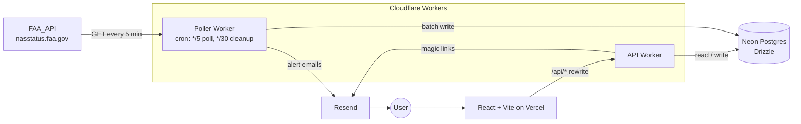
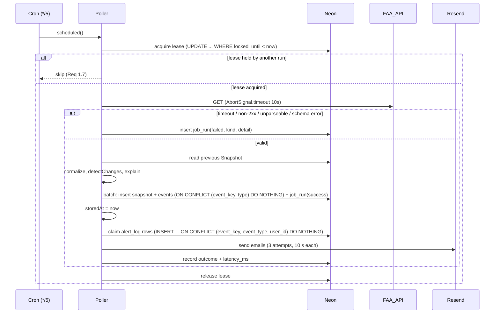

# Design Document

## Overview

AeroBrief polls the FAA airport-events endpoint every 5 minutes, validates the response, stores a Snapshot of 20 hardcoded airports, diffs it against the previous Snapshot, writes Events with plain-language Explanations, and emails users who watch the affected airports. A separate API Worker serves only stored data, so the web app keeps working when the FAA is down.

This document resolves two open items from the requirements:

- **Assumption 3 (FAA payload shape):** confirmed against the live endpoint and the FAA's published OpenAPI schema. See "FAA Payload Findings".
- **Assumption 6 (the 20 airports):** chosen and mapped to ARTCCs. See "Monitored Airports".

### Design Checklist

| Item | Specified as | Where |
|---|---|---|
| Poller | Workers cron (`*/5` poll, `*/30` cleanup) + Zod validation + Snapshot insert | Poll Cycle, Zod Schemas, apps/poller |
| Change_Detector | Pure function `detectChanges` returning typed events | packages/core, Change_Detector rules |
| Alert engine (Notifier) | Resend REST call with `Idempotency-Key = sha256(event_key:event_type:user_id)`, where `event_key` leads with the FAA_Event_ID | FAA_Event_ID and Alert Deduplication, Notifier |
| Stale flag | Set when the latest stored Snapshot (the last successful poll) is older than 600 s (10 minutes) | Key Design Decisions, apps/api (Stale criterion) |
| Public API | Route table of handlers behind a thin router interface | apps/api, Router interface |
| Tables | Five core tables and five supporting tables | Data Models |

### Stack Deviations Needing Approval

The steering stack is fixed. The items below are outside the listed technologies. None is used until approved.

| Item | Why needed | In-stack option considered | If declined |
|---|---|---|---|
| **Zod** (runtime) | Requirement 2.1 and Assumption 3 name Zod as the schema source of truth. It is not in the steering list. | Hand-written TypeScript type guards. They work but duplicate the type and the validator, and give weaker error descriptions for Requirement 2.3. | Replace with hand-written validators behind the same `parseFaaResponse` interface. |
| **Hono** (API Worker router) | User request. Typed routing, plus middleware for auth, CORS and validation. | A hand-written router on the Workers `fetch` handler, which is what this design specifies. | Keep the hand-written router. Until Hono is approved, the hand-written router is the implementation. See "Router interface" in apps/api. |
| **vitest-axe**, **jsdom**, **@testing-library/react** (dev-only) | Requirement 13.6 needs automated WCAG checks in CI, and component tests need a DOM. | Vitest alone has no DOM or accessibility engine. I chose tools that run inside Vitest rather than adding Playwright. | Requirement 13.6 cannot be met. Use manual audits and remove the CI gate. |

Not deviations, because they are part of the named platforms: Wrangler (Cloudflare Workers CLI), `@cloudflare/workers-types` (types only), `@neondatabase/serverless` (the driver Drizzle uses for Neon), Drizzle Kit (migrations), and `vercel.json` rewrites. Resend is called through its REST API with `fetch`, so no SDK is added.

## Architecture

Two Workers share one Neon database. The Frontend never talks to the FAA. Vercel rewrites `/api/*` to the API Worker so the browser sees one origin and the Session cookie can be `HttpOnly; Secure; SameSite=Lax` without cross-site cookie problems.



### Repository Layout

npm workspaces monorepo, all TypeScript with `"strict": true` in every tsconfig:

```
packages/core     pure logic, no I/O: airports, schemas, change detector,
                  explanation mapper, watchlist ops, time rules
packages/db       Drizzle schema, migrations, repositories
apps/poller       Worker: scheduled handler (poll, cleanup) and notifier
apps/api          Worker: fetch handler, small hand-written router behind a route-table interface
apps/web          React 18 + Vite
.github/workflows ci.yml
```

`packages/core` takes the current time as an argument everywhere. Nothing in it reads a clock, network, or database, which is what makes the properties testable and satisfies Requirement 3.1.

### Poll Cycle



### Key Design Decisions

| Decision | Rationale |
|---|---|
| Poller and API are separate Workers. | Requirement 14.2 names both as Workers. Separate deploys keep API availability independent of poller faults. |
| Notifier runs inside the Poller invocation, not on a queue. | A queue is a new technology. Direct sending meets the 120 s Alert_Latency target (worst case about 35 s per email). Cron-triggered Workers get a long wall-clock limit. |
| Alert latency starts at `storedAt`, taken right after the snapshot batch commits. | Matches Assumption 1. |
| Snapshot stores all 20 airports in one `jsonb` column in one row. | A Snapshot is therefore atomic by construction (Requirement 2.7). Events are written in the same `db.batch`, which neon-http executes as one transaction. |
| Explanations are generated once by the Poller and stored on the Event row. | Frontend and Notifier read the same text, so Requirement 5.8 holds by construction. |
| Airport names and ARTCCs come from the static list, not from the payload. | The FAA omits airports with no events, so a GROUND_STOP_ENDED Event would otherwise have no name. |
| Ground_Stop is active exactly when the payload's `groundStop` object is non-null. | See FAA Payload Findings for the risk. |
| Event identity is the FAA_Event_ID, not the Snapshot. `events.event_key` is derived from it. | A retried or re-run poll produces a new Snapshot id and capture time, so a Snapshot-based key would not catch duplicates. See "FAA_Event_ID and Alert Deduplication". Requirement 9.10, Assumption 7. |
| One stale criterion: the latest stored Snapshot is older than 600 s. | The API sets `stale`, the Frontend shows the Stale_Data_Banner from that flag only, and the Notifier gate uses the same `isStale`. No second clock or failure counter exists. Requirement 6.2. |
| The API's `nationwide.active` flag is the only input to the system-wide banner. | The Frontend never recounts ARTCCs, so the banner and the API cannot disagree. Requirement 4.8. |
| Magic links are redeemed with `POST` from a Frontend page, not by a `GET` link. | Email security scanners prefetch links and would burn a single-use token. The same applies to the unsubscribe link. |
| Watchlist cap is enforced in both the API and a Postgres trigger. | A concurrent pair of requests could otherwise pass the count check and reach 11 airports. |

## FAA Payload Findings (Assumption 3 resolved)

I fetched `https://nasstatus.faa.gov/api/airport-events` during design. The endpoint was reachable and returned HTTP 200 with a JSON body. I also read the FAA's published OpenAPI-derived JSON Schema for `AirportEvent` ([schema](https://artifacts.apis.io/faa/json-schema/faa-airport-event-schema.json), listed at [apis.io](https://apis.io/apis/faa/faa-airport-events-controller-api/)).

**What the live response showed**

1. The body is a top-level JSON array of airport objects, not an envelope object.
2. It contained only airports that currently have at least one event (10 airports in my sample: AUS, FMY, LAS, LAX, MCO, RSW, SAN, SFO, SNA, SUA, TEB). Airports with no events are absent. This agrees with Requirement 2.5 and means omission is normal, not an error.
3. Each object has `airportId` (3-letter FAA code), `airportLongName`, `latitude` and `longitude` (strings), and these event slots, each `null` when absent: `groundStop`, `groundDelay`, `airportClosure`, `freeForm`, `arrivalDelay`, `departureDelay`, `airportConfig`, `deicing`.
4. The response included non-monitored airports (FMY, SUA, TEB, RSW, SAN, SNA, AUS). They must be filtered out (Requirement 2.4).
5. `groundDelay.center` is a three-letter ARTCC identifier (AUS→ZHU, SAN→ZLA, SFO→ZOA). The ARTCC is therefore available in the payload, but only inside an event object.
6. Ground delay programs (`groundDelay`) are a separate slot from ground stops (`groundStop`). A delay program is not a Ground_Stop for this product.

**What I could not confirm from the live response**

In my sample every `groundStop` was `null`. A populated `groundStop` object was not observed live. Its field list comes from the FAA schema: `id`, `airportId`, `createdAt`, `sourceTimeStamp`, `updatedAt`, `impactingCondition`, `programExpirationTime`, `startTime`, `endTime`, `center`, `advisoryUrl`, `includedFacilities`, `includedFlights`, `probabilityOfExtension`. This is a residual risk, handled by:

- The Zod schema requires none of the `groundStop` inner fields, so a missing field cannot break ingestion. Only the non-null/null distinction drives detection.
- A contract test fixture for a populated `groundStop` is built from the FAA schema. First production use should capture a real example into `fixtures/`.
- The Poller logs a warning, never a failure, when `groundStop.center` disagrees with the static ARTCC mapping.

**Where the payload differs from the requirements' assumption**

The requirements assumed each airport event identifies its ARTCC. It does not at airport level. The ARTCC exists only inside event objects and is absent for airports with no event, yet an ARTCC mapping is needed for every Monitored_Airport. Design response: the ARTCC comes from the static airport table, and the payload's `center` is used only for the mismatch warning.

### Zod Schemas

The FAA schema validates only what AeroBrief consumes. Unknown keys are stripped (Zod's default), so the FAA adding fields never causes a failure. Event slots AeroBrief does not use are not validated.

```ts
import { z } from "zod";

export const FaaGroundStopSchema = z.object({
  id: z.union([z.string(), z.number()]).nullish(),   // FAA ground stop id (Assumption 7)
  startTime: z.string().nullish(),                   // used only for the FAA_Event_ID fallback
  impactingCondition: z.string().nullish(),
  center: z.string().nullish(),
  endTime: z.string().nullish(),
  programExpirationTime: z.string().nullish(),
});

export const FaaAirportEventSchema = z.object({
  airportId: z.string().min(1),
  airportLongName: z.string().nullish(),
  groundStop: FaaGroundStopSchema.nullish(),
});

// Top level is an array. An empty array is valid ("no events anywhere").
export const FaaResponseSchema = z.array(FaaAirportEventSchema);
```

An empty body or invalid JSON is reported as `unparseable` (Requirement 1.6). A parsed body that fails the schema is reported as `validation` (Requirement 2.3). A valid `[]` is accepted and stores a Snapshot with all 20 airports in the normal state. The risk that a faulty FAA `[]` falsely ends every ground stop is accepted for the MVP.

The internal Snapshot schema is the stored form. Times are ISO 8601 UTC strings with milliseconds so JSON round-trips exactly (Requirement 2.8).

```ts
export const MONITORED_IDS = ["ATL","BOS", /* ... 20 ids ... */] as const;

export const GroundStopInfoSchema = z.object({
  faaEventId: z.string().min(1),                     // FAA_Event_ID, see below
  idSource: z.enum(["faa_id", "start_time", "first_seen"]),
  reason: z.string().nullable(),
  center: z.string().nullable(),
  endTime: z.string().nullable(),
});

export const AirportStatusSchema = z.object({
  airportId: z.enum(MONITORED_IDS),
  groundStop: GroundStopInfoSchema.nullable(), // null = no active disruption
});

export const SnapshotSchema = z.object({
  id: z.string().uuid(),
  capturedAt: z.string().datetime({ offset: false }),
  airports: z.array(AirportStatusSchema).length(20)
    .refine((a) => new Set(a.map((x) => x.airportId)).size === 20),
});
```

Normalization (`normalizeResponse(faa, capturedAt, id, previous)`) filters to monitored ids, merges duplicate entries for one airport by treating the airport as active if any entry has a non-null `groundStop` (when several are non-null, the one with the lexicographically lowest FAA_Event_ID wins, so the result is deterministic), fills omitted airports with `groundStop: null`, assigns each active airport its FAA_Event_ID, and sorts by `airportId`. `previous` is the Previous_Snapshot or `null`. It is used only for the third FAA_Event_ID fallback below.

### FAA_Event_ID and Alert Deduplication

Requirement 9.10 and Assumption 7 define the FAA_Event_ID. `deriveFaaEventId(airportId, groundStop, capturedAt, previousEntry)` in `packages/core` applies the first rule that matches:

| Order | Condition | FAA_Event_ID | `idSource` |
|---|---|---|---|
| 1 | `groundStop.id` is present (not null, not blank after trimming) | `faa:{id}` | `faa_id` |
| 2 | no `id`, and `groundStop.startTime` parses as a date | `start:{airportId}:{startTime as ISO UTC with milliseconds}` | `start_time` |
| 3 | neither is available | `seen:{airportId}:{capturedAt of the first-detecting Snapshot}` | `first_seen` |

Rule 3 must stay stable for as long as the ground stop lasts. If the Previous_Snapshot has the same airport active with `idSource = "first_seen"`, the previous `faaEventId` is carried forward unchanged. Otherwise the current Snapshot's `capturedAt` is used. An unparseable `startTime` counts as absent and is never a validation failure. The ID is stored on the Snapshot's airport entry, so the Change_Detector stays pure: a GROUND_STOP_STARTED Event takes it from the current Snapshot and a GROUND_STOP_ENDED Event takes it from the Previous_Snapshot. Both Events of one ground stop therefore carry the same FAA_Event_ID.

**Keys.**

- `events.event_key` for ground stop Events is the FAA_Event_ID, with a unique constraint on `(event_key, type)`. The STARTED and ENDED Events of one FAA_Event_ID share the key and differ by type, so each yields its own email.
- A NATIONWIDE_EVENT has no FAA ground stop identity. Its key is `NATIONWIDE:{previousSnapshotId or "none"}`, which is stable for one detected transition and does not depend on the new Snapshot's id.
- `alert_log` repeats `event_key` and `event_type` and has `unique(event_key, event_type, user_id)`. This is the dedup rule of Requirement 9.10, and it holds even after the Event row is purged. FAA_Event_ID is the leading component of both `event_key` and this constraint, so dedupe is by FAA event ID in the sense of Requirement 9.10.

**Why a retried poll cannot send a duplicate.**

1. The Poller inserts Events with `ON CONFLICT (event_key, type) DO NOTHING RETURNING`. Only Events actually inserted are passed to the Notifier, so a re-detected FAA event (a retried poll, or an airport that flaps off and on under the same FAA_Event_ID) produces no new Event.
2. The Notifier claims `alert_log` rows with `INSERT ... ON CONFLICT (event_key, event_type, user_id) DO NOTHING RETURNING`. A pair that already exists is never sent again, even if step 1 were bypassed.
3. The Resend `Idempotency-Key` is `sha256(event_key + ":" + event_type + ":" + user_id)`, which is the same on every retry of the send.

**Why the Idempotency-Key is not the bare FAA event ID.** Resend dedupes by key: a second request with a key it has already seen is not sent again. A key equal to the FAA_Event_ID would be the same for every user watching that airport, so only the first user's email would go out and the rest would be suppressed. It would also be the same for the STARTED and ENDED alerts of one FAA event, so the ENDED alert would be suppressed. The key therefore keeps the FAA_Event_ID as its leading component (through `event_key`) and adds event type and user id, so it is unique per (FAA event, alert type, recipient) and still stable across retries.

Limit: `alert_log` rows are purged after 48 hours, so a ground stop that is re-detected under the same FAA_Event_ID more than 48 hours later could alert again. This is outside the 24-hour MVP history window.

## Monitored Airports (Assumption 6 resolved)

Selection criteria: the 20 are major US hubs spread across 18 distinct ARTCCs, so the "3 or more Affected_ARTCCs" rule in Requirement 4 can meaningfully trigger. Two airports share ZNY (EWR, JFK) and two share ZLA (LAS, LAX); each center counts once.

| ID | Airport | ARTCC |
|---|---|---|
| ATL | Hartsfield-Jackson Atlanta International | ZTL |
| BOS | Boston Logan International | ZBW |
| DCA | Ronald Reagan Washington National | ZDC |
| DEN | Denver International | ZDV |
| DFW | Dallas/Fort Worth International | ZFW |
| DTW | Detroit Metropolitan Wayne County | ZOB |
| EWR | Newark Liberty International | ZNY |
| IAH | George Bush Intercontinental Houston | ZHU |
| JFK | John F. Kennedy International | ZNY |
| LAS | Harry Reid International | ZLA |
| LAX | Los Angeles International | ZLA |
| MCO | Orlando International | ZJX |
| MEM | Memphis International | ZME |
| MIA | Miami International | ZMA |
| MSP | Minneapolis-Saint Paul International | ZMP |
| ORD | Chicago O'Hare International | ZAU |
| PHX | Phoenix Sky Harbor International | ZAB |
| SEA | Seattle-Tacoma International | ZSE |
| SFO | San Francisco International | ZOA |
| SLC | Salt Lake City International | ZLC |

ARTCC display names (used by the Explanation_Mapper): ZTL Atlanta, ZBW Boston, ZDC Washington, ZDV Denver, ZFW Fort Worth, ZOB Cleveland, ZNY New York, ZHU Houston, ZLA Los Angeles, ZJX Jacksonville, ZME Memphis, ZMA Miami, ZMP Minneapolis, ZAU Chicago, ZAB Albuquerque, ZSE Seattle, ZOA Oakland, ZLC Salt Lake City.

Verification status: the live payload showed `center` values for three airports that are not on this list (AUS→ZHU, SAN→ZLA, SFO→ZOA). Only SFO→ZOA directly confirms a row in this table. The other 19 assignments come from FAA ARTCC boundaries as I know them, not from a fetched source. A unit test asserts that the table has exactly 20 unique ids, and the mismatch warning described above will surface any wrong entry in production. Review the table before release.

The list lives in `packages/core/src/airports.ts` as a `readonly` tuple and cannot change at runtime (Requirement 2.6, 14.12).

## Components and Interfaces

### packages/core (pure)

```ts
export type ArtccId = string; // e.g. "ZNY"

export type GroundStopEvent = {
  type: "GROUND_STOP_STARTED" | "GROUND_STOP_ENDED";
  airportId: MonitoredId;
  occurredAt: string;          // Snapshot capturedAt
  faaEventId: string;          // STARTED: from current Snapshot; ENDED: from previous Snapshot
  reason: string | null;       // STARTED: current; ENDED: from previous Snapshot
};
export type NationwideEvent = {
  type: "NATIONWIDE_EVENT";
  occurredAt: string;
  count: number;               // === affectedArtccs.length
  affectedArtccs: ArtccId[];   // unique, sorted
};
export type DetectedEvent = GroundStopEvent | NationwideEvent;

detectChanges(current: Snapshot, previous: Snapshot | null): DetectedEvent[]
affectedArtccs(s: Snapshot): ArtccId[]
nationwideStatus(s: Snapshot): { active: boolean; count: number; artccs: ArtccId[] }
explain(e: DetectedEvent): string          // user-facing Explanation, throws UnsupportedEventTypeError
deriveFaaEventId(airportId, gs, capturedAt, previousEntry): { faaEventId: string; idSource: IdSource }
isStale(capturedAt: string, now: Date): boolean   // now - capturedAt > 600_000 ms
withinRetention(ts: string, now: Date): boolean   // age <= 86_400_000 ms
applyWatchlistOp(list: readonly MonitoredId[], op: WatchlistOp): WatchlistResult
isRateLimited(requestTimes: readonly Date[], now: Date): boolean
classifyMagicLink(link: LinkState, now: Date): "valid" | "expired" | "used" | "invalid"
eventKey(e: DetectedEvent, previousSnapshotId: string | null): string
                                           // ground stop: e.faaEventId; nationwide: "NATIONWIDE:" + (previousSnapshotId ?? "none")
dedupKey(e: DetectedEvent, previousSnapshotId: string | null, userId: string): string
                                           // eventKey + ":" + e.type + ":" + userId
```

**Change_Detector rules.** Per airport in the union of both Snapshots, with an absent airport treated as inactive (Requirement 3.9):

- inactive→active emits GROUND_STOP_STARTED, active→inactive emits GROUND_STOP_ENDED, otherwise nothing.
- A null `previous` is treated as all inactive (Requirement 3.5).
- Airport events are sorted ascending by `airportId`, followed by at most one NATIONWIDE_EVENT, emitted when `count(current) >= 3 && !(previous && count(previous) >= 3)` (Requirements 4.1 to 4.3).
- `count` is the number of distinct ARTCCs among airports with an active Ground_Stop, using the static table.

**Explanation_Mapper.** Each Event type has a user-facing, plain-language Explanation string (Requirement 5.1). The mapper holds a registry typed `Record<DetectedEvent["type"], (e) => string>`, so a missing type is a compile error and each type is produced from exactly one template. `explain(e)` looks up `EXPLANATION_TEMPLATES[e.type]` and throws `UnsupportedEventTypeError` when the key is absent. The Poller calls it once and stores the string in `events.explanation`. The API, the Frontend, and the Notifier show that string unchanged (Requirement 5.8). The templates use the airport full name followed by its code, and ARTCC names followed by their codes (Requirement 5.4):

- STARTED: "A ground stop is in effect at {Name} ({ID}). Flights bound for this airport are being held at their departure airports. {Cause}"
- ENDED: "The ground stop at {Name} ({ID}) has ended. Flights can depart for this airport again, although delays may continue for a while. {Cause}"
- NATIONWIDE: "Ground stops are active at airports served by {count} of the FAA's regional air traffic control centers, which points to widespread disruption. Affected centers include {up to 6 names with codes}{, and N more}."
- `{Cause}` is "The FAA says the cause is {translation}." when the reason matches the dictionary, otherwise "The FAA has not given a reason AeroBrief can explain." The untranslated text is never shown (Requirements 5.5 to 5.7).
- The reason dictionary matches on lower-cased, trimmed exact strings. Seed entries: `wind`, `weather`, `thunderstorms`, `low ceilings`, `low visibility`, `fog`, `snow`, `ice`, `airport volume`, `volume`, `runway construction`, `equipment outage`. Observed live reasons include `wind`, `airport volume`, and `runway construction`. Unknown strings fall through.
- The NATIONWIDE list is capped at 6 centers so the text stays under 500 characters even when all 18 are affected (Requirement 5.9).

### packages/db

Drizzle repositories on `@neondatabase/serverless` with the `neon-http` driver. Multi-statement writes use `db.batch([...])`, which runs as one transaction. Repositories take `now` as a parameter. Every read of Snapshots or Events adds `captured_at >= now - 24h` so the API excludes aged rows even before cleanup (Requirement 11.3).

### apps/poller

- `scheduled(controller, env)` dispatches on `controller.cron`: `*/5 * * * *` runs the poll, `*/30 * * * *` runs cleanup.
- **Lease** (Requirement 1.7): a one-row `poller_lease` table. `UPDATE ... SET locked_until = now()+interval '3 minutes', holder = <random token> WHERE id=1 AND locked_until < now() RETURNING` either gets the row, and `acquire` returns the token (`crypto.randomUUID()`), or the run exits and `acquire` returns `null`. The lease is released in `finally` with `release(token, now)`, which expires the lease only `WHERE id=1 AND holder = token`, so a run whose lease already expired and was taken by another run cannot release that run's lease.
- **Fetch:** `fetch(FAA_URL, { signal: AbortSignal.timeout(10_000) })`. Failure kinds recorded: `timeout`, `http_status` (with the status in `detail`), `network` (a non-timeout fetch rejection such as DNS failure or connection reset, with `<name>: <message>` in `detail`), `unparseable`, `validation` (Zod issue summary), `storage`.
- **Cleanup** deletes in one `db.batch`, so a failed run changes nothing (Requirement 11.6): Snapshots, Events and job runs older than 24 h, `alert_log` rows older than 48 h (so latency records live at least 24 h after creation), and expired Sessions and Magic_Links.
- **Notifier** (below).

### Notifier

1. Skip entirely if the stored latest Snapshot is older than 10 minutes at send time (Requirement 6.8). The check runs again before each retry.
2. For each GROUND_STOP event, select users whose Watchlist contains the airport. For a NATIONWIDE event, select users with at least one watchlist airport. Users with zero airports are never selected (Requirement 9.7).
3. Claim `alert_log` rows with one bulk `INSERT INTO alert_log ... ON CONFLICT (event_key, event_type, user_id) DO NOTHING RETURNING`. Only newly inserted rows are sent. This gives at most one email per user per FAA_Event_ID and Event type, including when the same FAA event is detected again by a retried poll (Requirements 9.4, 9.9, 9.10). A user with several matching watchlist entries still has one `(event_key, event_type, user)` triple. The Notifier only receives Events that the Poller's `ON CONFLICT (event_key, type) DO NOTHING RETURNING` insert actually created (see "FAA_Event_ID and Alert Deduplication").
4. Send through `POST https://api.resend.com/emails` with a 10 s timeout, up to 3 attempts with 1 s and 2 s backoff, and an `Idempotency-Key` header equal to `sha256(event_key:event_type:user_id)`, which is the same on every retry, so a timed-out first attempt cannot produce a duplicate (confirm the header against Resend's docs when implementing). Sends run with a concurrency of 10.
5. Update each row once to `handed_off` or `failed`, with `latency_ms = acceptedAt - storedAt`. If the latency write fails, the email result is kept and a structured `console.error` with `event: "latency_record_failed"` is emitted for operators (Requirement 12.7).
6. Alert email contents: airport name, event type, Explanation (verbatim, plus an HTML-escaped copy in the HTML part), event time as `YYYY-MM-DD HH:mm UTC`, and for ground stop events an unsubscribe link.

Capacity limit: each email costs about one subrequest, and the Workers Paid plan allows 1,000 per invocation. The design therefore assumes the paid plan and tops out near 900 recipients per poll. This is acceptable for the MVP and needs revisiting if the user base grows.

**Unsubscribe link (Requirement 9.8).** `FRONTEND_URL/unsubscribe?u={userId}&a={airportId}&sig={sig}` where `sig = base64url(HMAC-SHA256(UNSUBSCRIBE_SECRET, userId + "." + airportId))`. The Frontend page calls `POST /api/unsubscribe`, which verifies the signature in constant time, removes that airport from that user's Watchlist (a no-op if already removed), and returns the airport name for the confirmation.

### apps/api

A small hand-written router on the Workers `fetch` handler. No framework is assumed. Vercel's `/api/*` rewrite keeps the `/api` prefix in front of every path below. `:code` is the 3-letter id of a Monitored_Airport (the `airports.id` value). An unknown code returns `404`.

| Method and path | Auth | Purpose |
|---|---|---|
| `GET /api/health` | none | Synthetic availability check target (Requirement 12.1). |
| `GET /api/status/national` | none | Latest Snapshot summary for all 20 airports, `stale` flag, `capturedAt`, nationwide status, 24 h Events. |
| `GET /api/status/airport/:code` | none | One airport from the latest Snapshot, the `stale` flag, and its recent Events (24 h). |
| `GET /api/history/:code?since=ISO` | none | Events for one airport. 24 h only: `since` is clamped to the last 24 h (Requirement 11.7). |
| `POST /api/auth/magic-link` | none | Create and email a Magic_Link. |
| `POST /api/auth/redeem` | none | Redeem a token, set the Session cookie. |
| `POST /api/auth/logout` | session | Invalidate the Session. |
| `GET /api/watchlist` | session | Read the Watchlist. |
| `POST /api/watchlist` | session | Body `{ airportId }`. Idempotent add, cap 10. |
| `DELETE /api/watchlist/:code` | session | Remove, idempotent. |
| `DELETE /api/account` | session | Delete user, subscriptions, sessions. |
| `POST /api/unsubscribe` | signature | Stop alerts for one airport. |

`POST /api/watchlist` returns `200` with the Watchlist whether the airport was added or already present (adding a present airport to a full list also succeeds). A new airport on a full list returns `409`. An `airportId` outside the 20 returns `400`.

**Router interface.** Handlers are plain functions and the router is a route table, so the framework can be swapped without touching handlers:

```ts
type Handler = (req: Request, env: Env, ctx: RouteContext) => Promise<Response>;
type Route = { method: "GET" | "POST" | "DELETE"; pattern: string; auth: "none" | "session" | "signature"; handler: Handler };
export const routes: readonly Route[];            // the single source of the endpoint table above
export function createFetchHandler(routes: readonly Route[]): ExportedHandlerFetchHandler; // hand-written implementation
```

`RouteContext` carries path params (`code`), the resolved Session, and `now`. Auth, Origin and JSON checks are applied by the router from `Route.auth`, not inside handlers. The hand-written `createFetchHandler` is used until Hono is approved (see Stack Deviations). If Hono is approved, a second adapter registers the same `routes` on a Hono app and handlers do not change.

`/api/status/national` response shape:

```ts
type AirportSummary = { airportId: string; name: string; groundStop: { reasonText: string } | null };
type EventSummary = { type: string; airportId: string | null; occurredAt: string; explanation: string };

type NationalStatusResponse =
  | { state: "no_data"; message: string }            // no stale flag, no airports
  | {
      state: "ok";
      capturedAt: string;                            // UTC ISO
      stale: boolean;                                // isStale(capturedAt, now): > 600 s old, the only stale criterion
      airports: AirportSummary[];                    // all 20
      nationwide: { active: boolean; count: number; artccs: string[]; explanation: string | null };
                                                     // active drives the system-wide banner (Req 4.8, 10.2)
      events: EventSummary[];                        // last 24 h
    };

type AirportStatusResponse =
  | { state: "no_data"; message: string }
  | {
      state: "ok";
      capturedAt: string;
      stale: boolean;
      airport: AirportSummary;
      events: EventSummary[];                        // recent Events for this airport, 24 h
    };
```

`/api/history/:code` returns `{ airportId: string; events: EventSummary[] }`, newest first.

**Stale criterion (Requirement 6.2).** There is one rule: `stale = now - latestSnapshot.capturedAt > 600 s`. A failed poll does not set it, and a run of failed polls shorter than 10 minutes does not set it. While stale, the API still returns the latest stored Snapshot, `capturedAt` (UTC), and `stale: true`. The Frontend shows the Stale_Data_Banner with that `capturedAt` as the time of the last successful update, above all airport content, and removes it on the first refresh that returns `stale: false`. The Frontend does not compute staleness from its own clock. A failed browser-to-API refresh is a separate error indication (Requirement 10.7) and never shows the Stale_Data_Banner. With no Snapshot the response is `no_data`, with no `stale` field.

**System-wide banner flag (Requirements 4.4, 4.5, 4.8).** `nationwide.active` is computed with `nationwideStatus(latestSnapshot)`, the same function the Change_Detector uses. When `active` is true, `nationwide.explanation` is the Explanation from `explain()` for a NATIONWIDE_EVENT built from the latest Snapshot's current count and Affected_ARTCCs, so the banner has text even if the stored NATIONWIDE_EVENT row is more than 24 hours old or an earlier Snapshot raised it. When `active` is false, `explanation` is `null`.

The API never imports a FAA client. Requests mutating state require an `Origin` matching `FRONTEND_URL`, which together with `SameSite=Lax` covers CSRF. `Content-Type: application/json` is required for every POST and for any request with a non-empty body; an empty-bodied request such as DELETE needs only the matching `Origin` (proxies may forward an empty, non-null body stream). If the database throws, the API returns `503` with `Retry-After: 30`, using a 5 s query timeout (Requirement 12.6).

**Auth details**

- Tokens (Magic_Link and Session) are 32 random bytes from `crypto.getRandomValues`, base64url. Only SHA-256 hashes are stored (Requirement 7.6).
- Email is trimmed and lower-cased, validated as a syntactically valid address of at most 254 characters.
- Rate limit: count `magic_links` rows for that email created in the last 60 minutes; 5 or more rejects with 429. Rows invalidated by a Resend failure still count.
- Redeem is one atomic statement: `UPDATE magic_links SET used_at = now() WHERE token_hash = $1 AND used_at IS NULL AND invalidated_at IS NULL AND expires_at > now() RETURNING email`. No row means "invalid or expired" with no Session. On success the user row is upserted and a Session (30 days) is created.
- If Resend fails to accept a Magic_Link email, `invalidated_at` is set and the API returns an error (Requirement 7.10).
- Account deletion is one `DELETE FROM users WHERE id = $1`. Subscriptions (the Watchlist), Sessions, and `alert_log` rows cascade, so it is all-or-nothing (Requirement 8.10).
- No password field exists anywhere.

### apps/web

React 18 + Vite, plain `fetch`, no router or state library. Sign-in and unsubscribe screens are chosen from `location.pathname` (`/auth/callback`, `/unsubscribe`).

- `useStatus()` fetches `/api/status/national` on load and every 60 s, each with `AbortSignal.timeout(10_000)`. An airport detail view uses `/api/status/airport/:code` and `/api/history/:code`. Watchlist changes use `POST /api/watchlist` (body `{ airportId }`) and `DELETE /api/watchlist/:code`. On failure it keeps the last data and sets `refreshFailed` (Requirement 10.7).
- Two components render above the airport table, in this order: `<StaleDataBanner>` (shown when `stale` is true, with the `capturedAt` time) and `<SystemWideBanner>` (shown if and only if `nationwide.active` is true, containing `nationwide.explanation` unchanged). Text for the system-wide banner is the Explanation, preceded by the visible heading "System-wide disruption" so the status is not conveyed by color alone (Requirement 13.2).
- A permanent, always-mounted `<div aria-live="polite">` wrapper holds the Stale_Data_Banner and the system-wide banner. Because the live region already exists when content is inserted, assistive technology announces the banner text, and focus never moves (Requirement 13.4). Error messages go in a separate always-mounted `role="alert"` region (Requirement 13.7).
- Status is always text ("Ground stop" or "No ground stop reported"), with color as decoration only (Requirement 13.2). The label "No ground stop reported" is used in place of "no disruption" because an airport can be under a delay program that AeroBrief does not ingest (see Open Questions).
- The airport list is a semantic `<table>`. There is no map.
- Events older than 24 h are filtered client-side as well as server-side.
- Watchlist rows use real `<button>` elements with visible focus outlines. An attempt to add an 11th airport shows the API's error text and leaves the list and input unchanged.

### CI (GitHub Actions)

`.github/workflows/ci.yml` runs on `pull_request`: `tsc --noEmit` for every workspace, `vitest --run` (unit and fast-check), and the vitest-axe accessibility suite. Any failing job fails the pull request check (Requirements 14.7, 14.11, 13.6). A small script in the same workflow fails if any `.js/.jsx/.mjs/.cjs` source file exists outside `node_modules` and build output, and if any tsconfig lacks `"strict": true` (Requirement 14.1).

## Data Models

Drizzle tables on Postgres. All timestamps are `timestamptz(3)` (UTC, millisecond precision).

**Five core tables:** `airports`, `snapshots`, `events`, `subscriptions` (the Watchlist), `alert_log` (the alert delivery record). **Five supporting tables:** `users`, `sessions`, `magic_links`, `job_runs`, `poller_lease`.

| Table | Columns | Constraints and indexes |
|---|---|---|
| `airports` (core) | `id text pk` (3-letter code), `name text`, `artcc text` | Seeded by migration from the hardcoded list in `packages/core/src/airports.ts`, which stays the source of truth. Read-only at runtime: no API or Worker code writes it, and the runtime database role has `SELECT` only. A unit test asserts the seed rows equal the core list. |
| `snapshots` (core) | `id uuid pk`, `captured_at`, `airports jsonb` | index `captured_at desc` |
| `events` (core) | `id uuid pk`, `event_key text` (FAA_Event_ID, or `NATIONWIDE:{previousSnapshotId}`), `snapshot_id uuid`, `type text`, `airport_id text null`, `occurred_at`, `payload jsonb`, `explanation text` (user-facing, from the Explanation_Mapper) | `unique(event_key, type)`, index `occurred_at desc` |
| `job_runs` (supporting) | `id uuid pk`, `job text` (`poll` or `cleanup`), `started_at`, `finished_at`, `outcome text`, `failure_kind text null`, `detail text null`, `snapshot_id uuid null` | index `started_at` |
| `poller_lease` (supporting) | `id int pk (=1)`, `locked_until`, `holder text null` (token of the current holder) | single row |
| `users` (supporting) | `id uuid pk`, `email text`, `created_at` | `unique(lower email)` |
| `magic_links` (supporting) | `id uuid pk`, `email text`, `token_hash text`, `created_at`, `expires_at`, `used_at null`, `invalidated_at null` | `unique(token_hash)`, index `(email, created_at)` |
| `sessions` (supporting) | `id uuid pk`, `user_id uuid`, `token_hash text`, `created_at`, `expires_at` | `unique(token_hash)`, `user_id` FK on delete cascade |
| `subscriptions` (core, the Watchlist) | `user_id uuid`, `airport_id text`, `added_at` | `pk(user_id, airport_id)`, `user_id` FK on delete cascade, `airport_id` FK to `airports.id`, trigger `enforce_subscription_cap` |
| `alert_log` (core, alert delivery record) | `id uuid pk`, `event_id uuid`, `event_key text`, `event_type text`, `user_id uuid`, `status text` (`pending`, `handed_off`, `failed`), `attempts int`, `snapshot_stored_at`, `completed_at null`, `latency_ms int null`, `error text null`, `created_at` | `unique(event_key, event_type, user_id)`, `user_id` FK on delete cascade, no FK on `event_id` |

Design notes:

- `event_key` derives from the FAA_Event_ID (see "FAA_Event_ID and Alert Deduplication"), not from the Snapshot id. A re-run or retried poll that detects the same FAA event cannot create a second Event row or a second delivery.
- The trigger `enforce_subscription_cap` does `SELECT 1 FROM users WHERE id = NEW.user_id FOR UPDATE`, then raises if the user already has 10 entries. The row lock serializes concurrent adds. The API maps this error to the same "limit of 10" response as the pure check.
- `alert_log.event_id` has no foreign key, so purging Events at 24 h does not remove latency records early.
- A delivery row left `pending` by a crashed run is not re-sent. This is at-most-once delivery, a deliberate choice over risking duplicate emails.
- Secrets (`DATABASE_URL`, `RESEND_API_KEY`, `UNSUBSCRIBE_SECRET`) are Cloudflare Worker secrets set with `wrangler secret put`. A logger wrapper never serializes `env` or request headers (Requirement 14.10).

## Open Questions

1. **Airport status wording.** Requirement 2.5 says an omitted airport has "no active disruption", but a delay program or closure is also a disruption that this MVP does not ingest. The UI says "No ground stop reported" to avoid overclaiming. Confirm that wording, or widen the scope.
2. **Populated `groundStop` shape** was not observed live (see FAA Payload Findings).
3. **ARTCC table review** before release (see Monitored Airports).
4. **Zod and test-tool approval** (see Stack Deviations). Both deviations remain pending user approval.
5. **FAA ground stop `id` stability** (Assumption 7). The FAA_Event_ID rules in "FAA_Event_ID and Alert Deduplication" work whether or not `id` is present, but a live populated `groundStop` must confirm which rule applies in practice.
6. **Stale data past 24 hours.** Requirement 6.2 serves the most recent stored Snapshot, while Requirement 11.3 excludes Snapshots older than 24 hours. If the FAA stays unreachable for more than 24 hours, the API returns `no_data`. Confirm this is acceptable.

## Correctness Properties

*A property is a characteristic or behavior that should hold true across all valid executions of a system-essentially, a formal statement about what the system should do. Properties serve as the bridge between human-readable specifications and machine-verifiable correctness guarantees.*

These apply to the pure logic in `packages/core` and to the Notifier with in-memory fakes. Database transactions, cron wiring, timing targets, and UI rendering are covered by the example, integration, and smoke tests listed under Testing Strategy.

### Property 1: FAA body classification

*For any* string body, `parseFaaBody` never throws. If the string is not valid JSON (including the empty string) the result is kind `unparseable`. If it is valid JSON that does not match the FAA schema the result is kind `validation`. Otherwise the result is a parsed response.

**Validates: Requirements 1.6, 2.3**

### Property 2: Normalization yields exactly the 20 monitored airports

*For any* valid FAA response (random mix of monitored and non-monitored airport ids, duplicates, and null or populated `groundStop`), the normalized Snapshot has exactly 20 entries, one per monitored id, sorted by id. Non-monitored ids never appear. A monitored airport has a non-null `groundStop` if and only if at least one entry for it in the response had a non-null `groundStop`, and omitted monitored airports have `groundStop` null.

**Validates: Requirements 2.2, 2.4, 2.5**

### Property 3: Snapshot JSON round trip

*For any* valid FAA response and capture time, serializing the normalized Snapshot to JSON and parsing it with `SnapshotSchema` produces a Snapshot deeply equal to the original.

**Validates: Requirements 2.8**

### Property 4: Change detection is pure and deterministic

*For any* Snapshot and Previous_Snapshot, calling `detectChanges` twice returns deeply equal lists, and the call does not mutate its inputs (verified with deeply frozen inputs).

**Validates: Requirements 3.1**

### Property 5: Per-airport transition rule

*For any* pair of Snapshots and *for any* airport, the Events for that airport are exactly: one GROUND_STOP_STARTED if it was inactive and is now active, one GROUND_STOP_ENDED if it was active and is now inactive, and none otherwise. Each such Event carries its type, a monitored airport id, `occurredAt` equal to the current Snapshot's capture time, and a `faaEventId` taken from the current Snapshot (STARTED) or the Previous_Snapshot (ENDED).

**Validates: Requirements 3.2, 3.3, 3.4, 3.8**

### Property 6: Missing data is treated as inactive

*For any* Snapshot S, `detectChanges(S, null)` equals `detectChanges(S, P)` where P is S's airport set with every airport inactive. *For any* pair of Snapshots over different subsets of monitored airports, the result equals the result after padding each Snapshot with inactive entries for the airports it lacks.

**Validates: Requirements 3.5, 3.9**

### Property 7: Change detection against itself is empty

*For any* Snapshot S, `detectChanges(S, S)` returns an empty list.

**Validates: Requirements 3.6**

### Property 8: Started minus ended equals the change in active count

*For any* pair of Snapshots covering the same airports, the number of GROUND_STOP_STARTED Events minus the number of GROUND_STOP_ENDED Events equals the active airport count in the Snapshot minus the active airport count in the Previous_Snapshot.

**Validates: Requirements 3.7**

### Property 9: Event ordering and uniqueness

*For any* pair of Snapshots, the returned list has at most one ground stop Event per airport, those Events are in strictly ascending airport id order, and any NATIONWIDE_EVENT appears at most once and only after all ground stop Events.

**Validates: Requirements 3.10**

### Property 10: Nationwide emission

*For any* Snapshot and optional Previous_Snapshot, with `c` the number of Affected_ARTCCs in the Snapshot and `p` the number in the Previous_Snapshot (0 when absent), the list contains exactly one NATIONWIDE_EVENT if `c >= 3 && p < 3`, and none otherwise. When emitted, its `count` equals the length of `affectedArtccs`, the list has no duplicates, and it equals the distinct ARTCCs of airports with an active Ground_Stop.

**Validates: Requirements 4.1, 4.2, 4.3, 4.6**

### Property 11: Nationwide status threshold

*For any* Snapshot, `nationwideStatus` reports active if and only if the number of distinct Affected_ARTCCs is 3 or more. *For any* stored Snapshot, the `/api/status/national` response has `nationwide.active` equal to that result, a non-null `nationwide.explanation` when active, and `null` otherwise. This flag is the only input that decides whether the Frontend renders the system-wide banner.

**Validates: Requirements 4.4, 4.5, 4.8**

### Property 12: Nationwide status is monotonic

*For any* Snapshot S1 and Snapshot S2 whose active airports include all of S1's active airports plus zero or more others, if `nationwideStatus(S1).active` is true then `nationwideStatus(S2).active` is true.

**Validates: Requirements 4.7**

### Property 13: Explanation content and form

*For any* valid Event, the Explanation has 1 to 500 characters and contains a non-whitespace character. For ground stop Events it contains the airport's full name. For NATIONWIDE_EVENT it contains `count` as a whole number. Every airport code or ARTCC code in the text is immediately preceded by its plain-language name.

**Validates: Requirements 5.2, 5.3, 5.4, 5.9**

### Property 14: Cause text

*For any* ground stop Event, if its reason matches a dictionary entry (in any letter case and with surrounding whitespace) the Explanation contains that entry's translation. *For any* reason that is null or not in the dictionary, the Explanation contains the sentence stating the FAA has not given a reason AeroBrief can explain, and does not contain the raw reason text.

**Validates: Requirements 5.5, 5.6, 5.7**

### Property 15: Unsupported event types are rejected

*For any* Event whose type is not GROUND_STOP_STARTED, GROUND_STOP_ENDED, or NATIONWIDE_EVENT, `explain` throws `UnsupportedEventTypeError` and returns no Explanation.

**Validates: Requirements 5.10**

### Property 16: Staleness threshold and send gate

*For any* capture time and current time, `isStale` is true if and only if the elapsed time is greater than 600 seconds (exactly 600 seconds is not stale). *For any* elapsed time, the Notifier calls Resend zero times if and only if the elapsed time is greater than 600 seconds, given at least one eligible recipient. *For any* stored Snapshot and current time, the `stale` flag in the API response equals `isStale(capturedAt, now)`, so the API, the Frontend banner, and the Notifier gate share one criterion.

**Validates: Requirements 6.2, 6.3, 6.8**

### Property 17: Alert email content

*For any* Event and Explanation text, the plain-text body of the alert email contains the airport name, the Event type, the Explanation verbatim, and the Event time formatted as UTC to the minute. Ground stop emails contain an unsubscribe link naming the airport.

**Validates: Requirements 5.8, 9.2, 9.8**

### Property 18: Magic link validity

*For any* link creation time, current time, and used or invalidated flags, `classifyMagicLink` returns `valid` if and only if the link is unused, not invalidated, and the current time is before creation time plus 15 minutes. Every other state returns a non-valid classification, and a non-valid link never yields a Session.

**Validates: Requirements 7.2, 7.4**

### Property 19: Magic link rate limit

*For any* list of request times and current time, `isRateLimited` is true if and only if 5 or more requests fall within the preceding 60 minutes.

**Validates: Requirements 7.8**

### Property 20: Email address validation

*For any* generated syntactically valid email address of 254 characters or fewer, validation accepts it. *For any* string that is not a valid address, or is longer than 254 characters, validation rejects it.

**Validates: Requirements 7.1, 7.5**

### Property 21: Watchlist invariants over operation sequences

*For any* sequence of add and remove operations using ids from the monitored set and from outside it, after every step the Watchlist has between 0 and 10 entries and no duplicates. A rejected operation (unmonitored airport, or adding a new airport to a full list) leaves the Watchlist unchanged. A successful add leaves the airport in the list, and a successful remove leaves it out.

**Validates: Requirements 8.1, 8.2, 8.4, 8.5, 8.8**

### Property 22: Watchlist remove is idempotent

*For any* Watchlist and airport, removing the airport twice yields the same result as removing it once, and removing an airport that is not present returns the Watchlist unchanged.

**Validates: Requirements 8.3**

### Property 23: Watchlist add is idempotent

*For any* Watchlist and monitored airport that the Watchlist accepts, adding it twice yields the same result as adding it once. *For any* full Watchlist (10 airports), adding an airport already present succeeds and leaves the list unchanged.

**Validates: Requirements 8.6**

### Property 24: Alert recipient selection

*For any* set of users with Watchlists and any ground stop Event, the recipient set is exactly the users whose Watchlist contains the airport, with each user once. *For any* NATIONWIDE_EVENT, the recipient set is exactly the users with at least one Watchlist airport. A user with an empty Watchlist is never a recipient.

**Validates: Requirements 9.1, 9.4, 9.6, 9.7**

### Property 25: Retry bound and final outcome

*For any* number `k` of consecutive Resend failures before success, the Notifier makes `min(k + 1, 3)` attempts and records exactly one final outcome, `handed_off` if `k < 3` and `failed` otherwise.

**Validates: Requirements 9.5**

### Property 26: Unsubscribe signature

*For any* user id and airport id, verifying a signature produced for that pair succeeds, and verifying it against any different user id, airport id, or altered signature fails.

**Validates: Requirements 9.8**

### Property 27: Reprocessing events sends at most one email per user per event

*For any* list of Events and users, running the Notifier twice over the same Events against an `alert_log` store that enforces `unique(event_key, event_type, user_id)` results in at most one send per (user, Event) pair across both runs.

**Validates: Requirements 9.9, 9.10**

### Property 28: Display window selection

*For any* list of Events with random start times and any current time, the displayed list contains exactly the Events whose age is 24 hours or less, ordered from most recent to oldest.

**Validates: Requirements 10.3, 10.4**

### Property 29: Retention partition

*For any* set of records with timestamps and any current time, `withinRetention` is true if and only if the age is at most 86,400 seconds (exactly 86,400 is kept). The records selected for deletion are exactly the complement of the records the API returns.

**Validates: Requirements 11.1, 11.2, 11.3**

### Property 30: Age bound after cleanup

*For any* set of records, any cleanup run time `t`, and any elapsed time `d` of at most 60 minutes after that run, every remaining record has age at most 25 hours at `t + d`.

**Validates: Requirements 11.5**

### Property 31: History request clamping

*For any* `since` value, including dates far in the past, in the future, or older than 24 hours, `GET /api/history/:code` returns only Events within the last 24 hours and does not fail because of the age range.

**Validates: Requirements 11.7**

### Property 32: Secrets never reach logs

*For any* environment object containing secret values and any log call that receives that environment or request headers, the serialized log output contains none of the secret values.

**Validates: Requirements 14.10**

### Property 33: FAA_Event_ID derivation

*For any* active ground stop entry, `deriveFaaEventId` returns the `faa:` form when a non-blank `id` is present, regardless of `startTime`. Otherwise it returns the `start:` form when `startTime` parses as a date. Otherwise it returns the `seen:` form built from the airport id and `capturedAt`. *For any* sequence of Snapshots in which one airport stays active with no `id` and no usable `startTime`, every Snapshot after the first carries the same FAA_Event_ID as the first. *For any* Snapshot pair where an airport goes from active to inactive, the ENDED Event's `faaEventId` equals the one on the Previous_Snapshot's entry, which equals the STARTED Event's `faaEventId` from the earlier transition.

**Validates: Requirements 9.10**

### Property 34: Event key and alert dedup are independent of the Snapshot

*For any* ground stop Event and *for any* two detections of it with different Snapshot ids, capture times, and `previousSnapshotId` values, `eventKey` returns the same value, equal to its `faaEventId`. *For any* STARTED and ENDED Event with the same FAA_Event_ID, the event keys are equal and the `(event_key, event_type)` pairs differ. *For any* list of detected Events and users, running the Poller-plus-Notifier pipeline twice over detections of the same FAA events, where the second run has fresh Snapshot ids and later capture times, against in-memory stores that enforce `unique(event_key, type)` and `unique(event_key, event_type, user_id)`, results in exactly one send per (FAA_Event_ID, Event type, user) triple across both runs.

**Validates: Requirements 9.9, 9.10**

### Property 35: One user-facing template per Event type

*For any* valid Event, `explain(e)` equals the output of the single template registered for `e.type`. The template registry has exactly the keys GROUND_STOP_STARTED, GROUND_STOP_ENDED, and NATIONWIDE_EVENT. *For any* two valid Events of the same type, both Explanations are produced by that same template, and neither contains any raw Event type identifier (such as `GROUND_STOP_STARTED`) or other internal field name.

**Validates: Requirements 5.1**

### Property 36: Status table ordering

*For any* list of airport statuses, `sortAirports(list)` returns a permutation of the input without mutating it. Every airport with an active ground stop comes before every airport without one, and each of the two groups is in ascending order of airport identifier.

**Validates: Requirements 15.6**

### Property 37: Unsubscribe secret acceptance

*For any* current secret, optional previous secret, expiry and time, the accepted list contains the current secret, plus the previous secret only when the expiry is a valid ISO time strictly after that time. A link signed with a secret in the accepted list verifies, and a link signed with any other secret is rejected.

**Validates: Requirements 16.7, 16.8, 9.8**

## Error Handling

| Failure | Behavior |
|---|---|
| FAA timeout (10 s) | Abort, record `job_runs` failed with kind `timeout`, keep Snapshots, serve last data (stale after 10 min). |
| FAA non-2xx | Record kind `http_status` with the status in `detail`. |
| FAA network error (DNS, connection reset) | Record kind `network` with `<name>: <message>` in `detail`. |
| FAA body empty or not JSON | Record kind `unparseable`. |
| FAA body fails schema | Record kind `validation` with a short Zod issue summary, with no Snapshot write. |
| Snapshot batch fails | The batch is one transaction, so nothing is written. Record kind `storage`. |
| Database unreachable during poll | Failure cannot be recorded in the Database. It is logged with `console.error` and the next cron run retries. |
| Overlapping poll | Lease not acquired, run exits silently. |
| Resend rejects or times out on an alert | Up to 3 attempts, then `alert_log` row set to `failed`. Other recipients are unaffected. |
| Latency write fails | Email result kept, structured error logged for operators. |
| Resend fails on a Magic_Link | Link invalidated, API returns an error that the email could not be sent. |
| Database unreachable in the API | `503` with `Retry-After: 30` within 5 s, no writes. |
| Invalid input | `400` with a validation error body. Watchlist cap exceeded returns `409` with the 10-airport limit message. Rate limit returns `429`. Missing or expired Session returns `401`. |
| Cleanup fails | The single batch rolls back, failure recorded, retried 30 minutes later. |

Errors from the API carry `{ error: { code, message } }`. Messages never include stack traces, SQL, or secrets.

## Testing Strategy

**Why both approaches.** Properties cover the pure core (detection, normalization, explanation, watchlist, time rules, recipient selection) where input variation finds real bugs. Everything else is I/O, configuration, or rendering, where examples and integration tests are the right tool.

### Property-based tests (Vitest + fast-check)

- One fast-check test per property above, each with `numRuns: 100` or more.
- Each test carries a tag comment: `// Feature: aerobrief, Property N: <property title>`.
- Shared arbitraries in `packages/core/test/arbitraries.ts`: a Snapshot arbitrary over the 20 ids, a partial-subset variant for Property 6, a FAA response arbitrary mixing monitored ids, foreign ids, duplicates, nulls, and unknown extra keys, and an arbitrary of generic strings for Properties 1, 14, and 20.
- Property 12 builds S2 from S1 by activating extra airports, so generation does not rely on filtering.
- Ground stop arbitraries for Properties 33 and 34 mix `id` present (string, number, blank), `id` absent with and without `startTime` (including unparseable values), and multi-Snapshot sequences with the same airport staying active.
- Properties 16, 24, 25, 27, 34 run the Notifier against in-memory fakes of the `alert_log` store (honoring the unique constraint) and a scripted Resend client.

### Unit and example tests

- Airport table: the `airports` seed rows equal the core list, 20 unique ids, each with a name and ARTCC, and 18 distinct ARTCCs.
- Zod schemas against fixtures: the live response captured during design (`fixtures/airport-events-live.json`), and a populated `groundStop` built from the FAA schema.
- Poller with mocked `fetch` and repository: timeout, non-2xx, unparseable, validation failure each produce a failed `job_run` and no Snapshot write; only the FAA URL is requested.
- Alert dedup examples: a retried poll whose new Snapshot re-detects an existing FAA_Event_ID inserts no Event and sends no email; a STARTED then ENDED pair for one FAA_Event_ID sends two emails to a watching user; the Resend `Idempotency-Key` is identical across attempts and across runs for the same triple; the live-response fixture and a populated `groundStop` fixture with `id`, without `id` but with `startTime`, and with neither each yield the expected FAA_Event_ID.
- API handler tests: `/api/status/national` and `/api/status/airport/:code` make zero outbound fetches, return the `no_data` response when no Snapshot exists, `/api/status/airport/:code` returns one airport with its stale flag and recent Events (404 for an unknown code), `POST /api/watchlist` is idempotent and returns 409 for an 11th airport, `DELETE /api/watchlist/:code` is idempotent, the router table registers exactly the documented endpoints, stale flag true at 601 s and false at 600 s with `capturedAt` present in both cases, `nationwide.active` true at 3 Affected_ARTCCs and false at 2 with the Explanation present only when active, 401 for missing, expired, and unknown Sessions, 503 with `Retry-After: 30` when the repository throws, Resend failure invalidating a Magic_Link, latency-write failure still delivering the email.
- Frontend component tests (jsdom, Testing Library): Stale_Data_Banner above the list, banner time, banner removal after a fresh refresh, 20 rows and no map, system-wide banner shown only when `nationwide.active` is true, containing the API's Explanation unchanged and rendered above the airport table, banner text inserted into the always-mounted `aria-live="polite"` region without moving focus, 60 s refresh with fake timers, failed refresh keeps data and shows an error, watchlist rows labeled in text, error text kept in a `role="alert"` region with input preserved.
- Color contrast: a unit test computes ratios for each palette token pair (4.5:1 text, 3:1 large text and components).

### Integration tests (test Neon branch, run in CI against a service database or locally)

- Atomic Snapshot plus Events batch: forced failure leaves zero rows.
- Poller lease: two concurrent acquisitions, one wins.
- Concurrent Magic_Link redeem: one success.
- Watchlist cap trigger under concurrent adds never exceeds 10.
- Account deletion cascade and forced-failure rollback.
- Cleanup batch: forced failure leaves all rows.

### Accessibility

`vitest-axe` runs over the rendered core flows (status view with banner, sign-in, watchlist management, error states). Any violation fails the test, and CI treats that as a failed pull request check.

### Smoke checks

CI script and review items: strict mode in every tsconfig, no `.js/.jsx/.mjs/.cjs` source, wrangler cron expressions (`*/5 * * * *` poll, `*/30 * * * *` cleanup), no password column in the schema, workflow runs typecheck, tests, and accessibility.

### Production monitoring (not unit-testable)

Availability (99.9%), API p95 under 500 ms, and Alert_Latency p99 under 120 s are measured in production: one-minute synthetic checks against `/api/health` and the Frontend, Cloudflare edge analytics, and a query over `alert_log.latency_ms`.

### CI

`.github/workflows/ci.yml` on `pull_request`: install, `tsc --noEmit` per workspace, `vitest --run`, accessibility suite, strict-mode and no-JS check. All steps are required checks.

## Design System and Page Layouts

This section is the design for Requirement 15. It is additive: it changes how the existing frontend looks, and it does not change the DOM structure that the existing tests assert (see Test Compatibility at the end of this section).

### Design Principles

1. **Clarity over decoration.** A visual element earns its place only if it helps a reader find status faster.
2. **Text is the primary signal.** Every status, banner, and state can be read from its text alone.
3. **Color is decoration.** Color repeats what the text says and never carries meaning on its own (Requirement 13.2).
4. **One primary action per view.** Each page shows at most one primary Button. Other actions use the secondary, ghost, or danger variants.
5. **Every state has a visible representation.** Loading, empty, error, and success each render visible text (Requirement 15.9).

### Design Tokens

Tokens are CSS custom properties in `apps/web/src/styles/tokens.css`. That file already exists (Task 10.6), so Task 16.1 extends it rather than replacing it. Every color token is also listed in `apps/web/src/styles/palette.ts`, because `palette-sync.test.ts` requires each palette entry to appear in `tokens.css` as `--<name>: <hex>;`, and `contrast.test.ts` (Task 10.9) checks every entry in `palettePairs`.

| Category | Tokens | Values |
|---|---|---|
| Color (semantic) | surface, surface-raised, border, text-primary, text-muted, accent, warning, danger, success | Hex values chosen in Task 16.1. Names use the existing `color-` prefix. Existing keys (`color-bg`, `color-surface`, `color-text`, `color-text-muted`, `color-border`, `color-link`, `color-focus`, and the `ok`, `warn` and `danger` fg/bg pairs) map onto these roles. A key may be renamed only if `palette.ts`, `tokens.css` and every CSS use change together. Tinted pill and banner backgrounds are derived tokens (for example `color-warning-surface`) and get their own `palettePairs` entries. |
| Spacing | `--space-1` to `--space-8` | 4, 8, 12, 16, 24, 32, 48, 64 px |
| Type scale | `--text-xs`, `--text-sm`, `--text-md`, `--text-lg`, `--text-xl`, `--text-2xl` | 12, 14, 16, 20, 24, 32 px |
| Radius | `--radius-sm`, `--radius-md`, `--radius-lg` | 4, 8, 12 px |
| Elevation | `--elevation-1`, `--elevation-2` | Level 1 for cards and the sticky table header. Level 2 for the ConfirmDialog. |
| Motion | `--motion-fast` | `150ms ease-out` for color, background and shadow transitions. Set to `0ms` under `prefers-reduced-motion: reduce`. |

**Icons.** Icons are inline SVG, with no icon package. Inside the status view they are applied as CSS `mask-image` data URIs on an empty `<span aria-hidden="true">`, never as `<svg>` or `` elements, because the Task 10.8 test rejects `svg` and `img` inside `StatusView` (see Test Compatibility). Every icon is decorative and sits next to text that carries the meaning.

### Component Inventory

| Component | Purpose | Notes |
|---|---|---|
| NavBar | Site navigation (Requirement 15.2) | Exists since Task 10.10. Restyle only: keep `<nav aria-label="Main">`, the link and button names, and `aria-current="page"`. |
| Footer | Attribution (Requirement 15.3) | New `<footer>`, rendered by `App.tsx` after `<main>`. Contains "FAA NAS Status API", "MIT" and "Built with Kiro · Kiroween 2026". |
| PageHeader | Page title, optional subtitle, one action slot | Uses `<h2>`. `App.tsx` keeps the only `<h1>` ("AeroBrief"). |
| SummaryCard | National summary (Requirement 15.4) | Holds three MetricChips and the "Last updated" time. Sits outside and after the `aria-live` banner region. |
| MetricChip | Label and value | The value is text, for example "Ground stops: 2". |
| StatusPill | Status cell content (Requirement 15.5) | Icon span plus the existing text "Ground stop" or "No ground stop reported". |
| DataTable | Styling for `AirportTable` and `WatchlistTable` | Sticky `thead`, alternating rows and cell padding come from CSS only. One `tbody tr` per airport, as today. |
| EventCard | One Event (Requirement 15.7) | The content of each existing `<li>` in `EventList`: icon, airport, Explanation unchanged, and a `<time>`. |
| Banner | Variants `stale`, `nationwide` and `error` | `StaleDataBanner` and `SystemWideBanner` keep their `data-testid` and their place inside the `aria-live` region. The `error` variant styles the existing `ErrorRegion`, whose `role="alert"` text must stay exactly the message (no icon text inside it). |
| EmptyState | Empty data | Icon plus text, for example the `no_data` message or "No events in the last 24 hours." |
| LoadingState | Loading data | Icon plus text, for example "Loading status…". It must not add an `aria-live` attribute before the banner region. |
| Button | Variants `primary`, `secondary`, `danger` and `ghost` | Native `<button>`. A link that looks like a button stays an `<a href>`. |
| TextInput, FormLabel, FormError | Sign-in form | The label text "Email address" stays. FormError renders through `ErrorRegion`. |
| ConfirmDialog | Account deletion confirmation | A native `<dialog>` opened with `showModal()`. Escape closes it and focus returns to the trigger. Inside it, a `<div role="group" aria-label="Confirm account deletion">` holds the buttons "Confirm delete account" and "Cancel", because the Task 11.1 watchlist test looks up that group and those names. jsdom may not implement `showModal`, so tests stub it, and the stub must set `open` or the dialog content stays hidden from role queries. |

### Page Layouts

Every page renders `NavBar`, then `<main>` with the `<h1>` "AeroBrief" and the tagline, then the page content, then `Footer`.

**Status** (`/`)

```
PageHeader       h2 "National status"
[aria-live]      StaleDataBanner, SystemWideBanner (empty when neither applies)
[role=alert]     refresh error text
SummaryCard      Overall: Normal | Ground stops: 0 | Affected ARTCCs: 0 | Last updated 14:05 UTC
Segment control  [All (20)] [Affected only]       (aria-pressed buttons)
DataTable        Code | Airport | StatusPill | Watching tag (signed in only)
h2               Events in the last 24 hours
EventCards       newest first, or EmptyState
```

**Watchlist** (`/watchlist`)

```
[role=status]    "Successfully signed in as <email>." (only right after sign-in, dismissible)
PageHeader       h2 "Your watchlist"              counter chip "3 of 10 airports watched"
[role=alert]     API error text
All airports     WatchlistTable (20 rows): AIRPORT | STATUS pill (green "Watching" / gray "Not watching") | ACTION (primary "Add" when not watched, secondary "Remove" when watched)
Account          (last on the page) h3 "Account", subtle outlined red-text "Delete account" -> ConfirmDialog
```

After a successful redeem, `AuthCallbackPage` stores the returned email in `sessionStorage` and redirects to `/watchlist?signin=success`. `WatchlistPage` reads the flag on mount, shows the banner, removes the email from `sessionStorage`, and strips the query parameter with `history.replaceState`. The email never appears in the URL.

**Sign in** (`/sign-in`)

```
PageHeader       h2 "Sign in"   subtitle "We email you a one-time link. No password."
Form             FormLabel "Email address", TextInput, Button primary "Email me a sign-in link"
[role=alert]     send error text
Success          "Check your inbox" message replaces the form
```

**Auth callback** (`/auth/callback`)

```
PageHeader       h2 "Signing in"
LoadingState     "Signing you in…"        -> redirect to /watchlist on success
Error            [role=alert] text, link "Request a new sign-in link"
```

**Unsubscribe** (`/unsubscribe`)

```
PageHeader       h2 "Unsubscribe"
LoadingState     "Unsubscribing…"
Success          "You will no longer get alerts for <airport name>.", link to Watchlist
Error            [role=alert] text, link to Watchlist
```

**Not found** (any other path)

```
PageHeader       h2 "Page not found"
Text             "There is no page at this address."   link "Go to national status"
```

`App.tsx` currently renders the Status page for unknown paths. Task 16.12 changes the default case to the Not found page. `/` still renders the Status page.

### States Matrix

| Page | Loading | Empty | Error | Success |
|---|---|---|---|---|
| Status | LoadingState "Loading status…" | `no_data` message in EmptyState, with no Stale_Data_Banner (Requirement 6.7). No events: "No events in the last 24 hours." | First load fails: error text in `role="alert"`. Refresh fails: previous data stays and the refresh error shows (Requirement 10.7). Stale data: Stale_Data_Banner. | SummaryCard, table, EventCards |
| Watchlist | LoadingState "Loading your watchlist…" | Counter "0 of 10 airports watched" and "You are not watching any airports yet." | No Session: "Sign in to see your watchlist." with a sign-in link. A rejected action shows the API text in `role="alert"` and the list is unchanged (Requirement 13.7). | Counter, table, sign-in success banner after redeem |
| Sign in | Button disabled with "Sending…" | Empty input is caught by native `required` validation | Send failure or rate limit: text in `role="alert"`, input kept | "Check your inbox" message |
| Auth callback | LoadingState "Signing you in…" | Missing token: error state | Invalid or expired link: text in `role="alert"` and a new-link link | Redirect to `/watchlist` |
| Unsubscribe | LoadingState "Unsubscribing…" | Missing parameters: error state | Invalid signature: text in `role="alert"` | Confirmation naming the airport |
| Not found | None (static) | None | None | Message and link |

### Responsive Breakpoints

| Width | Layout |
|---|---|
| 375 px (base) | Single column. NavBar links wrap under the brand. MetricChips stack. Table cells wrap text, so the page does not scroll sideways (Requirement 15.10). |
| 768 px | MetricChips sit in one row. |
| 1024 px | Wider table columns and more spacing. |
| 1440 px | Wider screens keep the same layout. Content is capped at 1000 px and centered (Task 17.1). |

### Test Compatibility

The existing suites must keep passing unchanged, except for the sort-order assertion added in Task 16.7. They assert the following, and the design does not require changing any of it:

- **Task 10.8 component tests:**
  - `StatusView` and `StatusPage` render exactly 20 `tbody tr` rows.
  - `StatusView` contains no `canvas`, `iframe`, `svg`, `img`, `[role='map']` or `[class*='map' i]`, and its text never contains "map". That is why status view icons are CSS masks, and no class name may contain "map".
  - The first `[aria-live]` element in `StatusView` is the polite banner region. It is empty when no banner applies, it contains both banners, and both banners come before the table.
  - The first `[role='alert']` element on the Status page holds exactly the refresh error text.
  - `WatchlistTable` keeps one `tbody tr` per airport, the texts "Watching" and "Not watching", and the button names "Add Airport XXX to watchlist" and "Remove Airport XXX from watchlist". The Watchlist page relies on the table order (ATL is row 0), so the Task 16.7 sort applies to the status table only.
  - The sign-in form keeps the label "Email address" and its `role="alert"` text.
- **Task 11.1 watchlist test:** clicking "Delete account" must reveal a `role="group"` named "Confirm account deletion" that contains "Confirm delete account", and a failed delete shows "Could not delete your account. Try again."
- **Task 10.9 contrast test and `palette-sync.test.ts`:** every new color is a `palette.ts` entry and appears in `tokens.css` as `--<name>: <hex>;`. Every new pair is in `palettePairs`, and `tokens.css` keeps `--focus-outline` and `:focus-visible`.
- **Task 11.1 vitest-axe suite:** the axe checks must stay at zero violations. A violation is fixed in the UI, not the test.
- **App and Task 10.10 and 10.11 tests:** exactly one `<h1>` with the text "AeroBrief". The nav bar keeps its accessible names and `aria-current`. `/watchlist` makes one `/api/watchlist` request on load.

## Secret Rotation

This section is the design for Requirement 16. The script runs on the maintainer's machine. Its admin credentials are never stored in CI.

### Script

`scripts/rotate-secrets.ts`, run with `npm run rotate-secrets -- [--dry-run] [--only=neon,resend,unsubscribe] [--confirm-api-deployed] [--env-path <path>]`. The option is `--env-path` because Node reserves `--env-file`. Rotating the unsubscribe secret requires `--confirm-api-deployed` or an interactive "yes". Node 24 runs the TypeScript file directly (built-in type stripping), so the script adds no dependency. It uses only erasable TypeScript syntax and is covered by a strict tsconfig and the repo guard.

Inputs come from the local `.env`, read by the script and validated with Zod:

| Variable | Used for |
|---|---|
| `NEON_API_KEY`, `NEON_PROJECT_ID`, `NEON_BRANCH_ID`, `NEON_ROLE_NAME` | Neon role password reset |
| `RESEND_ADMIN_API_KEY` | Creating and deleting Resend keys (full access; the runtime key stays sending-only) |
| `RESEND_API_KEY_ID` | The id of the current runtime key, so it can be deleted after rotation |
| Cloudflare | `wrangler` uses the maintainer's existing `wrangler login` session |

### Order of operations

1. **Preflight.** Validate inputs for the selected steps and print the plan. `--dry-run` stops here, before any subprocess or network call. A real run then confirms `wrangler whoami` works.
2. **Neon.** Call `POST /api/v2/projects/{project}/branches/{branch}/roles/{role}/reset_password`. The old password stops working at once, so the script immediately replaces the password inside every connection string that uses this role (`DATABASE_URL` and any related URL in `.env`) and runs `wrangler secret put DATABASE_URL` for the API and the Poller. It then verifies with `GET https://www.aerobriefs.com/api/status/national`, which reads the database.
3. **Resend.** Create a new sending-only key restricted to the `aerobriefs.com` domain, put it on both Workers as `RESEND_API_KEY`, and verify it by sending one email to Resend's test address `delivered@resend.dev`. Only after that succeeds, delete the old key by `RESEND_API_KEY_ID` and store the new id.
4. **Unsubscribe secret.** Generate 32 random bytes (base64url). On the API, set `UNSUBSCRIBE_SECRET_PREVIOUS` to the old value and `UNSUBSCRIBE_SECRET_PREVIOUS_EXPIRES_AT` to the rotation time plus 30 days, then set `UNSUBSCRIBE_SECRET` on the API and the Poller.
5. **Local file.** Rewrite `.env` atomically (temp file, then rename), changing only the affected lines, after copying the previous file to the gitignored `.env.backup`.
6. **Report.** List what changed, without values, and any manual follow-ups.

If a step fails, the script stops and reports which secrets are already rotated. It never deletes the old Resend key unless the new key was verified. Secret values reach `wrangler` through stdin, never through command-line arguments, so they don't appear in process listings.

### Dual-secret unsubscribe verification

`verifyUnsubscribe` accepts a list of secrets. The API passes `[UNSUBSCRIBE_SECRET]`, plus `UNSUBSCRIBE_SECRET_PREVIOUS` while `UNSUBSCRIBE_SECRET_PREVIOUS_EXPIRES_AT` is in the future. Both new variables are optional. The Poller signs with `UNSUBSCRIBE_SECRET` only. The previous secret is added to the logger's redaction list. The API change must be deployed before the first unsubscribe-secret rotation.

### Pure helpers (unit-tested)

The decisions are pure functions, tested without network or file access: replacing the password inside a Postgres connection string, updating `KEY=value` lines in `.env` text while keeping other lines and comments, building the step plan from `--only`, and deciding whether the previous unsubscribe secret is still valid at a given time.
