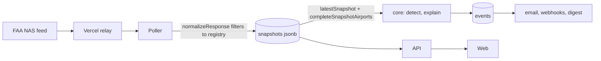

# Design Document: Core 30 Airports and Watchlist of 30

## Overview

The Owner decided on 2026-11-24: "Core 30, watchlist 30, keep the rest." AeroBrief moves from 20 hardcoded airports to the FAA Core 30 list and from a Watchlist cap of 10 to 30. The code change is small because every layer already reads the airport list from `packages/core/src/airports.ts`. Three places hold the old numbers in a way that a list edit alone would break, and the design handles each:

1. `SnapshotSchema` in `packages/core/src/schemas.ts` requires exactly 20 airports. Stored Snapshots from the last 24 hours have 20 entries. With the schema at 30, `snapshotRepository.latestSnapshot` would throw on every legacy row, and the Poller (which reads the previous Snapshot before it stores a new one) would fail on every run until the old rows age out. The design adds a pure completion step (Requirement 4).
2. The `airports` table is the target of a foreign key from `subscriptions.airport_id`. The 10 new rows must exist before any user can watch a new airport. Migration `0006` inserts them.
3. The Cap_Trigger hardcodes 10 and its message. Migration `0006` replaces the function.

Language: TypeScript (strict), detected from the workspace and fixed by `tech.md`.

### Decisions and defaults (no owner decision is open)

| # | Item | Default in this spec |
|---|------|----------------------|
| 1 | Feature flag | None. The limits are core product limits. Rollback is `git revert` of the commit range, then the down file of `0006`. |
| 2 | Names of New_Airports | FAA-style names listed below. The Owner can change a name later with one edit to `airports.ts` and an `UPDATE` (names are not part of any key). |
| 3 | ARTCC of New_Airports | Listed below and checked against an FAA source in task 1.2. If a source disagrees, the source wins and the table here is corrected in the same task. |
| 4 | Nationwide threshold | Stays 3 distinct ARTCCs (Requirement 10.4). With 30 airports and one more ARTCC (ZHN), a nationwide event can start slightly more easily. The Owner did not ask to change it. |
| 5 | Production order | Apply `0006` to production first, then push `main` (see "Release order"). The Owner approves each step. |

The only action that needs the Owner is approving and running `0006` on the Production_Database, then pushing `main`. Both are tasks, not open questions.

## The Core 30 list

Source (FAA, checked 2026-11-24):

- The FAA Aviation System Performance Metrics help page "ASPM 77" marks each airport with "(Core 30, OEP 35)": https://www.aspm.faa.gov/aspmhelp/index/ASPM_77.html
- The FAA ASPM help page "OEP 35" states that the Core 30 list, adopted in 2005, contains all OEP 35 airports except Cincinnati, Cleveland, Pittsburgh, Portland and St. Louis: https://aspm.faa.gov/aspmhelp/index/OEP_35.html. That gives 35 minus 5 = 30, which matches the count on the ASPM 77 page.
- The FAA PBN implementation plan table "OEP Airports | Core 30" lists the same group: https://www.faa.gov/air_traffic/flight_info/aeronav/procedures/reports/media/OEP_Airports.pdf

Content was rephrased for compliance with licensing restrictions. The ASPM 77 page was read in full and every airport marked "Core 30" was copied into the table. Task 1.1 re-checks the list against the page before editing code.

| # | Code | Name used in AeroBrief | ARTCC | Status |
|---|------|------------------------|-------|--------|
| 1 | ATL | Hartsfield-Jackson Atlanta International | ZTL | existing |
| 2 | BOS | Boston Logan International | ZBW | existing |
| 3 | BWI | Baltimore/Washington International Thurgood Marshall | ZDC | **new** |
| 4 | CLT | Charlotte Douglas International | ZTL | **new** |
| 5 | DCA | Ronald Reagan Washington National | ZDC | existing |
| 6 | DEN | Denver International | ZDV | existing |
| 7 | DFW | Dallas/Fort Worth International | ZFW | existing |
| 8 | DTW | Detroit Metropolitan Wayne County | ZOB | existing |
| 9 | EWR | Newark Liberty International | ZNY | existing |
| 10 | FLL | Fort Lauderdale-Hollywood International | ZMA | **new** |
| 11 | HNL | Daniel K. Inouye International (Honolulu) | ZHN | **new** |
| 12 | IAD | Washington Dulles International | ZDC | **new** |
| 13 | IAH | George Bush Intercontinental Houston | ZHU | existing |
| 14 | JFK | John F. Kennedy International | ZNY | existing |
| 15 | LAS | Harry Reid International | ZLA | existing |
| 16 | LAX | Los Angeles International | ZLA | existing |
| 17 | LGA | New York LaGuardia | ZNY | **new** |
| 18 | MCO | Orlando International | ZJX | existing |
| 19 | MDW | Chicago Midway International | ZAU | **new** |
| 20 | MEM | Memphis International | ZME | existing |
| 21 | MIA | Miami International | ZMA | existing |
| 22 | MSP | Minneapolis-Saint Paul International | ZMP | existing |
| 23 | ORD | Chicago O'Hare International | ZAU | existing |
| 24 | PHL | Philadelphia International | ZDC | **new** |
| 25 | PHX | Phoenix Sky Harbor International | ZAB | existing |
| 26 | SAN | San Diego International | ZLA | **new** |
| 27 | SEA | Seattle-Tacoma International | ZSE | existing |
| 28 | SFO | San Francisco International | ZOA | existing |
| 29 | SLC | Salt Lake City International | ZLC | existing |
| 30 | TPA | Tampa International | ZJX | **new** |

**Verification (task 1.1, 2026-11-24).** Both FAA pages were fetched again and compared with the table. The 30 airports marked "(Core 30, OEP 35)" on ASPM 77 are exactly the 30 codes above, no more and no fewer. The OEP 35 page lists 35 codes; removing CLE, CVG, PDX, PIT and STL (the five it names as excluded) leaves the same 30. The codes need no correction. The ARTCC column is not on either page and is checked in task 1.2.

**Verification (task 1.2, 2026-11-24).** The ARTCC of each New_Airport was read from the FAA National Flight Data Center (NFDC) airport record, field "ARTCC" (`https://nfdc.faa.gov/nfdcApps/services/ajv5/airportDisplay.jsp?airportId=<CODE>`; MDW answered only for `KMDW` in the selective fetch, and the plain `MDW` page shows the same value). Results: BWI ZDC, CLT ZTL, FLL ZMA, HNL ZHN, IAD ZDC, LGA ZNY, MDW ZAU, PHL ZDC, SAN ZLA, TPA ZJX. Two entries in the earlier draft of the table disagreed with the source and were corrected above: **PHL** was ZNY, now **ZDC**; **TPA** was ZMA, now **ZJX**. The other eight matched. The corrections do not add an ARTCC code to the registry (ZDC and ZJX are already used by DCA and MCO), so `ARTCC_NAMES` still needs only the `ZHN` entry. Effect on the nationwide rule (3 distinct ARTCCs): PHL now counts toward ZDC and TPA toward ZJX instead of ZNY and ZMA; the threshold is unchanged.

**Feed code format (task 1.2).** `FaaAirportEventSchema` in `packages/core/src/schemas.ts` takes `airportId: z.string().min(1)` and `normalizeResponse` matches it to the registry with `isMonitoredId`, an exact string match on the three-letter code. Every existing fixture (`apps/poller/test/poll.test.ts`, `faa-client.test.ts`, `faa-client.pbt.test.ts`) uses a three-letter code (`"JFK"`). No fixture contains any of the 10 New_Airports, so the repo alone cannot show the format for them. The live `airport-events` call was not made (the tool environment blocked the request), and public references describe the sibling FAA XML feed as keyed on three-letter airport codes (for example `<ARPT>MDW</ARPT>`). That is consistent with the three-letter code but is not a direct reading of `airport-events` for the New_Airports. The owner (or a later task with network access) can confirm with one read-only GET of `https://nasstatus.faa.gov/api/airport-events` during an event; until then the risk stays as described under "Error Handling" (an airport with a different code would always show "no ground stop"). `normalizeResponse` is not changed.

The FAA pages use abbreviated names, and the "Name used in AeroBrief" column intentionally differs from them for display. The FAA names, for reference: Hartsfield-Jackson Atlanta Intl; Boston Logan Intl; Baltimore/Washington Intl; Charlotte Douglas Intl; Ronald Reagan Washington National; Denver Intl; Dallas/Fort Worth Intl; Detroit Metropolitan Wayne County; Newark Liberty Intl; Fort Lauderdale/Hollywood Intl; Honolulu Intl; Washington Dulles Intl; George Bush Houston Intercontinental; New York John F. Kennedy Intl; Las Vegas McCarran Intl; Los Angeles Intl; New York LaGuardia; Orlando Intl; Chicago Midway; Memphis Intl; Miami Intl; Minneapolis/St. Paul Intl; Chicago O'Hare Intl; Philadelphia Intl; Phoenix Sky Harbor Intl; San Diego Intl; Seattle/Tacoma Intl; San Francisco Intl; Salt Lake City Intl; Tampa Intl. Two AeroBrief names differ in substance from the FAA page: LAS ("Harry Reid International", the airport's current name; the FAA page still says "Las Vegas McCarran Intl") and HNL ("Daniel K. Inouye International (Honolulu)"; the FAA page says "Honolulu Intl"). Both AeroBrief names are the airports' current official names and are kept.

All 20 airports of the Legacy_20_List are in the Core 30. The 10 New_Airports are BWI, CLT, FLL, HNL, IAD, LGA, MDW, PHL, SAN, TPA.

The ARTCC column for the New_Airports comes from the project author's knowledge of FAA center boundaries, not from the ASPM page, which lists no centers. It was checked in task 1.2 (see the verification note above). HNL is served by the Honolulu Control Facility (ZHN), which is the only new ARTCC code. `ARTCC_NAMES` gets one entry: `ZHN: "Honolulu"`.

Observation, outside this change: the airport search matches the code or the name, so "Las Vegas" does not find LAS (its name is "Harry Reid International"). The name for HNL carries "(Honolulu)" and the name for LGA carries "New York" so the new airports are findable by city. Existing names stay as they are.

## Architecture

The data flow does not change. Only the list and two limits change.



Where the number 30 lives:

| Layer | Location | Source of the number |
|-------|----------|----------------------|
| Airport list | `packages/core/src/airports.ts` | the array itself (30 entries) |
| Snapshot size | `packages/core/src/schemas.ts` | `AIRPORTS.length` (no literal) |
| Watchlist cap | `packages/core/src/watchlist.ts` | `WATCHLIST_CAP = 30` |
| API cap message | `apps/api/src/handlers/watchlist.ts` | built from `WATCHLIST_CAP` |
| DB trigger | `0006_watchlist_cap_30.sql` | literal 30 (SQL cannot import) |
| DB `airports` rows | `0006_watchlist_cap_30.sql` | the 10 new rows |
| Web counter | `apps/web/src/pages/WatchlistPage.tsx` | local `MAX_WATCHLIST = 30`, pinned equal to `WATCHLIST_CAP` by a test |

The Web_App keeps its own constant because it imports only the `@aerobrief/core/theme` subpath today. A test asserts the two constants are equal, so a future change to one fails the other. This avoids a new package export.

## Components and Interfaces

### packages/core

`airports.ts`: add the 10 entries to `AIRPORTS` in code order (alphabetical, as today) and `ZHN` to `ARTCC_NAMES`. The existing `satisfies Readonly<Record<Airport["artcc"], string>>` makes a missing ARTCC name a compile error.

`schemas.ts`: replace both literal 20s.

```typescript
import { AIRPORTS, type MonitoredId, isMonitoredId } from "./airports";

const AIRPORT_COUNT = AIRPORTS.length;

export const SnapshotSchema = z.object({
  id: z.string().uuid(),
  capturedAt: z.string().datetime({ offset: false }),
  airports: z
    .array(AirportStatusSchema)
    .length(AIRPORT_COUNT)
    .refine((a) => new Set(a.map((x) => x.airportId)).size === AIRPORT_COUNT, {
      message: "Airport ids must be unique",
    })
    .readonly(),
});
```

New file `snapshot-compat.ts` (pure, exported from `index.ts`):

```typescript
/**
 * Completes the airports of a stored Snapshot written before the monitored list grew.
 * Input that is not an array is returned unchanged so SnapshotSchema reports the error.
 * Entries already present are kept as they are. Each missing monitored id is added with
 * `groundStop: null`. Output is sorted by airportId. Unknown ids are kept so the schema rejects them.
 */
export function completeSnapshotAirports(stored: unknown): unknown {
  if (!Array.isArray(stored)) return stored;
  const present = new Set(
    stored.flatMap((e) => (typeof e === "object" && e !== null && "airportId" in e ? [String((e as { airportId: unknown }).airportId)] : [])),
  );
  const added = MONITORED_IDS.filter((id) => !present.has(id)).map((airportId) => ({ airportId, groundStop: null }));
  return [...stored, ...added].sort(byAirportId);
}
```

`byAirportId` compares `airportId` strings with `<`, the same comparison `normalizeResponse` uses, and sorts entries that lack a string `airportId` last so the schema still reports them.

`watchlist.ts`: `WATCHLIST_CAP = 30` and the doc comment "Cap 30".

`normalize.ts`, `change-detector.ts`, `explain.ts`, `dedupe.ts`: no code change. They iterate `MONITORED_IDS`, `AIRPORTS` and `airportById`. The detector already treats an airport absent from a Snapshot as "no active ground stop" (see the doc comment of `detectChanges`).

### packages/db

`repositories/snapshots.ts`: call the completion before parsing.

```typescript
return SnapshotSchema.parse({
  id: row.id,
  capturedAt: row.capturedAt.toISOString(),
  airports: completeSnapshotAirports(row.airports),
});
```

The new Snapshot written by the Poller always has 30 entries, so the completion changes only Legacy_Snapshots, which age out after 24 hours.

`repositories/subscriptions.ts`: `SubscriptionLimitError` message becomes "subscription limit of 30 reached"; comments say "31st airport". `isSubscriptionLimitError` is unchanged. It matches on SQLSTATE `23514` and the text "subscription limit", so it accepts both the old and the new trigger message. That is what makes the release order safe in both directions.

`schema.ts`: comment says cap of 30.

`migrations/0006_watchlist_cap_30.sql` (custom migration, applied by `scripts` or Neon MCP, not by drizzle-kit, like 0004 and 0005):

```sql
-- Custom migration: Watchlist cap of 30 and the 10 Core 30 airports added to the 20 seeded by 0002.
-- Safe to run twice. The trigger enforce_subscription_cap (0001) calls this function by name, so
-- replacing the function is enough. The API maps SQLSTATE 23514 with "subscription limit" to its
-- watchlist_full response.
CREATE OR REPLACE FUNCTION enforce_subscription_cap() RETURNS trigger AS $$
BEGIN
	PERFORM 1 FROM "users" WHERE "id" = NEW."user_id" FOR UPDATE;
	IF (SELECT count(*) FROM "subscriptions" WHERE "user_id" = NEW."user_id") >= 30 THEN
		RAISE EXCEPTION 'subscription limit of 30 reached' USING ERRCODE = '23514';
	END IF;
	RETURN NEW;
END;
$$ LANGUAGE plpgsql;
--> statement-breakpoint
INSERT INTO "airports" ("id", "name", "artcc") VALUES
  ('BWI', 'Baltimore/Washington International Thurgood Marshall', 'ZDC'),
  -- ... the other 9 rows, generated by renderAirportsInsertSql() for the New_Airports
ON CONFLICT ("id") DO NOTHING;
```

`migrations/down/0006_watchlist_cap_30.down.sql` (not in the journal's applied path, like the other down files; run in one transaction, flag-free, with the Owner's approval, after the code has been reverted and deployed):

```sql
-- Reverses 0006_watchlist_cap_30.sql. Run after the code is reverted.
CREATE OR REPLACE FUNCTION enforce_subscription_cap() RETURNS trigger AS $$ ... >= 10 ... 'subscription limit of 10 reached' ... $$ LANGUAGE plpgsql;
--> statement-breakpoint
-- The previous code rejects a Snapshot that does not list exactly 20 airports.
DELETE FROM "snapshots" WHERE jsonb_array_length("airports") <> 20;
--> statement-breakpoint
DELETE FROM "events" WHERE "airport_id" IN ('BWI','CLT','FLL','HNL','IAD','LGA','MDW','PHL','SAN','TPA');
--> statement-breakpoint
-- Keeps any airport a user still watches. Subscriptions are never deleted here.
DELETE FROM "airports" a WHERE a."id" IN ('BWI','CLT','FLL','HNL','IAD','LGA','MDW','PHL','SAN','TPA')
  AND NOT EXISTS (SELECT 1 FROM "subscriptions" s WHERE s."airport_id" = a."id");
```

Effects of the down file, stated for the Owner: the stored 30-airport Snapshots and the events of the last 24 hours for the New_Airports are deleted, so the dashboard shows "no data" until the next poll (at most 5 minutes). Users who already watch a New_Airport keep that row, and the old API lists it as a normal watchlist entry the old Web_App cannot show. The down file lowers no one's list below its size: the trigger only blocks inserts, so a user with more than 10 airports keeps them.

`meta/_journal.json`: add `{ "idx": 6, "version": "7", "when": 1760000006000, "tag": "0006_watchlist_cap_30", "breakpoints": true }`.

`seed.ts`: no change; `renderAirportsInsertSql()` renders all 30 rows. A new helper `renderNewAirportsInsertSql(legacyIds)` is not needed: the migration text is generated once with the existing function over the 10 rows and pasted, and a test (Requirement 8.9) compares the ids.

### apps/api

`handlers/watchlist.ts`: `capError()` builds its text from `WATCHLIST_CAP`:

```typescript
function capError(): ApiError {
  return new ApiError(409, "watchlist_full", `Your Watchlist already has ${WATCHLIST_CAP} airports. Remove one to add another.`);
}
```

The handler already uses `applyWatchlistOp` and maps `SubscriptionLimitError` to `capError()`, so no other change. `handlers/status.ts`: comment "all 30 airports". `docs/api.md` examples: trimmed response "2 of the 30 airports", "Always 30 items", "one of the 30 monitored airports".

### apps/poller

No code change. `poll.ts` already calls `latestSnapshot` (now completing legacy rows), `normalizeResponse` (30 entries) and `detectChanges`. Tests change (Requirement 8).

### apps/web

- `WatchlistPage.tsx`: `MAX_WATCHLIST = 30`. The counter text stays `"{n} of {MAX_WATCHLIST} airports watched"`. Add controls stay enabled at the cap so the server message shows (existing behavior from task 16.11 of the original spec).
- `StatusPage.tsx`: subtitle "FAA ground stop status for 30 major US airports."
- `StatusView.tsx`, `WatchlistTable.tsx`: no change (they use `airports.length`); comment in `WatchlistTable.tsx` says 30.
- No DOM, class or color change. `design.md` steering rules are untouched.

### Steering and docs

Edit as listed in Requirement 7 and 6. The new `scope.md` text, in full (the front matter and the "Prohibited" and "Rule: enforce the boundaries" sections stay as they are, except that the second rule below names the new limits):

```markdown
## Limits

- AeroBrief monitors the FAA Core 30 airports (the 30 airports the FAA ASPM help pages mark "Core 30"). Source: https://www.aspm.faa.gov/aspmhelp/index/ASPM_77.html. The codes are in `packages/core/src/airports.ts`.
- A user watchlist is capped at 30 airports.
- History retention is 24 hours only.

(The owner raised the airport count from 20 to 30 and the watchlist cap from 10 to 30 on 2026-11-24. See `docs/decisions.md`.)
```

and the Phase 2 section reduces to: the list of Phase 2 items (still "specified in `.kiro/specs/aerobrief-phase2/`"); the sentence "The Kiroween 2026 submission is `main` as of the deadline, December 4, 2026, 2:00 PM PT. Tag `mvp-contest-2026` stays as the MVP restore point."; the retained rules from Requirement 7.4; and "After the deadline, `main` is frozen until judging has finished." The two sentences that restrict merging ("The contest set ... may merge ..." and "Every other Phase 2 item ... stays on `phase-2` until judging has finished.") are deleted, as is "run only against a Neon branch, never the production database, until it is merged" in favor of "tested on a Neon branch first; the Owner applies it to production". The sentence "The limits and prohibitions above stay in force on `main`, which is the Kiroween 2026 submission" is replaced by the submission sentence above.

A decision-log section "2026-11-24: Core 30 airports and watchlist of 30" is appended to `docs/decisions.md` in the style of the "UI refresh decisions" section.

## Data Models

No new table or column. Changed data:

- `airports`: 10 new rows (30 total).
- `snapshots.airports` (jsonb): new rows hold 30 entries `{ airportId, groundStop }`. Legacy rows hold 20 and are completed on read.
- `subscriptions`: up to 30 rows per user instead of 10. The primary key `(user_id, airport_id)` is unchanged.
- `events`: no schema change; `airport_id` may be a New_Airport code.

Zod schemas stay the single source of data shapes (`structure.md`). `MonitoredId` widens to the 30-code union through `as const`, so TypeScript flags every switch or record that is keyed by airport and missed the new codes.

## Release order

Facts used (read from the repo): `deploy-workers.yml` deploys the API Worker and then the Poller Worker on a push to `main`; the Web_App deploys from Vercel on the same push; production has migrations 0000 to 0003 only (0004 and 0005 exist on the Phase2_Branch); `isSubscriptionLimitError` matches any "subscription limit" text.

1. **Tests green on `phase-2`** (task 9).
2. **Phase2_Branch first** (task 10): apply `0006` there in one transaction through Neon MCP `run_sql_transaction`, run the opt-in integration test against it, read-only checks of the rows and the function.
3. **Production, with the Owner's approval, before the push** (task 11): `0006` in one transaction. Effect while the old code still runs: 10 unused `airports` rows and a trigger that allows 30. The old API still limits a Watchlist to 10 in code, the old Poller still stores 20-airport Snapshots, and nothing a user sees changes. This is why the migration goes first. The reverse order would put the new UI with the old trigger: a user's 11th add would pass the new API check and fail at the old trigger with the same `watchlist_full` response, showing "already has 30 airports" at 10. That is wrong text, so the order is fixed.
4. **Fast-forward `main` and push** (task 12). The API Worker deploys first, so the new API reads the old 20-airport Snapshot through the completion step. The Poller Worker deploys second and from then on stores 30-airport Snapshots. No old API ever reads a 30-airport Snapshot. Vercel deploys the Web_App at about the same time. For the short gap in which the new Web_App is served by the old API, the counter says "of 30" and a user at 10 airports who tries to add another sees the API's current message ("already has 10 airports"), as Requirement 9.5 requires.
5. **Owner check on the live site** (task 13).

Rollback: `git revert` the range on `main` and push (the Workers redeploy in the same order), then, with approval, run the down file in one transaction. Reverting first matters, because the old code must be running before the 30-airport Snapshots are deleted.

## Error Handling

- Stored Snapshot with an unknown airport id: still a validation error (Requirement 4.6), because completion adds only registry ids and the schema still checks each id.
- Stored Snapshot with a non-array `airports` value: passed through unchanged; the schema reports the error. The Poller already records a failed poll for a throw from `latestSnapshot`.
- Add at the cap: HTTP 409 `watchlist_full`, same shape as today, message with 30.
- Trigger raised during a race: `SubscriptionLimitError`, mapped to the same 409.
- FAA feed lists an airport that is not monitored: ignored by `normalizeResponse` (unchanged).
- FAA feed uses a different code for a New_Airport than the three-letter code (for example HNL): the airport would show "no ground stop" always. Task 1.2 checks the codes against the live FAA response fixture and the FAA feed code format that the existing 20 use; if a code differs, `normalizeResponse` is not changed, and the Owner is told in the task report.

## Testing Strategy

Vitest for unit tests and fast-check for property tests, as `tech.md` requires. Property tests run at least 100 runs and carry a tag comment `// Feature: core30-limits, Property N: <title>`. Tests live where `structure.md` puts them and mirror source paths.

Property tests (pure logic):

- `packages/core/test/watchlist-invariants.pbt.test.ts` (extend): P1.
- `packages/db/test/subscription-limit.pbt.test.ts` (new): P2.
- `packages/core/test/snapshot-compat.pbt.test.ts` (new): P3, P4, P8.
- `packages/core/test/normalize.pbt.test.ts` (extend): P5.
- `packages/core/test/change-detector-new-airports.pbt.test.ts` (new): P6.
- `packages/core/test/explain-airports.pbt.test.ts` (new): P7.

Example tests: registry list (`airports.test.ts`), migration text (`packages/db/test/migration-0006.test.ts`), API 31st add (`apps/api/test/watchlist.test.ts`), counter and cap message in the Web_App (`apps/web/test/...`), search for each New_Airport, poll with a Legacy_Snapshot (`apps/poller/test/poll.test.ts`), digest and notifier examples with a New_Airport.

Integration (opt-in, skipped without a test database): `packages/db/test/integration/watchlist-cap.test.ts` changes to 35 concurrent adds, 30 fulfilled and 5 `SubscriptionLimitError`; a second case asserts the 31st sequential add is rejected and a repeat add of a present airport returns false. `seededAirportIds` in `test-db.ts` must return 30 ids; the test database must have `0006` applied. The existing test `skipIf(!hasTestDb)` pattern stays.

Existing tests that hard-code 20 or 10 and change (values only, none deleted or weakened):

| File | Change |
|------|--------|
| `packages/core/test/airports.test.ts` | exact Core 30 list, subset and new-airports assertions |
| `packages/core/test/normalize.test.ts`, `normalize.pbt.test.ts`, `schemas.test.ts` | `toHaveLength(AIRPORTS.length)` |
| `packages/core/test/arbitraries.ts` (comment and subset arbitrary) | comments say 30 |
| `packages/core/test/watchlist*.test.ts` (four files) | use `WATCHLIST_CAP` already; check `MONITORED_IDS.slice(0, WATCHLIST_CAP)` still has enough ids (30 of 30) |
| `packages/db/test/schema.test.ts` | `toHaveLength(30)` |
| `packages/db/test/auth-repositories.test.ts` | trigger message "of 30", plus a case for the old "of 10" message |
| `packages/db/test/webhooks.test.ts` line 73 | the negative case keeps working with either number |
| `packages/db/test/integration/watchlist-cap.test.ts` | as above |
| `apps/api/test/status.test.ts`, `nationwide-status.pbt.test.ts` | 30 |
| `apps/poller/test/poll.test.ts` | 30 |
| `apps/web/test/components/airport-search.test.tsx`, `airport-filter.test.tsx`, `status-view.test.tsx`, `status-page.test.tsx` | 30 rows, "All (30)", "Showing 30 of 30 airports" |
| `apps/web/test/**` for the Watchlist counter and the subtitle | "of 30", "30 major US airports" |

Where a web fixture builds its airport list by hand with 20 entries, the fixture builds it from `AIRPORTS` instead (the web tests already import `@aerobrief/core`). The task for each file looks up its fixture before editing.

## Correctness Properties

*A property is a characteristic or behavior that should hold true across all valid executions of a system-essentially, a formal statement about what the system should do. Properties serve as the bridge between human-readable specifications and machine-verifiable correctness guarantees.*

### Property 1: Watchlist cap invariant

For any sequence of add and remove operations over any mix of monitored and unmonitored airport ids, starting from the empty Watchlist, the Watchlist after every step holds at most 30 airports, has no duplicates and holds only monitored ids. An add is refused with `cap_exceeded` if and only if the id is monitored, not on the list, and the list holds 30 airports. An add of an id already on the list succeeds and leaves the list unchanged, even at 30.

**Validates: Requirements 2.1, 2.2, 2.3, 2.4, 8.3**

### Property 2: Cap_Error recognition

For any error object (or chain of `cause` links up to depth 5) with `code` `"23514"` and a message that contains "subscription limit", for any number in the message and any nesting depth up to 5, `isSubscriptionLimitError` returns true; for any error whose code is not `"23514"` or whose message lacks "subscription limit", it returns false.

**Validates: Requirements 2.5, 8.5**

### Property 3: Completing a Legacy_Snapshot

For any subset of the Airport_Registry with any ground stop values, `completeSnapshotAirports` returns a list of exactly 30 entries sorted by `airportId` with unique ids, in which every input entry appears unchanged and every added entry has `groundStop` null. Applying it to its own output returns the same list.

**Validates: Requirements 4.1, 4.2, 8.7**

### Property 4: Schema accepts exactly the full registry

For any list of airport entries, `SnapshotSchema` accepts it if and only if it holds each registry id exactly once. For any strict subset of the registry, parsing fails, and parsing the completion of the same subset succeeds.

**Validates: Requirements 4.5, 4.6**

### Property 5: Normalization covers the registry and keeps stops

For any FAA response that mixes monitored ids (including the New_Airports), unmonitored ids and entries without a ground stop, `normalizeResponse` returns a Snapshot with exactly 30 entries sorted by id; every monitored id with a ground stop in the response has a non-null `groundStop` in its entry; every other entry is null; and unmonitored ids do not appear.

**Validates: Requirements 5.1, 5.3, 8.8**

### Property 6: Legacy-to-new transition creates no false events, and real changes are detected

For any 30-airport Snapshot S whose New_Airports have no ground stop, the Snapshot L made from S by dropping the 10 New_Airports and completing it yields no event when compared with S by `detectChanges`. For any monitored airport (including the New_Airports), a Snapshot with a ground stop there compared against one without yields one `GROUND_STOP_STARTED` event for that airport, and the reverse yields one `GROUND_STOP_ENDED` event.

**Validates: Requirements 4.4, 5.1, 5.2**

### Property 7: Explanations name the airport and show no raw reason

For any monitored airport and any FAA reason string (or null), the explanation for a ground stop started or ended event contains the registry name and code of the airport. When the reason is not a key of the reason dictionary after trimming and lower-casing, the explanation ends with the fixed sentence "The FAA has not given a reason AeroBrief can explain." and not with the reason.

**Validates: Requirements 5.7**

## Requirement coverage

Every requirement is covered by a task in `tasks.md`; the map is in the "Requirements" line of each task.

Reflection on the properties: criteria 2.2, 2.3 and 2.4 collapse into one sequence property (Property 1). Criteria 5.1 and 5.2 collapse into Property 6. Criteria 4.1 and 4.2 collapse into Property 3. Criteria 1.x, 3.x, 5.4 to 5.6, 5.8 to 5.11, 6.x and 9.5 are fixed data, SQL text, UI text or process, and use example tests or review.
