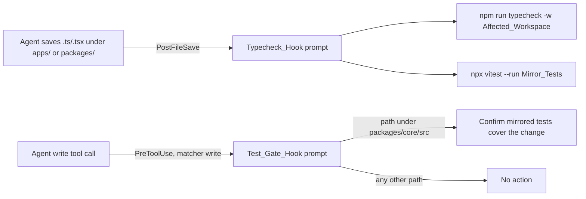

# Design Document

## Overview

Two hook files are rewritten to the current Kiro schema and point at paths and commands that exist in this repository. Four documents are updated or rewritten to match what is live on https://www.aerobriefs.com. A checkpoint runs the full test and typecheck commands and parses the hook files. The Owner confirms that each hook fires.

No application code, dependency, migration or secret is touched. The work is JSON and Markdown. Nothing is committed by the agent.

Language: TypeScript is the project language. This spec edits no TypeScript. The hook prompts name TypeScript commands only.

## Architecture



| Artifact | Action | Task |
| --- | --- | --- |
| `.kiro/hooks/typecheck-on-save.json` | create | 1.1 |
| `.kiro/hooks/lint-on-save.json` | delete | 1.1 |
| `.kiro/hooks/require-test-update.json` | rewrite | 1.1 |
| `docs/hooks.md` | create | 1.2 |
| `docs/kiro-usage.md` | edit | 2 |
| `docs/demo-script.md` | rewrite | 3 |
| `docs/devpost-submission.md` | edit | 4 |

## Hook schema: finding and decision

The brief asked for the hook format "as the existing files use" and for a check of the schema fields `when`/`then`, `patterns` and `toolTypes`. The Kiro documentation shows that the existing files use a superseded format.

| Field in the existing files | Current Kiro schema | Source |
| --- | --- | --- |
| Flat object with `"version": "1"` | `"version": "v1"` and a `hooks` array of hook objects | [Hooks](https://kiro.dev/docs/hooks/) |
| `when.type: "fileEdited"` | `trigger: "PostFileSave"` | [What's new in 1.0, Hooks](https://kiro.dev/docs/ide/whats-new-v1/hooks/) |
| `when.type: "preToolUse"` | `trigger: "PreToolUse"` | same |
| `when.patterns` | `matcher`, a regex on the file path (file triggers) or a tool selector (tool triggers) | same, and [Hook triggers](https://kiro.dev/docs/hooks/types/) |
| `when.toolTypes: ["write"]` | `matcher: "write"`, a built-in tool category | [Hook triggers](https://kiro.dev/docs/hooks/types/), "Pre Tool Use" |
| `then.type: "askAgent"`, `then.prompt` | `action: { "type": "agent", "prompt": "..." }` | [Hooks](https://kiro.dev/docs/hooks/) |

The migration page says the `when`/`then` structure becomes `trigger`/`matcher`/`action`, and that legacy `.kiro.hook` files are migrated through an upgrade badge in the Agent Hooks panel. The 0.x reference page (https://kiro.dev/docs/ide/0x-reference/) documents an intermediate form with `when` and `then` inside a `hooks` array. The `toolTypes` field appears in none of the current pages.

**Decision.** Write both files in the current v1 schema (`trigger`, `matcher`, `action`). Keep the existing conventions that still apply: `enabled`, `name`, `description`, and an agent action with a prompt. Reasons: the current documentation defines only this form for `.kiro/hooks/*.json`, and the flat form is a likely reason that no firing was ever recorded. This is a stated deviation from "as the existing files use". If the Owner's Kiro version does not fire the v1 files, Task 6 records that and the Owner decides the next step. The Hooks_Doc must not claim firing without the Task 6 record.

Two behaviors from the documentation shape the hooks:

1. `PostFileSave` fires when a file is saved or modified **by the agent** ([Hooks](https://kiro.dev/docs/hooks/types/), "File Save"). Task 6 therefore asks the agent to make the edit, not the Owner to type it.
2. An `agent` action injects a prompt and cannot block the trigger; only a `command` action that exits with code 2 blocks ([What's new in 1.0, Hooks](https://kiro.dev/docs/ide/whats-new-v1/hooks/)). The Test_Gate_Hook is an agent action, so it is a reminder that the agent follows, not a hard block. A blocking version needs a command action, which is a script and is not part of this spec. The Hooks_Doc states the limit.

## Components and Interfaces

### Typecheck_Hook (`.kiro/hooks/typecheck-on-save.json`)

```json
{
  "version": "v1",
  "hooks": [
    {
      "name": "Typecheck and test on save",
      "description": "After the agent saves a .ts or .tsx file under apps/ or packages/, typecheck the affected workspace and run the tests that mirror the file.",
      "enabled": true,
      "trigger": "PostFileSave",
      "matcher": "(^|[\\\\/])(apps|packages)[\\\\/].+\\.tsx?$",
      "action": {
        "type": "agent",
        "prompt": "A TypeScript file under apps/ or packages/ was just saved. If its path contains node_modules, dist or .wrangler, do nothing. Otherwise: (1) Take the first two path segments of the saved file (for example packages/core or apps/api) and run `npm run typecheck -w <that path>`. (2) Find the Vitest files that mirror the saved file under the rule in .kiro/steering/structure.md: for <pkg-or-app>/src/<name>.ts that is <pkg-or-app>/test/<name>.test.ts and <name>.pbt.test.ts, and for a saved test file that file itself. If no mirror exists by name, search the test folder of the same workspace for files that import the saved module. Run `npx vitest --run <those files>`. (3) If anything fails, report each failure with its file and message in a short list. Do not change any file and do not install anything. Do not run ESLint; it is not part of this project."
      }
    }
  ]
}
```

The matcher is a regex on the file path. The path may use `/` or `\`, so the character class `[\\/]` accepts both (JSON-escaped above). Test files match too, so editing a test runs that test.

Typecheck uses the existing per-workspace `typecheck` scripts. The root script `npm run typecheck` runs the root `tsc`, `scripts/tsconfig.json` and every workspace; the hook runs the one workspace only, so the check stays short.

### Test_Gate_Hook (`.kiro/hooks/require-test-update.json`)

```json
{
  "version": "v1",
  "hooks": [
    {
      "name": "Require test update for core logic and schemas",
      "description": "Before a write under packages/core/src/, confirm that the mirrored unit and property tests are updated. Schema changes also need the schema and property tests.",
      "enabled": true,
      "trigger": "PreToolUse",
      "matcher": "write",
      "action": {
        "type": "agent",
        "prompt": "Check the target path of this write. If it is NOT under packages/core/src/, do nothing and let the write proceed. If it IS under packages/core/src/, first confirm that the mirrored tests in packages/core/test/ are updated for this change, or are updated in this same task: for packages/core/src/<name>.ts they are <name>.test.ts and <name>.pbt.test.ts (and any other *.pbt.test.ts file whose name starts with <name>). If the path is packages/core/src/schemas.ts, the tests that must cover the change are schemas.test.ts, snapshot-roundtrip.pbt.test.ts and faa-body.pbt.test.ts. If a mirrored test is missing or does not cover the change, write or update it first, then perform the source write. If you cannot confirm coverage, stop and tell the user why."
      }
    }
  ]
}
```

Why these test names: `packages/core/test/` holds `schemas.test.ts`, `snapshot-roundtrip.pbt.test.ts` (Snapshot JSON round trip, Property 3) and `faa-body.pbt.test.ts` (FAA body classification, Property 1). The structure rule `packages/core/src/<x>.ts` to `packages/core/test/<x>.test.ts` and `<x>.pbt.test.ts` holds for the rest. The folder `packages/core/src/schemas/` named in `structure.md` does not exist; schemas live in the single file `schemas.ts`.

The `write` matcher is the built-in category for file write tools. Shell commands that write files are not matched. The Hooks_Doc states this.

### Hooks_Doc (`docs/hooks.md`)

Sections: Purpose; Hook 1 and Hook 2 (file, trigger, matcher, what the agent is asked to do, limits); How to see each hook fire (steps for the video); Firing record (table with blank rows, filled in Task 6); History (the original files were `lint-on-save.json` running ESLint that is not installed and `require-test-update.json` watching `src/lib/schemas/`, commit `66e1b0e`; see `docs/kiro-audit.md` gaps 3 to 5); Sources (the four documentation URLs).

"How to see each hook fire" gives, for each hook, the prompt to type into Kiro, where the hook run appears (Agent Hooks panel and the hook card in chat), and what to point at on camera. The steps must say the edit is made by the agent.

### Kiro_Usage_Doc edits

| Section | Change |
| --- | --- |
| Opening paragraph and Summary table | State that the four flags are on in production, remove "off by default", update the hooks row ("2 defined, fixed in this change; firing record in `docs/hooks.md`"), add the `ui-improvements` spec to the spec row, and refresh counts (see Counts below). |
| Hooks | Rewrite for the two fixed hooks, link `docs/hooks.md`, keep the history paragraph that the first versions were broken (commit `66e1b0e`) and name this change as the fix. |
| Phase 2 | Replace "Each flag is off by default. This document does not claim that any flag is on in production" with the verified production state (flags on, 2026-11-25; migrations 0004 to 0006 applied with Neon restore points; Safe_Send_Mode on). Cite `docs/phase2-rollout.md` and `docs/decisions.md`. The "Hooks" bullet inside Phase 2 changes to point at the fixed hooks. |
| Later specs | Rename "Three later specs" to four and add `ui-improvements`: owner's 17-requirement document, 100 criteria, split into Build now, Deferred and Out of scope (map view, prohibited by `scope.md`), no migration, shipped before the deadline. |
| Where Kiro surprised us (new) | Six items (a) to (f) of Requirement 4.4, each as: what we expected, what happened, evidence. |
| MCP | Add the Neon MCP uses beyond the smoke test: branch `phase-2` created and migrations 0004 to 0006 applied through `run_sql_transaction` (`docs/decisions.md`, 2026-11-18 to 2026-11-24), restore-point branches before the production migrations (`docs/phase2-rollout.md` step 3a), and read-only production checks. |
| "What this document does not claim" | Remove the claims that no hook fired once Task 6 is recorded and the demo-video line if the video is recorded; keep the rest. |

**Evidence for each surprise.**

| Item | Evidence to cite | Check before writing |
| --- | --- | --- |
| (a) Property 10 | `bbd419e`; `packages/core/test/digest-unsubscribe.test.ts` and `digest-unsubscribe.pbt.test.ts`; existing text in `docs/kiro-usage.md` | `git show --stat bbd419e` |
| (b) FAA 403 probe | `.kiro/specs/faa-403-poller/probe-result.md`, `relay-probe-result.md`; `docs/decisions.md` 2026-11-22; `tech.md` approved exception | read both result files |
| (c) Sub-agent reported finished work that was not | `a690842` ("Add missing event card styles (task 17.4)"); existing text in `docs/kiro-usage.md` | `git show --stat a690842` |
| (d) `fetchFaa` never throws | `apps/poller/test/faa-client.test.ts` ("does not throw when the thrown object has a non-callable toString"), `apps/poller/src/faa-client.ts` (`safeString`), `apps/poller/src/poll.ts` (`describeError`) | find the commit with `git log -S"safeString" --oneline -- apps/poller/src/faa-client.ts`. The brief ties this to core30-limits task 6; that task text in `.kiro/specs/core30-limits/tasks.md` does not mention it, so cite the commit if found, otherwise cite the files and write "commit not identified". |
| (e) CSS specificity in stacked tables | `5f19226` ("Fix clipped Add/Remove buttons in the stacked phone layout of the airport tables"); `docs/responsive-check.md` | `git show --stat 5f19226` |
| (f) Version skew over `incidentKey` | `9074304`; `.kiro/specs/ui-improvements/tasks.md` task 3.1; `apps/web/src/api/client.ts` | `git show --stat 9074304` |

Any item whose evidence does not hold on inspection is reworded to what the evidence shows, or removed with a note in the final report.

**Counts.** The existing document states 76 `*.pbt.test.ts` files. Recount in Task 2 with `Get-ChildItem -Recurse -Filter *.pbt.test.ts -File apps,packages,tests | Where-Object FullName -notmatch node_modules | Measure-Object` and use the result in both Kiro_Usage_Doc and Devpost_Copy. Recount the property totals from the spec design files only if the text states them.

### Demo_Script outline

Target about 3:00. The Owner checks the maximum video length in the Devpost rules first (the previous script assumed under 3:00 from the Kiroween rules) and trims if the limit is lower.

| # | Time | Screen | Narration idea |
| --- | --- | --- | --- |
| 1 | 0:00-0:15 | Title card or the live Overview | The November 13 ground stop: the FAA page down, airline apps saying "delayed" with no reason. |
| 2 | 0:15-0:40 | Status, Overview: headline, two chips, freshness chip | Plain-language network summary of 30 airports, with a visible freshness state. |
| 3 | 0:40-1:05 | Events: an incident card expanded | One card per incident, five labeled fields: what, why, impact, next update, source. |
| 4 | 1:05-1:20 | Airports pane, search by city (for example "Las Vegas") | Filter and search, count announced. |
| 5 | 1:20-1:45 | Watchlist signed out, quick-add chips, then sign in, merge offer | Works without an account; sign-in merges the list (cap 30). |
| 6 | 1:45-2:05 | Settings: digest, webhooks test event, display and time | Daily digest, signed webhooks, time preference. Allowlisted address (Safe_Send_Mode). |
| 7 | 2:05-2:15 | Phone-width window or device | Stacked tables, collapsed nav. |
| 8 | 2:15-2:50 | `.kiro/specs/` list; `.kiro/steering/`; Agent Hooks panel with a hook firing; Neon MCP; a property test run; one or two surprises | The Kiro story. |
| 9 | 2:50-3:00 | Dashboard | Closing pitch and URL. |

Each shot also lists "have open" (tab, panel, file) and a fallback if a live step fails (for example a recorded clip). The stale-banner section of the current script stays, rewritten for the freshness chip: the DevTools override still works, because the API response still carries `stale`, and the chip shows Delayed. The Owner confirms this on the live site while recording, and the script says so rather than asserting it.

Only Built_Features appear. The script lists what not to show: map, airport detail redesign, delays or closures, Terms and Privacy.

### Devpost_Copy edits

| Section | Change |
| --- | --- |
| Category | Keep Frankenstein; add the relay and the redesign to the stitched parts only if they are true in the text below. |
| What it does | Replace the old dashboard bullets with: Overview with headline and chips, incident cards with structured explanations, freshness chip, time display setting (Relative, Airport local, My local, UTC), signed-out Watchlist with merge on sign-in, new navigation, footer with the advisory notice. Keep 30 airports, watchlist of 30, magic link sign-in, email alerts, unsubscribe. |
| Additions behind feature flags | Rename to "Phase 2 features, live in production". All four are on; Safe_Send_Mode on; migrations 0004 to 0006 applied with restore points. Remove "off by default" and "Nothing in this file claims production use". |
| Relay | Keep the FAA relay paragraph; add that `tech.md` records the single approved exception. |
| How we built it | Hooks sentence replaced by the fixed hooks; add four later specs plus `ui-improvements`; add MCP uses; add two or more surprises; update counts. |
| What's next | From the Deferred dispositions: grouped Airports view with watch star and sortable headers, airport detail redesign, Minor Impact and Disrupted statuses with delay program and closure tracking, 7 and 30 day history ranges, digest preview and time zone, organization features. Mark each as "needs data or a decision", not as promised. The map view is prohibited and is not listed. Ground delay programs appear once, under the status pipeline. |
| Judge testing notes | Add: the freshness chip, the signed-out Watchlist (no sign-in needed), the Settings Display section, the allowlist limit on digests and webhooks. |
| Checklist | Keep; mark the Kiro write-up row as updated again. |

## Data Models

None. No schema or data change.

## Error Handling

- A hook prompt reports failures and changes nothing, so a failed typecheck cannot lead to an unreviewed edit.
- If `npm run typecheck -w <path>` fails because the workspace has no `typecheck` script, the agent reports that and runs the root `npm run typecheck` instead. The prompt need not name this; the Hooks_Doc notes it.
- If a claim in a document has no evidence on inspection, the author removes or rewords it (Requirement 4.6). The final report lists what was removed.
- If the Kiro version does not fire the v1 hook files, Task 6 records it and nothing in the docs claims firing.

## Testing Strategy

This work is configuration and documentation, so property-based tests do not apply: there is no function with inputs and outputs and no universal property to state. The checks are:

1. Existing suite: `npm test` and `npm run typecheck` still pass (no code changed, so a failure points at the environment).
2. Hook files: a JSON parse of both files, plus structure checks (`version` is `"v1"`, `hooks` is a non-empty array, each hook has `name`, `trigger`, `action`, and the `matcher` of each compiles as a JavaScript regex). Run as a one-off PowerShell or `node -e` command; no test file or dependency is added.
3. Matcher sanity: the Typecheck_Hook matcher accepts `packages/core/src/schemas.ts` and `apps\api\src\index.ts`, and rejects `docs/hooks.md` and `apps/web/src/styles/tokens.css`, using the same one-off command.
4. Text checks by search: no `eslint`, `src/lib/schemas` or `tests/pbt` in the two hook files; no "off by default" referring to production in the three docs; no "map view" or "Terms" feature in the Demo_Script shots.
5. Scope check: `git status --short` shows changes only under `.kiro/hooks/`, `.kiro/specs/submission-polish/` and `docs/`.
6. Owner check (Task 6): each hook fires once in Kiro, recorded in `docs/hooks.md`.

## Sources

- Kiro hooks overview and schema: https://kiro.dev/docs/hooks/
- Hook triggers and matchers: https://kiro.dev/docs/hooks/types/
- IDE 1.0 hooks format and trigger mapping: https://kiro.dev/docs/ide/whats-new-v1/hooks/
- IDE 0.x hooks reference (legacy fields): https://kiro.dev/docs/ide/0x-reference/
- Repository evidence: `docs/kiro-audit.md` gaps 3 to 5, `docs/kiro-usage.md` "Hooks"
