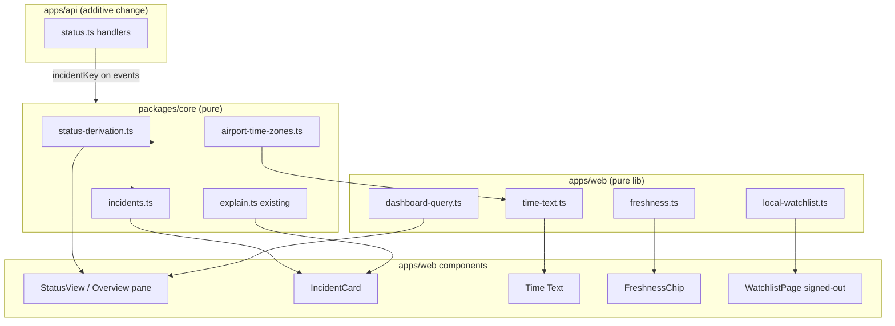

# Design Document: AeroBrief UI Improvements

## Overview

This design implements the **Build now** criteria of `requirements.md` on top of the Status dashboard and Settings page built by `.kiro/specs/ui-refresh/`. It adds no database migration and one small, additive field to the status API response (`incidentKey` on events already in the `NationalStatusResponse`/`AirportStatusResponse`/`HistoryResponse` shapes). Everything else is new pure logic in `packages/core` and `apps/web/src/lib`, new components in `apps/web/src/components`, and CSS. The branch is `phase-2`.

Four new pure modules carry the weight of this spec:

- `packages/core/src/status-derivation.ts` — Requirement 1 (status per airport, recovery window, network summary, normalization estimate).
- `packages/core/src/incidents.ts` — Requirement 2 (merging GROUND_STOP_STARTED/ENDED pairs into one Incident, sorting).
- `packages/core/src/airport-time-zones.ts` — Requirement 7 (static IANA zone table for the 30 Core 30 airports).
- `apps/web/src/lib/time-text.ts`, `apps/web/src/lib/freshness.ts`, `apps/web/src/lib/local-watchlist.ts`, `apps/web/src/lib/dashboard-query.ts` — Requirements 7, 9, 4, 11 (frontend-only pure logic).

`packages/core` stays free of I/O: `status-derivation.ts`, `incidents.ts` and `airport-time-zones.ts` take a snapshot, events and `now` as plain arguments, matching `time.ts`'s existing pattern (`isStale(capturedAt, now)`). The frontend-only modules read `Date.now()` and `window.localStorage` only at their call sites in hooks/components, never inside the pure functions they call.

## Architecture



## Components and Interfaces

### 1. Status derivation (`packages/core/src/status-derivation.ts`)

```ts
export type AirportStatusKind = "normal" | "minor_impact" | "disrupted" | "ground_stop" | "recovering" | "data_unavailable";

export const RECOVERY_PERIOD_MS = 24 * 60 * 60 * 1000; // default Recovery_Period, Requirement 1.2

export interface DerivedAirportStatus {
  airportId: MonitoredId;
  kind: AirportStatusKind;
  /** Present only for "recovering": ms since the ground stop ended. */
  recoveringSinceMs?: number;
  /** Present only for "recovering": the Normalization_Estimate range in minutes, e.g. [30, 90]. */
  normalizationEstimateMinutes?: readonly [number, number];
}

/**
 * One airport's status. `hasData` is false when no snapshot has ever been captured
 * (Requirement 1.5, "Data Unavailable" for every airport). `endedAt` is the most recent
 * GROUND_STOP_ENDED event time for this airport within the retained events, or null.
 */
export function deriveAirportStatus(input: {
  airportId: MonitoredId;
  hasData: boolean;
  activeGroundStop: boolean;
  lastEndedAt: string | null; // ISO
  now: Date;
}): DerivedAirportStatus;

export interface NetworkSummary {
  counts: Readonly<Record<AirportStatusKind, number>>;
  /** Airports whose status is not "normal", as {airportId, name, kind}. */
  affected: readonly { airportId: MonitoredId; kind: AirportStatusKind }[];
  allNormal: boolean;
}

/** Aggregates 30 DerivedAirportStatus into counts and the affected list (Requirement 1.3). */
export function summarizeNetwork(statuses: readonly DerivedAirportStatus[]): NetworkSummary;

/** Range in minutes, from the Incident's duration (Requirement 1.6). Pure arithmetic, no I/O. */
export function normalizationEstimate(durationMs: number): readonly [number, number];
```

`deriveAirportStatus` precedence (highest first): `data_unavailable` (no snapshot ever captured) > `ground_stop` (active) > `recovering` (ended within `RECOVERY_PERIOD_MS` and not superseded by a newer active stop) > `normal`. `minor_impact` and `disrupted` are declared in `AirportStatusKind` and have icon/color/label entries (Requirement 1.8) but `deriveAirportStatus` never returns them until the deferred event-type pipeline exists — this is documented in the function's docstring and enforced by a unit test that asserts the two kinds never appear in current output.

`normalizationEstimate` is a single deterministic function of the ground stop's duration (for example `[duration * 0.5, duration * 1.5]` clamped to a minimum 15-minute window), so the same Incident always yields the same range; the UI always labels it "AeroBrief estimate" per Requirement 1.6.

### 2. Incident merging (`packages/core/src/incidents.ts`)

```ts
export interface Incident {
  incidentKey: string; // the event key shared by the started/ended pair
  type: "GROUND_STOP_STARTED" | "NATIONWIDE_EVENT"; // Incident "type" shown on the card
  airportId: MonitoredId | null;
  startedAt: string;
  endedAt: string | null; // null = active
  durationMs: number | null; // null while active
}

/**
 * Groups stored events by Incident_Key (the event key of the GROUND_STOP_STARTED event;
 * a GROUND_STOP_ENDED event with no matching start becomes its own ended Incident with
 * startedAt = endedAt, so no event is dropped). Requirement 2.1.
 */
export function mergeIncidents(events: readonly (DetectedEvent & { incidentKey: string })[]): Incident[];

/** Active first, then ended by endedAt descending; stable for equal keys (Requirement 2.5). */
export function sortIncidents(incidents: readonly Incident[]): Incident[];
```

`incidentKey` is the same string Core already computes for dedup (`eventKey` in `event-keys.ts`): the FAA event id for ground stops, `NATIONWIDE:{previousSnapshotId}` for nationwide events. The API adds this value to each `EventSummary` it returns (see "Data Models" below); no new storage format, because `events.eventKey` already exists as a database column (`packages/db/src/schema.ts`, `events_event_key_type_unique`) and the repository already reads full rows.

### 3. Airport time zones (`packages/core/src/airport-time-zones.ts`)

```ts
/** IANA time zone per Core 30 airport. Pure static table, covered by a unit test
 *  that asserts every MonitoredId has an entry and every value is accepted by Intl. */
export const AIRPORT_TIME_ZONES: Readonly<Record<MonitoredId, string>>;

export function airportTimeZone(id: MonitoredId): string;
```

### 4. Frontend pure logic (`apps/web/src/lib/`)

- **`time-text.ts`**: `type DisplayMode = "relative" | "airport_local" | "my_local" | "utc"`; `formatTimeText(iso, now, mode, airportTz, userTz)` returns the primary text; `formatTooltip(iso, airportTz, userTz)` returns airport-local/user-local/UTC lines; `resolveDisplayMode(stored)` returns the stored mode or `"relative"`. The 48-hour relative/absolute threshold (Requirement 7.1) lives here as `RELATIVE_THRESHOLD_MS = 48 * 60 * 60 * 1000`, mirroring the `STALE_THRESHOLD_MS` pattern in `packages/core/src/time.ts`. A new `<TimeText>` component (`apps/web/src/components/TimeText.tsx`) wraps these functions in a `<time dateTime>` element with a focusable, keyboard-reachable tooltip (a native `title` is not keyboard-reachable, so the tooltip is a small popover shown on hover/focus, matching the pattern already used for `aria-describedby` hints in `DisplaySettings.tsx`). `TimeText` replaces the ad hoc `formatUtc(...)` calls in `EventCard`, `SummaryCard`, `AirportPage`, `GroundStopDetails` and the Overview/Events panes, and refreshes itself at least once a minute via a shared `setInterval` tick (Requirement 7.5, tested with fake timers, not PBT per the workflow's own guidance on timers).
- **`freshness.ts`**: `type Freshness = "live" | "delayed" | "unavailable"`; `deriveFreshness({ hasData, stale, refreshFailed })` is a pure function (Requirement 9.1, 9.5); `freshnessChanged(prev, next)` is `prev !== next`, used to gate the live-region announcement (Requirement 9.4).
- **`local-watchlist.ts`**: `readLocalWatchlist()/writeLocalWatchlist(ids)` wrap `window.localStorage` (I/O, at the edge only); `mergeIntoAccount(local, account, cap)` is the pure cap-respecting merge (Requirement 4.3); `sortBySeverity(airports, statusOf)` is the pure comparator (Requirement 4.5).
- **`dashboard-query.ts`**: `encodeDashboardQuery(state)/decodeDashboardQuery(search)` round-trip the Airports-pane filter, the Events-pane filters and the search text through `URLSearchParams` (Requirement 11.7), leaving `window.location.hash` (the section id) untouched, consistent with `status-sections.ts`.

### 5. Components

- **`IncidentCard.tsx`** (new): replaces `EventCard` inside the Events pane for ground-stop and nationwide events (`EventCard` stays for any other type, matching the existing fallback branch). Renders the type, airport link, `TimeText` for start/end, duration, active/ended style (`event-card--active` / `event-card--resolved`, reusing the existing `event-card` CSS family with new modifiers instead of new DOM, so `AirportTable`/nav/banner DOM stays untouched per the design steering hard rule), an expand/collapse disclosure (native `<details>`) showing the timeline and recovery status, the five labeled explanation fields from Requirement 3, and a "View FAA NAS Status site" link (`FAA_STATUS_URL`, already exported by `Footer.tsx`/`GroundStopDetails.tsx`) — never raw FAA text.
- **`StructuredExplanation.tsx`** (new): pure-props component rendering the five labeled fields (What's happening / Why / Likely impact / Next update / Source) from a plain object built by a new Core function `explainStructured(incident, reason, expectedEnd)` in `packages/core/src/explain.ts` (an addition beside the existing `explain`, reusing `REASON_DICTIONARY` and the "not published"/"not yet announced"/"not available" fallback strings required by 3.2, 3.3, 3.7).
- **`FreshnessChip.tsx`** (new): renders in the `PageHeader` action slot of the Status page, text Live/Delayed/Unavailable, a tooltip with the exact `capturedAt` via `TimeText`'s tooltip renderer, and a visually hidden polite live region that only updates on `freshnessChanged`.
- **Overview pane** (`StatusView.tsx` edit): replaces the current ad hoc ground-stop/ARTCC counts with `summarizeNetwork(...)`, the all-normal headline, the stale "outdated" marker, the two summary chips (ground stops, recovering) via the existing `MetricChip`, and the per-airport recovering detail line.
- **Airports pane** (`StatusView.tsx` edit, no new DOM in `AirportTable`): adds the "All (N)" / "Affected (N)" segmented control already partly present (it currently reads "Affected only" with no count — Requirement 11.1 adds counts and a visibly distinct selected state), the richer search placeholder, icon and clear button (Requirement 11.2), and keeps the table itself byte-for-byte except for the `<StatusPill>` text/icon, which already comes from a prop and needs no markup change.
- **`WatchlistPage.tsx` edit**: adds the signed-out branch (quick-add chips, search, Local_Watchlist-backed status list, sign-in merge offer banner, non-blocking account note, severity sort with a one-line explanation) instead of the current unconditional "sign in to see your watchlist" early return. The 401 branch is removed for the watchlist contents only; it still governs server-side mutation attempts (adding/removing while signed out saves to `local-watchlist.ts` instead of calling the API).
- **Settings page reorder** (`SettingsPage.tsx`, `settings-sections.ts` edit): `SECTION_IDS` becomes `["digest", "webhooks", "display", "account"]` (Requirement 12.1); the lock indicator and sign-in prompt (12.6) replace the current plain `ErrorRegion` sign-in message with an icon + text; the Display section's theme control becomes a segmented control with live preview and the "High contrast" hint keeps its existing `aria-describedby` wiring (12.4, already present in `DisplaySettings.tsx` — this criterion is satisfied by the existing code and is covered by a regression test, not new code); Save/Saved/Retry text is added to `DigestSettings.tsx` and `WebhookSettings.tsx` where missing.
- **`NavBar.tsx` edit**: splits "Sign in" into a `Button`-styled link separate from the plain nav links (13.1), adds an account menu (`AccountMenu.tsx`, new) when signed in, and adds the narrow-viewport collapse (a `<button aria-expanded>` toggling a `hidden` attribute on the `<ul>`, matching the disclosure pattern already used by `AccountSection`'s `ConfirmDialog`). The nav bar's DOM changes; `test/components/nav-bar.test.tsx` and `test/a11y/nav-bar.test.tsx` are updated in the same task that changes the markup, per the owner's decision.
- **`Footer.tsx` edit**: adds the API documentation link, the advisory notice, and restyles the license/attribution line as secondary (smaller, muted) text, dropping nothing existing.

## Data Models

```ts
// apps/api/src/handlers/status.ts — additive field only, no migration
export type EventSummary = {
  type: string;
  airportId: string | null;
  occurredAt: string;
  explanation: string;
  /** New: the event key shared by a GROUND_STOP_STARTED/ENDED pair. Read from the already-stored
   *  events.eventKey column; StatusEventRow gains the same field from the repository row. */
  incidentKey: string;
};
```

```ts
// apps/web/src/api/client.ts mirrors the additive field (never imports apps/api)
export type EventSummary = {
  type: string;
  airportId: string | null;
  occurredAt: string;
  explanation: string;
  incidentKey: string;
};
```

No Zod schema in `packages/core/src/schemas.ts` changes (it validates the FAA payload and the stored Snapshot, not the API response shape). `isEventSummary` in `apps/web/src/api/client.ts` gains one more required string field; this is a backward-incompatible runtime check change, acceptable because API and web deploy together.

## Correctness Properties

*A property is a characteristic or behavior that should hold true across all valid executions of a system — essentially, a formal statement about what the system should do. Properties serve as the bridge between human-readable specifications and machine-verifiable correctness guarantees.*

### Property 1: Status derivation returns exactly one of the four live statuses

For any airport input (`hasData`, `activeGroundStop`, `lastEndedAt`, `now`), `deriveAirportStatus` returns a `kind` that is one of `"normal"`, `"ground_stop"`, `"recovering"`, `"data_unavailable"`, and the precedence `data_unavailable > ground_stop > recovering > normal` always holds (e.g. `hasData: false` always yields `data_unavailable` regardless of the other fields).

**Validates: Requirements 1.1, 1.2**

### Property 2: Recovery window boundary

For any ground stop end time and any `now`, `deriveAirportStatus` returns `"recovering"` if and only if `activeGroundStop` is false and `now - lastEndedAt < RECOVERY_PERIOD_MS`; at or after `RECOVERY_PERIOD_MS` it returns `"normal"`.

**Validates: Requirements 1.2**

### Property 3: Network summary counts and affected list are consistent

For any list of 30 `DerivedAirportStatus` values, the sum of `counts` across all kinds equals 30, and `affected` contains exactly the airports whose `kind` is not `"normal"`.

**Validates: Requirements 1.3**

### Property 4: Normalization estimate is a non-empty, ordered range

For any non-negative incident duration in milliseconds, `normalizationEstimate` returns `[low, high]` with `low <= high` and `low >= 0`.

**Validates: Requirements 1.6**

### Property 5: Incident merging drops no event and pairs correctly

For any list of stored ground-stop and nationwide events (each tagged with an `incidentKey`), `mergeIncidents` produces one Incident per distinct `incidentKey`; an Incident is active (`endedAt === null`) if and only if its key has a GROUND_STOP_STARTED/NATIONWIDE_EVENT with no matching GROUND_STOP_ENDED in the input; every input event's `incidentKey` appears in exactly one output Incident.

**Validates: Requirements 2.1**

### Property 6: Incident sorting is active-first, then most-recent-end-first

For any list of Incidents, `sortIncidents` places every incident with `endedAt === null` before every incident with `endedAt !== null`, and orders the ended incidents by `endedAt` descending; applying `sortIncidents` to any permutation of the same list yields the same output (confluence).

**Validates: Requirements 2.5**

### Property 7: Structured explanation never has an empty field

For any Incident with or without a published reason and with or without a known next-update time, `explainStructured` returns all five fields ("What's happening", "Why", "Likely impact", "Next update", "Source") as non-empty strings, using "Reason not published by the FAA", "Not yet announced" or "Not available" exactly where the corresponding input is absent.

**Validates: Requirements 3.1, 3.2, 3.3, 3.7**

### Property 8: Local watchlist merge respects the cap and reports overflow

For any local watchlist and any account watchlist (each a list of monitored airport ids, account list length 0-30), `mergeIntoAccount` returns an account list of at most 30 unique ids that is a superset of the pre-merge account list wherever the cap allows, and the count of local ids it could not add equals `max(0, (uniqueCombined.length) - 30)`.

**Validates: Requirements 4.3**

### Property 9: Severity sort is a total order consistent with status

For any list of airports and any status-lookup function, `sortBySeverity` orders airports such that an airport with a strictly more severe status (ground_stop > recovering > data_unavailable > normal, per the card's documented severity order) never appears after a strictly less severe one.

**Validates: Requirements 4.5**

### Property 10: Relative/absolute threshold

For any ISO timestamp and any `now`, `formatTimeText(iso, now, "relative", ...)` returns a relative-style string when `now - timestamp < 48h` and an absolute-style string when `now - timestamp >= 48h`.

**Validates: Requirements 7.1**

### Property 11: Tooltip always shows all three zones

For any ISO timestamp and any airport id, `formatTooltip` returns a string containing three distinct formatted times: the airport-local time, the user-local time and the UTC time.

**Validates: Requirements 7.2**

### Property 12: Display mode resolution

For any stored value (one of the four valid modes, an invalid string, or absent), `resolveDisplayMode` returns that value when valid and `"relative"` otherwise.

**Validates: Requirements 7.3, 7.4**

### Property 13: Time element datetime is preserved

For any ISO 8601 string accepted as input, the `dateTime` attribute of the rendered `<TimeText>` element equals the input string unchanged.

**Validates: Requirements 7.6**

### Property 14: Freshness derivation is total and deterministic

For any combination of `hasData`, `stale` and `refreshFailed`, `deriveFreshness` returns exactly one of `"live"`, `"delayed"`, `"unavailable"`, with `hasData: false` always yielding `"unavailable"`.

**Validates: Requirements 9.1, 9.5**

### Property 15: Freshness announcement fires only on change

For any sequence of Freshness values, `freshnessChanged` returns `false` for every repeated value immediately following an equal value, and `true` exactly where consecutive values in the sequence differ.

**Validates: Requirements 9.4**

### Property 16: All/Affected counts match the airport list

For any list of derived airport statuses, the "All" count equals the list length and the "Affected" count equals the number of entries whose `kind` is not `"normal"`.

**Validates: Requirements 11.1**

### Property 17: Airport search matches code, name or city case-insensitively

For any airport (code, name, city) and any query string, the search predicate returns true when the query is empty or whitespace, or when the query (case-insensitively) is a substring of the code, the name or the city, and returns false otherwise.

**Validates: Requirements 11.2**

### Property 18: Dashboard query round-trips

For any valid dashboard filter/search state, `decodeDashboardQuery(encodeDashboardQuery(state))` returns a state equal to the original.

**Validates: Requirements 11.7**

## Error Handling

- **Status derivation and incident merging** never throw: every branch of `deriveAirportStatus`, `summarizeNetwork` and `mergeIncidents` is total over its typed input, matching the existing style of `time.ts` and `watchlist.ts` (no exceptions, explicit result shapes).
- **`explainStructured`** reuses `UnsupportedEventTypeError` from the existing `explain.ts` for event types it does not recognize (ground stop and nationwide only, same as today); the API only ever calls it for recognized types, so the error path is defensive, not reachable in production, and is covered by one unit test.
- **Local watchlist storage** (`local-watchlist.ts`) wraps every `localStorage` call in a try/catch, exactly like `DisplaySettings.tsx` already does, so a blocked or full storage degrades to an empty/unsaved watchlist rather than throwing into a component.
- **Dashboard query decoding** never throws on malformed query strings: unknown or invalid parameters are ignored and the corresponding filter falls back to "all" (airport, type, state) or "" (search text), mirroring `resolveStatusSection`'s fallback-on-unknown-hash pattern.
- **API** (`status.ts`): if a stored event somehow lacks an `eventKey` (schema violation, never possible given the `NOT NULL` column and the existing dedup `onConflictDoNothing` insert path), `toEventSummary` would throw on a missing field read; this is prevented by keeping `incidentKey: e.eventKey` a direct, non-optional property read with a `StatusEventRow` type that requires it, so a type error — not a runtime surprise — is the failure mode if the repository ever changes shape.
- **Freshness/time components** never show a blank state: `FreshnessChip` always renders one of the three words, and `TimeText` falls back to showing the raw ISO string if it is unparseable, matching `formatUtc`'s existing "return the input unchanged" behavior.

## Testing Strategy

**Unit tests** (Vitest) cover every new pure function's edge cases and every new/edited component's specific examples, mirroring source paths per `structure.md` (e.g. `packages/core/test/status-derivation.test.ts`, `apps/web/test/components/incident-card.test.tsx`). Unit tests specifically cover:
- The four fixed-copy strings (all-normal headline, "No events in the last 24 hours", stale "outdated" marker, Data Unavailable fallback) — Requirement 1.4, 1.5.
- The Airport_Status catalog has an icon, color and text label for all six kinds including the two not yet derivable — Requirement 1.8.
- `IncidentCard` expand/collapse shows the timeline, the FAA site link (and never raw FAA text), and the active/ended icon+text — Requirements 2.2, 2.3, 2.4, 2.6, 2.7.
- The ARTCC definition is reachable by keyboard and by screen reader (`aria-describedby` or a `<details>` disclosure) — Requirement 8.1.
- Settings order, segmented-control live preview, Saved/error+Retry, lock indicator for signed-out sections — Requirements 12.1, 12.3, 12.5, 12.6.
- Nav bar collapse at Narrow_Layout, Touch_Target sizes, 320px no-horizontal-scroll — Requirements 13.1-13.5.
- Footer links, advisory notice, secondary attribution line, sticky-bottom CSS — Requirement 14.
- Layout container width and spacing-scale usage — Requirement 15.1-15.3.
- axe checks extended to every new/changed page and state — Requirement 17.6.

**Property-based tests** (fast-check, `numRuns` >= 100) implement the 18 Correctness Properties above as one test each, in `packages/core/test/*.pbt.test.ts` or `apps/web/test/*.pbt.test.ts` to mirror their source location, each tagged `// Feature: ui-improvements, Property N: <text>`.

**Accessibility**: the existing `apps/web/test/a11y/themes/all-variants.test.tsx` matrix gains cases for the new Overview summary chips/headline states, the signed-out Watchlist page, the Settings reordered sections, and the collapsed nav bar at a narrow viewport, keeping the zero-tolerance axe rule. Every new or changed color (Airport_Status colors, freshness chip, incident card active/resolved accents) is added to `palettePairs` and passes the existing generic AA-ratio property test over `palettePairs`; no new contrast property test is needed because that property already exists and is universal over the pairs list.

**PBT library note**: the project already uses fast-check (`tech.md`); no new testing dependency is introduced.
