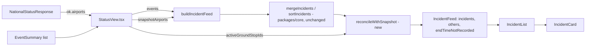

# Design Document: AeroBrief UI Review Fixes

## Overview

This design implements the 11 owner-approved fixes from the 2026-11-25 screenshot review (`requirements.md`). All code changes are in `apps/web`, in TypeScript strict mode, matching the existing conventions of `.kiro/specs/ui-improvements/`. One requirement (Requirement 2) is investigation-only: it records findings about `packages/core/src/change-detector.ts` and `packages/core/src/event-keys.ts` but makes no change to either file in this spec's tasks.

No new runtime dependency is added. No database migration. The nav bar DOM changes for Requirement 4 (owner-approved precedent); the airport table, banner, and `aria-live` region DOM stay exactly as they are — only `Status_Cell` text content and CSS change.

## Investigation: FAA mid-stop id change (Requirement 2)

**The bug chain.** `apps/poller/src/normalize.ts`'s `deriveFaaEventId` assigns a ground stop's `faaEventId` from the FAA's own `gs.id` field when present (`idSource: "faa_id"`). `packages/core/src/change-detector.ts`'s `detectChanges` does a presence diff per airport: a `GROUND_STOP_STARTED` fires when `prev.get(id) === undefined && cur.get(id) !== undefined`, and `GROUND_STOP_ENDED` fires on the reverse. `detectChanges` does **not** compare `faaEventId` between consecutive snapshots — it only checks whether `groundStop` is `null` or not. So if the FAA ground stop stays active but its `id` changes between two polls, `detectChanges` emits **no** event at all for that transition (the airport was active before and after). The two stored events in the production case (ORD start at 21:25 with one `faaEventId`, ORD end at 22:05 with a different `faaEventId`) are therefore not from one single id change visible to `detectChanges` as a presence transition; they came from two distinct detected transitions — most likely a brief gap in FAA reporting (the ground stop appeared absent for one poll, so an END fired, then reappeared under a new id, so a START fired) rather than mid-stop id substitution while continuously active. Both the START and END are real, independently detected events; they simply carry different FAA ids because FAA reissued the id between the two polls when the stop was (however briefly) reported absent.

**Is a Core change needed?** No. `detectChanges` already behaves correctly for a continuously active stop: no spurious event fires while `groundStop !== null` stays true, regardless of id changes, because the function never inspects `faaEventId`. The actual defect is entirely in the **display layer**: `mergeIncidents` (`packages/core/src/incidents.ts`) and `assignIncidentKeys` (`apps/web/src/lib/fallback-incident-keys.ts`) group by `incidentKey` (== `faaEventId` for API-sourced events), so a START and END with different keys never merge into one incident, and — before this spec — nothing cross-checks the merged incident's "active" claim against the current snapshot. Requirement 1's fix (snapshot-aware activity check, nearest-earlier-start pairing across keys) closes this at the one layer where it belongs: the web incident feed, which already receives both the snapshot and the events. No change to `change-detector.ts` or `event-keys.ts` is needed for Requirement 1 to produce a correct Events pane and Overview headline.

**Is the alert pipeline affected?** `eventKey(e, previousSnapshotId)` returns `e.faaEventId` for a ground stop event, and `notifier.ts`'s `dedupKey`/`claimKey` use `eventKey + type + userId` to dedupe a user's alert for one event. Because `detectChanges` only fires START/END on an actual presence transition (not on every poll while the stop stays active), and each fired event keeps the `faaEventId` it was detected with, the alert pipeline sends at most one START alert and one END alert per *detected transition*, independent of how display-layer merging later treats the pair. The alert pipeline is **not** affected by Requirement 1's web-layer fix, because that fix only changes how `apps/web` renders incidents after the fact; it does not touch `detectChanges`, `eventKey`, or `notifier.ts`. Per Requirement 2 Criterion 4, `change-detector.ts` and `event-keys.ts` are left unchanged by this spec.

## Architecture

No architectural change. Every fix is a targeted edit inside the existing `apps/web` component/lib layering (`apps/web/src/lib/*` pure helpers feeding `apps/web/src/components/*`), with no new module boundary, no new API route, and no new package. The one new file, `apps/web/src/lib/digest-local-time.ts`, sits alongside the existing pure `lib/time-text.ts` and follows the same import rule (no relative imports deeper than one level, no environment reads). The data flow for Requirement 1 changes within `apps/web` only:



## Components and Interfaces

### 1. Incident feed: snapshot-aware activity and cross-key pairing (Requirement 1)

File: `apps/web/src/lib/incident-feed.ts`. No change to `packages/core/src/incidents.ts` (`mergeIncidents`/`sortIncidents` stay as they are; they have no snapshot to consult and keep working for other callers). The new logic sits in `buildIncidentFeed` and a new post-processing step, because the fix is specific to how the web app reconciles the merged incidents against the one `NationalStatusResponse` it already has in hand (`StatusView.tsx` already passes `ok.airports` to `buildNetworkOverview`; the same airports list becomes available to the incident feed).

```ts
/** Per-airport ground-stop activity from the current snapshot. Absent airport = not active. */
export type ActiveGroundStopMap = ReadonlySet<string>; // monitored airport ids with groundStop !== null

export function activeGroundStopIds(airports: readonly { airportId: string; groundStop: unknown }[]): ActiveGroundStopMap {
  return new Set(airports.filter((a) => a.groundStop !== null).map((a) => a.airportId));
}

/**
 * Reconciles merged incidents against the current snapshot (Requirement 1.1, 1.2, 1.3, 1.5).
 * `active` is undefined when no "ok" status exists; in that case the pre-existing behavior
 * (endedAt from the merged event pair) is kept unchanged (Requirement 1.5).
 */
export function reconcileWithSnapshot(incidents: readonly Incident[], active: ActiveGroundStopMap | undefined): Incident[]
```

`reconcileWithSnapshot` runs after `mergeIncidents`+`sortIncidents` inside `buildIncidentFeed`, and does three things in one pass, each directly satisfying one acceptance criterion:

1. **Criterion 1.1** — for every incident whose `endedAt === null` (merge saw no end), if `active` is defined and the incident's `airportId` is not in `active`, the incident's active claim is wrong. It is reclassified in step 3 below, together with step 2's pairing, because an incident that looks active but has no end event is exactly an Unmatched_Start.
2. **Criterion 1.2** — before this function runs, `mergeIncidents` has already produced one Incident per `incidentKey`; an Unmatched_End became `mergeIncidents`'s "own ended Incident with `startedAt = endedAt`" case (see `packages/core/src/incidents.ts`, the `start === null` branch), and an Unmatched_Start kept `endedAt: null`. `reconcileWithSnapshot` finds, per airport, the set of incidents that are either (a) an Unmatched_End (`startedAt === endedAt`, `durationMs === 0`) or (b) an Unmatched_Start whose airport is not in `active`, sorts each group by time, and pairs each Unmatched_End with the nearest earlier Unmatched_Start at the same airport (by `startedAt`), producing one incident with the start's `startedAt`, the end's `endedAt`, and a recomputed `durationMs`. The two original incidents are replaced by the one paired incident, keyed by the start's `incidentKey` (consistent with `mergeIncidents`'s own "earliest start's key wins" convention).
3. **Criterion 1.3** — an Unmatched_Start that is not in `active` and has no Unmatched_End left to pair with (after step 2) is reclassified as ended with `endedAt` set to a sentinel the UI recognizes (see below) and rendered with the text "End time not recorded" instead of a computed duration.
4. **Criterion 1.5** — when `active` is `undefined` (status is not "ok"), `reconcileWithSnapshot` returns `incidents` unchanged, which is exactly `mergeIncidents`+`sortIncidents`'s pre-existing output.

To avoid inventing a magic timestamp for "end time not recorded" (Criterion 1.3), `Incident` is not given a new field; instead `IncidentCard` (Requirement 7) detects this case the same way it already detects the symmetric "unknown start" case — structurally, not by sentinel value. `reconcileWithSnapshot` marks this case by setting `endedAt` to the incident's own `startedAt` (mirroring `mergeIncidents`'s existing "unmatched end" convention of `startedAt === endedAt`, `durationMs: 0`) *and* leaving a discriminator the card can read. Concretely, `reconcileWithSnapshot` returns `{ incidents: Incident[]; endTimeNotRecorded: ReadonlySet<string> }` (the `incidentKey`s reclassified under Criterion 1.3), and `buildIncidentFeed`'s `IncidentFeed` type gains an optional `endTimeNotRecorded?: ReadonlySet<string>` alongside `incidents`/`others`. `IncidentCard` already receives `incident` directly from `IncidentList`; `IncidentList`/`StatusView` thread the set through the same way `recovery`/`activeStops` maps are threaded today (by `incidentKey`).

`buildIncidentFeed`'s signature gains an optional second parameter so every existing call site (tests included) keeps compiling without the snapshot:

```ts
export function buildIncidentFeed(
  events: readonly EventSummary[],
  snapshotAirports?: readonly { airportId: string; groundStop: unknown }[],
): IncidentFeed
```

`StatusView.tsx` passes `ok?.airports` (or omits the argument when `ok === null`, matching Criterion 1.5's fallback). This is the only call site that needs updating outside of tests.

### 2. Settings icon and nav (Requirement 4)

`AccountMenu.tsx` gains an inline SVG chevron, `aria-hidden="true"`, after the "Account" text, and a CSS class (`account-menu__button`, already present) gets a border/background to read as a control (styling only, matching the existing `.btn--secondary` visual weight via `controls.css`). `NavBar.tsx`'s `links` filter (`session === "signed-in" ? LINKS.filter(...) : LINKS`) is removed so `LINKS` (which already includes `/settings`) always renders for every session state; `AccountMenu`'s own Settings link is unaffected (it still exists for the quick path from the menu). `aria-current` already uses the shared `current(href)` helper keyed by `pathname`, so once `/settings` is back in the always-rendered list, `aria-current="page"` already works for it with no further logic change — the fix is removing the filter, not adding new matching logic.

### 3. Airport table status text (Requirement 8)

`AirportTable.tsx` currently renders `<StatusPill variant="normal" text="No ground stop reported" />` unconditionally when `groundStop === null`. The fix needs a derived "recovering" signal per row, which `AirportTable` does not have today (it only receives `AirportSummary[]`, no events). Rather than have `AirportTable` import event data (which `StatusView` already turns into `NetworkOverview.affected` via `buildNetworkOverview`), `StatusView.tsx` passes a `recoveringIds: ReadonlySet<string>` prop (derived from `overview.affected.filter(a => a.kind === "recovering")`) into `AirportTable`. `AirportTable`'s per-row rendering becomes:

```ts
airport.groundStop !== null
  ? <StatusPill variant="active" text="Ground stop" />
  : recoveringIds.has(airport.airportId)
    ? <AirportStatusPill kind="recovering" />
    : <StatusPill variant="normal" text="Operating normally" />
```

`recoveringIds` defaults to an empty `Set` when the prop is omitted, so every existing test call that does not pass it keeps its current "Operating normally" (previously "No ground stop reported") behavior unchanged structurally.

### 4. IncidentCard header and ended-state text (Requirement 7)

The header's existing flex row (`event-card__title`) already places the icon, `stateLabel` span, `typeLabel` span, and airport link/name as siblings. The fix wraps the existing `stateLabel` span in pill-styled markup: a `.status-pill`-equivalent class (`incident-card__state-pill`, visually identical to `.status-pill` via a shared class, not a new component) rather than forcing `AirportStatusPill`'s kind union to grow — `AirportStatusPill` is typed to the six `AirportStatusKind`s and "Ended"/"Active" for an *incident* is not quite the same axis as an *airport's* current status, so `IncidentCard` keeps its own `Icon` + pill span. This keeps `AirportStatusPill`'s contract (Requirement 1.8 of `ui-improvements`) untouched. `incident-card__state-pill` gets `margin-right`/`gap` spacing tokens so it visually separates from `incident-card__type` and the airport code/name, satisfying Criterion 7.1 with CSS only.

Ended-state text: today `durationText` is set from `formatDuration(incident.durationMs)` when `!unknownStart`. The new rendering, for an ended incident:

- If `!unknownStart` and `!endTimeNotRecorded.has(incident.incidentKey)`: render `Ended <TimeText iso={incident.endedAt} .../> · lasted {formatDuration(incident.durationMs)}` (Criterion 7.2).
- If `unknownStart` (today's existing "unmatched end" case, `startedAt === endedAt`) or the incident is in `endTimeNotRecorded` (Requirement 1 Criterion 1.3's case): render "Started more than 24 hours ago" (Criterion 7.3). This text applies to both the pre-existing unknown-start case and the new "end time not recorded" case from Requirement 1, because both share the same underlying fact (the start is outside the 24-hour retention window, so AeroBrief cannot say how long the incident actually ran) — one consistent sentence covers both, and Requirement 1.3's literal "End time not recorded" wording governs only incidents still classified as *active-looking-but-reclassified*; once `IncidentCard` renders them as ended, Criterion 7.3's "Started more than 24 hours ago" is the duration-line text. (If this reads ambiguously to the owner during Preview review, Task 6.1 below flags it as a one-line confirmation, not a blocker.)

### 5. WebhookSettings: TimeText, danger-outline, confirm dialog (Requirements 5, 6)

`formatTime(iso)` (the `"YYYY-MM-DD HH:mm UTC"` helper) is deleted; `outcomeText(item)` changes from building a string with `formatTime` to returning JSX (a small `<>Last delivery: {word} at <TimeText iso={item.lastOutcomeAt!} />.</>`), since `TimeText` is a component, not a string formatter. `WebhookSettings`'s list item changes from `<p className="webhook-settings__outcome">{outcomeText(item)}</p>` (string) to `<p className="webhook-settings__outcome">Active. {outcomeTextNode(item)}</p>` pattern — the existing `outcomeText`/`item.state === "disabled"` branching stays, only the leaf time rendering changes from string interpolation to a `TimeText` element.

Delete button: `variant="secondary"` → `variant="danger-outline"` on the per-item Delete button. A `ConfirmDialog` (imported into `WebhookSettings.tsx`, following the exact pattern `AccountSection.tsx` already uses for account deletion) is added with its own `pendingDelete: WebhookItem | null` state; "Delete" sets `pendingDelete` instead of calling `onDelete` directly; the dialog's `onConfirm` calls the existing `onDelete(pendingDelete)` and clears the state; `onCancel` just clears the state.

### 6. Digest local-time equivalent (Requirement 11)

New pure function in `apps/web/src/lib/digest-local-time.ts` (new file, mirrors the existing `lib/time-text.ts` pattern — pure, takes `now`/zone as explicit or Intl-resolved arguments, no module-level `Date.now()`):

```ts
/** "7:00 PM" for UTC hour 1 in "America/Los_Angeles" on the given reference date. */
export function localHourLabel(utcHour: number, timeZone: string, referenceDate: Date): string

/** "01:00 UTC (7:00 PM your time)". referenceDate fixes the calendar day; the hour is the parameter. */
export function hourWithLocalEquivalent(utcHour: number, timeZone: string, referenceDate: Date): string
```

`localHourLabel` builds a UTC `Date` at `referenceDate`'s UTC calendar day and `utcHour:00:00`, then formats it in `timeZone` with `Intl.DateTimeFormat(..., { hour: "numeric", minute: "2-digit", hour12: true })`. `DigestSettings.tsx`'s `hourLabel(hour)` (today just `"${hour} UTC"` per option) stays for the `<option>` text (changing `<option>` text does not aid screen reader users mid-list and keeps the select's option list compact); the new local-equivalent text renders once, next to the `<select>`, as `<p id="digest-hour-local" aria-live="polite">{hourWithLocalEquivalent(hour, browserTimeZone(), new Date())}</p>`, reusing the same `browserTimeZone()` helper pattern already defined in `TimeText.tsx` (duplicated locally rather than exported, to avoid a cross-component coupling for one three-line function — consistent with how `TimeText.tsx` itself does not export `browserTimeZone`). It updates on every `hour` state change because it is computed inline in the render, before any save action, satisfying Criterion 11.3.

### 7. Display settings: contrast hint spacing and theme preview (Requirement 10)

**Contrast hint spacing.** `display-settings.css`'s `.display-settings__hint` today has `margin: var(--space-1) 0 0`. The fix changes the `ContrastControl` markup only slightly: today the hint `<p>` is a sibling of the `<label>` inside `.display-settings__contrast`; the fix keeps that DOM (the `aria-describedby` link is already present and correct) and tightens `.display-settings__contrast .display-settings__hint` to `margin-top: 2px` (a value smaller than the generic `--space-1`, since Criterion 10.1 asks for tighter spacing specifically here, not a change to the shared `.display-settings__hint` rule other controls also use). This is scoped with a more specific selector so `TimeDisplayControl`'s hint usage (if any) is unaffected.

**Theme preview.** Per Requirement 10 Criterion 10.2, the design chooses the **three-swatch option** over removal. Reason: the single grey swatch carries no information today (it renders `var(--color-surface)`/`var(--color-border)` regardless of `selected.value` — the swatch never actually changes color with the theme choice, which is the complaint), but a working preview is more useful to a user choosing a theme than no preview at all, and the three-swatch version is achievable with zero new tokens: `themes.css`/`themes.ts` already define a full color set for `light` (the default, unscoped values in `tokens.css`) and `dark` (`html[data-theme="dark"]`); the HC variants are out of scope here since `ThemeControl` only offers System/Light/Dark. Each swatch is a small `<span>` with inline `style` reading the *resolved* value for that theme (not the live page theme), using the two already-existing variable sets: default (`:root`/`tokens.css`, used as "Light") and `html[data-theme="dark"]` (used as "Dark"); for "System" the swatch shows the OS-resolved choice at render time (same value as whichever of Light/Dark the system currently resolves to, read via `window.matchMedia("(prefers-color-scheme: dark)")`, matching `ThemeController`'s own resolution logic). Each swatch keeps a visible text label ("System"/"Light"/"Dark") so color is decoration, not the only signal, per `.kiro/steering/design.md` Principle 3. The existing `data-testid="theme-preview"` wrapper `<p>` is kept (now wrapping three swatches instead of one), so `apps/web/test/display-settings.test.tsx`'s existing `getByTestId("theme-preview")` query keeps resolving; its two assertions on `.textContent` (`"Preview: Dark theme"` etc.) are updated in the same task to assert the three labels are present instead of one combined sentence.

## Data Models

No new persisted data model. One new in-memory type (`ActiveGroundStopMap`, a `ReadonlySet<string>`) and one extended return type (`IncidentFeed` gains optional `endTimeNotRecorded?: ReadonlySet<string>`), both in `apps/web/src/lib/incident-feed.ts`. No Zod schema changes (`packages/core/src/schemas.ts` untouched).

## Error Handling

- `activeGroundStopIds`/`reconcileWithSnapshot` are pure and total: an empty or malformed airports list simply yields an empty active set, which `reconcileWithSnapshot` already treats the same as "no snapshot" would for any airport not in the set (every incident at an unlisted airport is treated as not-active, which is the conservative, correct default — it never shows a stale "Active").
- `localHourLabel`/`hourWithLocalEquivalent` never throw: `Intl.DateTimeFormat` with an invalid or unsupported `timeZone` string falls back to `"UTC"` the same way `TimeText.tsx`'s existing `browserTimeZone()` already catches and falls back.
- The webhook delete confirmation follows the exact `AccountSection.tsx` error-handling precedent: if `deleteWebhook` rejects after confirmation, the existing `run()` helper's catch path (already present in `WebhookSettings.tsx`) sets `formError`/`message` and offers `retry`; the `ConfirmDialog` itself does not need its own error state because it closes optimistically before the request completes, matching today's behavior for every other `WebhookSettings` action.

## Correctness Properties

*A property is a characteristic or behavior that should hold true across all valid executions of a system — a formal statement about what the system should do.*

### Property 1: Activity reflects the snapshot

For any set of merged incidents and any snapshot-derived active-airport set, after reconciliation, an incident's `endedAt` is `null` if and only if its `airportId` is a member of the active set (an incident with no `airportId`, i.e. a nationwide incident, is unaffected and keeps its pre-reconciliation `endedAt`).

**Validates: Requirements 1.1**

### Property 2: Cross-key pairing matches nearest-earlier-start

For any sequence of `GROUND_STOP_STARTED` and `GROUND_STOP_ENDED` events at one airport with arbitrary (possibly colliding or possibly all-distinct) incident keys, pairing each unmatched end with the nearest earlier unmatched start (by `startedAt`) at that airport and computing the pair's duration as the difference between the two timestamps produces the same result as a reference greedy stack-based matcher that processes the airport's unmatched starts and ends in time order.

**Validates: Requirements 1.2**

### Property 3: Unpaired, inactive starts are marked unresolved

For any incident whose `airportId` is not in the active set and that has no unmatched end available to pair with under Property 2, reconciliation marks it as ended and flags it in `endTimeNotRecorded`, and never leaves it with `endedAt === null`.

**Validates: Requirements 1.3**

### Property 4: No snapshot means no reclassification

For any list of already-merged incidents, calling the reconciliation step with no active-airport set (snapshot unavailable) returns the incidents list with every `endedAt`, `durationMs`, and `incidentKey` unchanged from the input, and `endTimeNotRecorded` empty.

**Validates: Requirements 1.5**

### Property 5: Local hour conversion is a consistent rotation

For any UTC hour `h` in `0..23` and any IANA time zone string that `Intl.DateTimeFormat` accepts, formatting `h` through `hourWithLocalEquivalent` produces a string containing the two-digit UTC hour label for `h` and a 12-hour local time label that, when the zone's UTC offset in minutes at the reference date is applied to `h`, lands on the same wall-clock hour (modulo 24) that `Intl.DateTimeFormat` independently computes for that instant in that zone — the function's output is never inconsistent with a from-scratch `Intl` computation for the same `(h, timeZone, referenceDate)` triple.

**Validates: Requirements 11.1**

## Testing Strategy

Unit/example tests cover: the nav bar's Settings link and chevron icon and `aria-current` across its small, fixed link set (Requirement 4); `AirportTable`'s three status-cell branches (Requirement 8); `IncidentCard`'s header pill separation and the two ended-state text branches, using representative durations already exercised by `ground-stop-durations.pbt.test.ts` so this spec does not duplicate that property (Requirement 7); `WebhookSettings`'s `TimeText` integration, danger-outline class, and the three confirm-dialog interaction states (Requirements 5, 6); the CSS token assertions for search field width, webhook item border, and footer border, following the existing `layout-css.test.ts`/`palette-sync.test.ts` static-CSS-parsing pattern (Requirements 3, 12); the Watchlist signed-out spacing groups via class-name/DOM-presence assertions (Requirement 9); the contrast hint spacing and the three-swatch preview's labels and `data-testid` (Requirement 10); and the digest hour text updating on selection change before save (Requirement 11.3).

Property tests (fast-check, `numRuns >= 100`) cover the five properties above, all in `apps/web/test/` since `incident-feed.ts` and the new digest helper are both web-only pure modules (no `packages/core` change in this spec, so no `packages/core/test` PBT is added).
